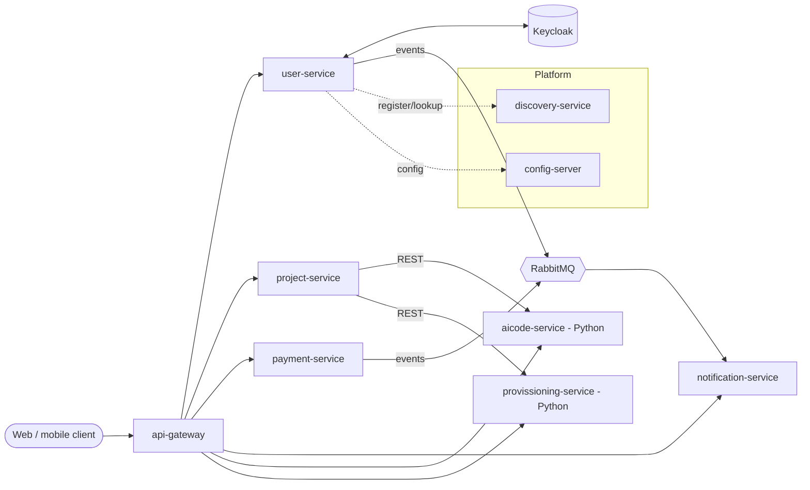

# Architecture

## Overview
Clients call the **api-gateway**, which routes to the business services. Services find each other through **Eureka (discovery-service)** and read configuration from **config-server**. Identity is handled by **Keycloak** (OIDC/JWT). Asynchronous work uses **RabbitMQ**. Each service owns its own PostgreSQL database managed by Flyway.

The diagram shows the intended shape. Confirm each arrow against `contracts/` and `docs/service-map.md`; unknown links stay `TODO(owner)` until verified.

## Principles
- **Database per service.** No cross-service SQL, no shared tables.
- **Contracts first.** REST in `contracts/openapi/`, events in `contracts/events/`.
- **Clean architecture** in Spring services: presentation/infrastructure -> application -> domain.
- **Resilience:** timeouts, retries (idempotent calls only), circuit breakers on every inter-service call; consumers idempotent with dead-letter queues.
- **Security in depth:** gateway validates tokens, but every service validates the JWT again and checks role and ownership (see `security-model.md`).
- **Config outside code:** config-server per environment; secrets from the secret store/environment, never from the repo.

## Open decisions
- API gateway: Spring Cloud Gateway vs Istio (DevOps preference) - see `decisions/0002-gateway-vs-istio.md`.
