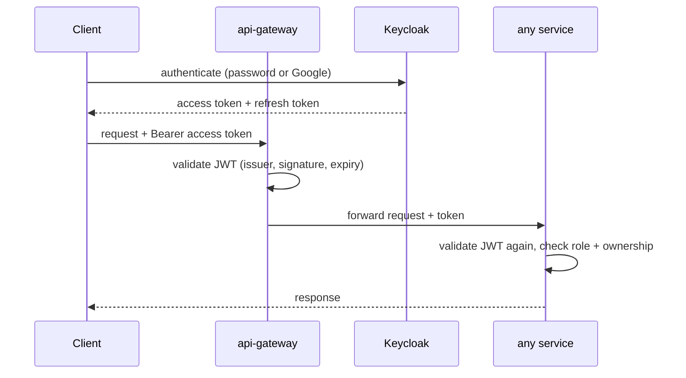

# Authentication flows (Keycloak)

Owner: user-service (Vannda). Identity provider: Keycloak. Tokens: OAuth2/OIDC JWT. This document is a skeleton; the owner confirms every step against the implementation and fills the `TODO` lines.

## Flows in scope
1. **Manual sign-up**: user submits email + password -> user-service validates and creates the Keycloak user -> verification (OTP) -> account enabled.
2. **Google sign-up / login**: Keycloak identity brokering with Google -> user-service creates or links the profile on first login.
3. **Login**: credentials or Google -> Keycloak issues access + refresh tokens -> client sends `Authorization: Bearer <access_token>`.
4. **OTP**: generation, expiry, attempt limit, resend limit - TODO(Vannda): where OTP lives (Keycloak vs user-service) and its TTL.
5. **Forgot password / reset password**: request -> OTP or reset link -> new password set in Keycloak -> old sessions revoked.

## Sequence (login)

## Rules
- Passwords and OTPs are never stored, logged or returned by our code; hashing and credential storage are Keycloak's job.
- OTP: short TTL, single use, limited attempts, rate-limited resend, constant-time comparison.
- Reset flow responses must not reveal whether an email exists.
- Access tokens are short-lived; refresh tokens rotate; logout revokes the session.
- Services read roles from the JWT through one converter; role names are listed here once they are final: TODO(Vannda).
- Client secrets and realm configuration are never committed.

## Realm and roles
TODO(Vannda): realm name, clients (frontend, backend services), roles (e.g. USER, ADMIN), token lifetimes.
