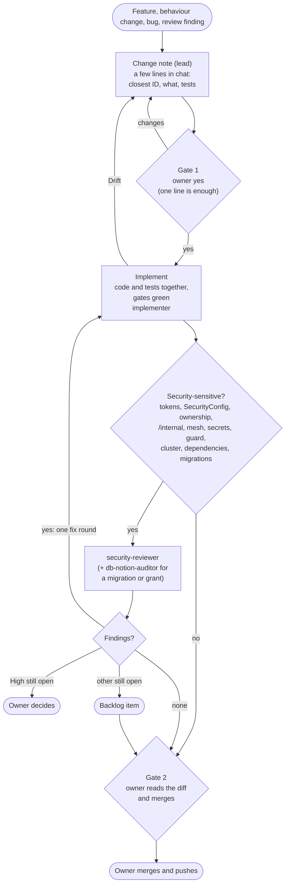

# Workflow: lean flow, code first

The one explanation of how every change to the Project service is made: which step, which agent, which skill,
and where the owner says yes (two gates: the change note and the merge). The binding rules are
`.claude/rules/spec-driven.md`; every change is checked against the constitution
[`docs/CONSTITUTION.md`](docs/CONSTITUTION.md) (version 8, articles I to VIII). Agents live in
`.claude/agents/` (roster: [`agents/README.md`](agents/README.md)), skills in `.claude/skills/`.

## The flow

Small batches: one change per branch, merged within a day where it can be (Art. I). Code first: the time goes into
code and tests, not into documents.



Once per phase, not per branch: the direction check (`spec-writer`, `DIRECTION.md`) and the QA sweep (`qa-reviewer`),
then the `final-reviewer` on the phase or before a large merge. A change that crosses services also gets the Kind
check (`kind-runner`) in an owner-given slot.

## Steps

| Step | What it means | Agent | Skills | True before the next step |
| --- | --- | --- | --- | --- |
| Change note | The only plan of a change (template below), citing the closest existing ID | lead | none | Gate 1: the owner said yes |
| Spec edit | Only for a new user-visible feature or a new contract between services | `spec-writer` | `writing-frd` | Owner agrees |
| Design file | Only for a new service, a new or changed contract between services, or a schema change | `designer` | `writing-trd`, `decision-record` | Constitution check has no conflict; owner agrees |
| Implement | Code and tests together; docs only when a runbook, README command, contract or rule changes | `implementer` | `project-gates`, `spring-endpoint`, `new-migration` | `./gradlew check` green; OSV clean after a dependency change |
| Security review | Only for security-sensitive changes: tokens, `SecurityConfig`, ownership answers, `/internal` or mesh rules, secrets, the guard, the cluster, dependencies, migrations, grants | `security-reviewer` | `project-gates` | No open High finding |
| DB audit | After a migration or entity change | `db-notion-auditor` | `db-notion-audit` | Zero differences (Art. III) |
| Fix round | One, answering the findings | `implementer` | none | High still open goes to the owner; the rest becomes a backlog item with its ID |
| Merge | Gate 2 | owner | none | `./gradlew check` green on the head |
| Per phase | Direction check, QA sweep, final review | `spec-writer`, `qa-reviewer`, `final-reviewer` | `checking-requirements-direction`, `qa-sweep` | No Drift on a Must item |

A decision record is written only when a rule is set that later work must follow (`docs-keeper`, `decision-record`).
Handoffs are written with `phase-handoff`.

## Change note

The lead writes it in the chat; a few lines.

```
ID: the closest existing FR or TR
What changes:
Tests:
Risk or article at stake (only if any):
```

## Routing

| Input | Goes to |
| --- | --- |
| New user-visible feature or new contract between services | `spec-writer` adds its FR, then a change note |
| Any other change: behaviour fix, technical change, bug, review finding | Change note, `implementer` |
| Tokens, ownership answers, `/internal` or mesh rules, secrets, the guard, the cluster, dependencies | `security-reviewer` after the change |
| A migration, a JPA entity, `scripts/db/` or grants | `db-notion-auditor` after the change |
| The access check, codegen input or events Provisioning reads | `kind-runner` before the merge |
| Docs, runbooks, decision records, handoffs | `docs-keeper` |
| Missing facts (repo, sibling repos, web, Notion) | `researcher` |

## What every brief contains

```
Goal: <one sentence>
Stage: <change note | implement | review | fix round | per phase>
IDs: FR-n, FR-n.m, TR-n (and Art. N when an article is at stake)
Sources: change note, design file if any, decision record, Notion pages (read-only)
Allowed files: <paths>    Not allowed: <paths>
Base commit: <sha> on branch <name>
Output: <report path or commit>, in the agent's report format
Stop and ask when: Drift, no FR ID, a missing fact, a gate that fails for an outside reason
```

## Always

- One implementer at a time in the shared tree; when a review runs, a different agent does it; the owner reads the
  diff before every merge.
  Without subagents, say so and use separate review sessions; never claim delegation that did not happen.
- Agree shared contracts first, give agents non-overlapping files, run dependent work in order. No agent changes
  another service's contract alone.
- A report gives exact commands and results, skipped checks, schema changes, open gaps and risks. Kind is not proof
  of production. Never say all edge cases are covered; say which were tested. Reports go under `ai/reviews/`.
- Handoffs: `ai/handoffs/next.md` (what is owed) is kept true before a session stops.
- Safety: the guard hook (`.claude/hooks/guard.py`) blocks cluster changes, secret reads, pushes and Notion DB edits.
- The Notion DB design never changes from here and the databases match it 100%. The architecture page may change.

## Quick start messages

- New feature: "Spec-driven: use the spec-writer to add FRs for <feature> to the FRD, then stop for my approval."
- First spec: "Use the spec-writer to write the BRD, PRD and FRD for what Project does today, then stop for my
  approval."
- Design: "Use the designer to write the design for FR-n to FR-m, then stop for my approval."
- Database: "Use the db-notion-auditor to compare both databases with Notion and list every difference."
- Continue work: "Read ai/handoffs/next.md and continue with the next step of the workflow."
