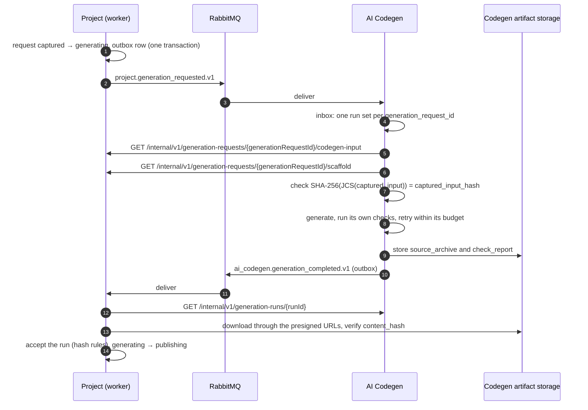

# How the Project service talks to the other services

The rules every service follows (section 1) and the exchanges with AI Codegen (section 2). The index of every exchange
is `.claude/docs/contracts/README.md`. The Payment interface is in `.claude/docs/contracts/payment-contract.md`, the
Provisioning exchanges in `.claude/docs/contracts/provisioning-contract.md`, Account in
`.claude/docs/contracts/account-contract.md` and Notification in `.claude/docs/contracts/notification-contract.md`.
Approved by the owner where section 6 says so. The Notion "Web Block architecture" page is the platform-wide source;
where it differs, it wins and this file follows, except where section 2 lists an open owner question.

## 1. Rules for every service

| Situation | Mechanism | Why |
| --- | --- | --- |
| A question that needs an answer now (may this user act on this project? may this client create a website?) | Synchronous internal HTTP (JSON), bounded timeout, the caller fails closed | The caller cannot continue without the answer |
| Work that takes time, or a fact another service must react to (generate this source, source published, entitlement ended) | RabbitMQ event, delivered at least once | Codegen runs for minutes; producers must not wait for consumers |
| Large data (generated source, scaffold) | Downloaded over HTTP from the owning service, or from object storage through a short-lived presigned URL, always checked against a SHA-256 | Messages stay small; bytes are verified at the receiver |

Each service's own PostgreSQL database is the authority for its own records. **RabbitMQ only notifies.** A lost message
must be recoverable from the database, so:

- **Outbox on the producer side.** The event row is inserted in the same transaction as the business change. A publisher
  sends it with publisher confirms and marks it sent only after the confirm.
- **Inbox (deduplication) on the consumer side.** The consumer records the `message_id` (or the event's own key) and its
  outcome in the same transaction as its effect. It acknowledges the message only after that commit.
- **A read API for every asynchronous flow.** If an expected event never arrives, the waiting service asks the owner
  over HTTP, after a deadline it keeps itself.
- **Messages carry identifiers, not content.** A consumer compares them with durable state and never acts only because a
  message is well formed.
- **Never read another service's database.** The one exception is the shared catalog, through the roles designed for it
  (Project writes it as `catalog_platform`; sites read it as their own role).

### HTTP conventions

- **Field names:** REST request and response bodies use **camelCase**.
- **Envelope:** every successful JSON response uses the standard envelope `{ success, data, meta }`
  (`.claude/docs/decisions/0003-http-and-event-formats.md`).
- **Errors:** every error response is RFC 9457 Problem Details (`application/problem+json` when `Accept` allows it;
  `application/json` with the same body for a client that accepts only `application/json`; never a 406 for an error)
  with `type` `urn:webblock:problem:<code in kebab-case>`, `title`, `status`, `instance`, and the extensions `code`
  (from the service's stable code list), `errors` (`[{ field, code, message }]`) where a service reports field details
  (the Project service does; Provisioning does not), plus the request identifiers in each API's own field case: the
  Project service `requestId` and `traceId` (camelCase), Provisioning `correlation_id` and, where it applies,
  `command_id` (snake_case). No `detail`: an error never echoes caller input. MCP error results carry the same object.
  Both services use this shape and this content-type rule (decision 0003;
  Provisioning decision 0018).
- **Shapes in this note:** the JSON shown in this note is the content of `data`.
- **Events:** RabbitMQ events keep **snake_case**, matching Provisioning's existing contracts.

### Message conventions

- **Envelope:** the same as Provisioning's (`src/contracts/events/envelope.v1.schema.json` in the Provisioning
  repository): `schema_version`, `message_id` (UUIDv7), `message_type`, `occurred_at` (RFC 3339), `correlation_id`,
  `project_id`, plus the event's own fields. The correlation ID is an envelope field only; events do not set the AMQP
  `correlation_id` property. The AMQP properties set are `type` (equals `message_type`), `message_id` (equals the
  envelope's), content type `application/json`, content encoding UTF-8 and the delivery mode (persistent). Because
  publisher returns are on (`publisher-returns: true`), Spring AMQP also adds `spring_*_correlation` headers.
- **Names:** `message_type` is `<service>.<event>.v<N>`, for example `project.source_published.v1`.
- **Exchanges:** one durable topic exchange per producing service: `project.events`, `ai_codegen.events`,
  `payment.events`, `provisioning.events`, `account.events`. The routing key is `<event>.v<N>`.
- **Declaring `project.events`:** the Project service declares it, with the alternate exchange `project.events.unrouted`
  (fanout, with a quorum queue of the same name that keeps events no consumer queue is bound for). Consumers declare
  `project.events` passively, or with identical arguments. Never redeclare it with different arguments: the broker
  answers `PRECONDITION_FAILED`.
- **Inbox and outbox tables:** in the Project service they live in the schema `project_messaging`.
- **Queues:** the consumer owns them. They are named `<consumer>.<event>.v<N>`, are quorum queues with a delivery limit,
  and each has its own dead-letter queue. Delivery limits on RabbitMQ 4 are still open in Provisioning (OD-70).
- **Broker users:** one per process. Each may only publish to its own exchange and consume its own queues. The Project
  broker user needs configure and write on `project.events` and `project.events.unrouted`, and configure, write and read
  on its own queues. To be verified with a restricted broker user (open item O9): declaring `project.events` with an
  alternate exchange and binding queues may also need read permission on the exchanges.
- **Versioning:** a `v1` schema only gains optional fields. A breaking change is a new `v2`, published alongside `v1`
  until every consumer has moved.
- **Schemas:** JSON Schema 2020-12. The producer owns them in its repository; each consumer keeps a contract test
  against a pinned copy.

### Service-to-service identity

**Mesh identity, no tokens** (`.claude/docs/decisions/0002-authentication-and-service-identity.md`). An internal HTTP
call carries
**no bearer token**. Every service runs in the Istio mesh with STRICT mTLS, so a caller is its workload identity (its
ServiceAccount), and the called service's Istio `AuthorizationPolicy` admits named callers on named paths. That policy
is the only gate: the called application does not authenticate `/internal/**`, ignores a bearer sent by mistake, and
checks no scope. The tables below name, per endpoint, the workloads the policy admits. A user token is never passed
through to another service; where a service needs to know who the user is, it sends the user ID explicitly. (The one
caller that sends a user's token is the platform frontend, acting for that user.) Kind has no Istio yet,
so internal endpoints are open there.

The user's platform `user_id` is a claim in the access token (a Keycloak mapper;
`.claude/docs/contracts/authentication-contract.md`).

## 2. Project and AI Codegen

**AI Codegen is not built yet. This section is the spec the service will be built to**, not an agreement with a live
team. AI Codegen is a separate service that works for Project. It never touches Gitea, the catalog or Provisioning.
Project owns the site templates and the scaffold, and alone commits to Gitea.

| Exchange | Direction | Transport | State | IDs | Built in Project |
| --- | --- | --- | --- | --- | --- |
| `project.generation_requested.v1` (2.1) | Project to AI Codegen | RabbitMQ | proposed by Project | FR-27, FR-26, PR-16 | yes |
| `codegen-input` (2.2) | AI Codegen calls Project | REST | agreed in this note | FR-29, PR-16, PR-22 | yes |
| `scaffold` (2.2) | AI Codegen calls Project | REST | spec | PR-22 | no (J4) |
| `ai_codegen.generation_completed.v1` (2.4) | AI Codegen to Project | RabbitMQ | proposed by Project | PR-9, PR-16 | no |
| Read a run and its runs (2.4) | Project calls AI Codegen | REST | spec | PR-9, PR-16 | no |
| Source archive download (2.3) | Project reads AI Codegen storage | HTTPS, SHA-256 | spec | PR-9 | no |
| `project.generation_cancelled.v1` (2.5) | Project to AI Codegen | RabbitMQ | proposed by Project | PR-16 | no |
| `CheckThreadOwner` | AI Codegen calls Project | gRPC (Notion) | missing; no field list | PR-22 | no |
| Gitea | Project calls Gitea | HTTP, bot account | missing; no contract file | PR-8, PR-9 | no |

Machine files, all on `web-block-contracts` branch `main` (`18dd301`), header DRAFT, proposed by Project:
`events/project/generation_requested.v1.schema.json`, `events/project/generation_cancelled.v1.schema.json` and
`events/ai_codegen/generation_completed.v1.schema.json`. `contracts.lock` pins that commit; `contracts-sync.sh` copies
only the files Project builds against, so these are not in `contracts/` yet.

**Open owner questions.** Notion "Web Block architecture" 5.1 names gRPC for three of these: `GetCodegenInput` and
`GetScaffold` (AI reads Project), `GetGenerationRun` and `ListGenerationRuns` (Project reads AI). Section 3.7 of that
page lists a `codegen_input.proto` that does not exist, and Notion "4 · AI" says HTTP. Section 2 uses REST, which is
built for `codegen-input`. Suggestion: keep REST until AI Codegen is built, then write the protos in
`web-block-contracts` and move each call. Second, 5.1 also lists a push method for AI to hand over tested code, while
the rest of Notion and this section use a pull (the completion event, then Project reads the run). Suggestion: pull
only. Third, `CheckThreadOwner` (the design assistant asks who owns a thread) has no field list; PR-22.



### 2.1 Project → Codegen: `project.generation_requested.v1`

Published when a generation request moves `captured → generating`, after Payment has admitted the attempt. Schema:
`events/project/generation_requested.v1.schema.json` (`generation_request_id`, `captured_input_hash` matching
`^[0-9a-f]{64}$`, `correlation_id` a UUID). Serves FR-27, FR-26, PR-16. Built: yes (`GenerationRequested`).

| Field | Meaning |
| --- | --- |
| envelope | `correlation_id` = `generation_request_id` |
| `generation_request_id` | The request; Codegen's deduplication key |
| `captured_input_hash` | 64 lowercase hex; lets Codegen verify the input it fetches |

Rules for Codegen:

- **One run set per request.** A repeated message for a request that already has a run is not an error. Codegen
  re-publishes the completion if the request is already finished, and otherwise does nothing.
- **Codegen numbers its own attempts** (`ai_codegen.generation_runs.attempt`) and retries within its own budget. Project
  sees only the final outcome. Payment counts the whole request as one attempt, whatever happens inside Codegen.

### 2.2 Codegen reads the input from Project (HTTP)

| Endpoint | Admitted by the mesh policy | Answer |
| --- | --- | --- |
| `GET /internal/v1/generation-requests/{generationRequestId}/codegen-input` | `<ai-codegen-sa>` | See below. `409` with code `REQUEST_NOT_GENERATING` when the request is no longer `generating` (failed, timed out, cancelled), so Codegen stops |
| `GET /internal/v1/generation-requests/{generationRequestId}/scaffold` | same | `application/gzip`: the deterministic scaffold for this request, as a tar archive. Header `Content-Digest: sha-256=…`; the same hash is in the input document |

`codegen-input` document:

```json
{
  "generationRequestId": "…",
  "projectId": "…",
  "businessTypeCode": "clothing_shop",
  "capturedInput": { "componentCatalogVersion": "…", "pages": [ … ], "generationContractId": "…" },
  "capturedInputHash": "<sha256 hex>",
  "generationContract": {
    "generationContractId": "…",
    "apiContractVersion": "…",
    "productTypes": [ { "productTypeId": "…", "code": "shirt", "productTypeSchemaId": "…", "fieldSchema": { } } ]
  },
  "scaffold": {
    "templateCode": "clothing_shop",
    "templateVersion": "1.4.0",
    "archiveSha256": "<sha256 hex>",
    "allowedPaths": ["app/(site)/**", "components/generated/**"]
  },
  "limits": { "maxFiles": 400, "maxTotalBytes": 5242880, "maxFileBytes": 524288 }
}
```

**Built today.** `scaffold` and `limits` arrive in J4, together with the `scaffold` endpoint. Until then the
`codegen-input` document has every member above except those two, and Codegen has no scaffold to fetch. The endpoint
carries no scope: the mesh policy for the `ai-codegen` workload is its gate. Without the catalog it answers
`503 CATALOG_UNAVAILABLE` (`.claude/docs/decisions/0004-generation-capture-and-admission.md`).

**Hash rule (both services):** `capturedInputHash` = SHA-256, lowercase hex, of the UTF-8 bytes of the **RFC 8785 (JCS)
canonical form** of `capturedInput`, exactly as stored in `project.generation_requests.captured_input`. It is the same
value as the event's `captured_input_hash`. It does not depend on the programming language. Project computes it when it
captures the input; Codegen recomputes it and refuses a mismatch with `input_hash_mismatch`. Every run's `input_hash` is
this value.

### 2.3 Codegen's output

- **`source_archive`:** a gzip-compressed tar holding **only the files Codegen wrote**, with paths relative to the
  repository root, every path inside `allowedPaths`, regular files only (no links or devices), UTF-8 text, within
  `limits`. It is an overlay on the scaffold, not a whole repository.
- **`check_report`:** JSON listing each check Codegen ran (install, lint, typecheck, `next build`, smoke) with its
  result and a bounded, redacted log excerpt.

Both are stored by Codegen under `<project_id>/<generation_run_id>/`, each with its `content_hash`.

### 2.4 Codegen → Project: `ai_codegen.generation_completed.v1`

Published once per request, when its **final** run ends (succeeded, or failed with no retry left). Schema:
`events/ai_codegen/generation_completed.v1.schema.json`, proposed by Project, waiting for AI Codegen. Project reads it
on its queue `project.generation_completed.v1`. Serves PR-9, PR-16. Built: no (Project has no consumer yet).

| Field | Meaning |
| --- | --- |
| envelope | `correlation_id` = `generation_request_id` |
| `generation_request_id` | The request |
| `generation_run_id` | The final run |
| `outcome` | `succeeded` or `failed` |

Project then reads the run from Codegen, which is the authority:

| Endpoint (Codegen) | Admitted by the mesh policy | Answer |
| --- | --- | --- |
| `GET /internal/v1/generation-runs/{runId}` | `<project-sa>` (Codegen's own policy; J4) | `generationRunId`, `generationRequestId`, `projectId`, `inputHash`, `status`, `attempt`, `errorCode`, and `artifacts[]` with `artifactType`, `contentHash`, `byteSize` and a presigned `downloadUrl` valid ≤ 10 minutes |
| `GET /internal/v1/generation-requests/{id}/runs` | same | Every run of the request; used only for reconciliation |

Project accepts a run only when **all** of these hold:

1. The run's `generation_request_id` and `project_id` match the request.
2. `input_hash` equals `captured_input_hash`.
3. The request is still `generating`.
4. Each artifact's bytes match its `content_hash`.
5. The overlay passes Project's own checks (section 2.6).

Then it sets `accepted_generation_run_id` and moves `generating → publishing`. A failed outcome moves the request to
`failed` with Codegen's sanitized `error_code` mapped to Project's `failure_code`.

### 2.5 Deadlines and cancellation

- Project gives each request a generation deadline (configuration, for example 30 minutes). When it passes without a
  completion, Project asks Codegen for the request's runs:
  - finished: process it as if the event had arrived;
  - still running: wait until a hard deadline;
  - no run at all: publish the request again (it is idempotent).
- After the hard deadline, the request becomes `failed` (`codegen_timeout`), and Project publishes
  **`project.generation_cancelled.v1`** (`generation_request_id`; schema
  `events/project/generation_cancelled.v1.schema.json`, PR-16, not built) so Codegen can stop. Codegen's next input
  fetch also answers `409`. A completion that arrives later is ignored, because the request is no longer `generating`.

### 2.6 Where checks happen

**Build correctness belongs to Codegen** (`.claude/docs/decisions/0006-codegen-owns-the-build.md`). Codegen's harness
runs the
generation in a sandbox and builds the site there, so a run reported `succeeded` has built successfully; the results are
in the `check_report`. Project does not re-run install, lint, typecheck or `next build`. Provisioning's Jenkins build
remains the last build gate.

Project keeps only the checks that protect what it commits. They run inside its worker, never execute generated code,
and take milliseconds:

- apply only overlay files inside `allowedPaths`, and reject the whole archive if any other path appears (so the backend
  wiring, `package.json`, `Dockerfile`, `/healthz` and `/readyz` stay as the scaffold wrote them);
- enforce the limits;
- scan for secrets (gitleaks over the files), because the site image is public.

### 2.7 What Codegen never receives

Gitea credentials, catalog credentials, Payment or Provisioning access, user tokens, and anything about the project
beyond the captured input, the contract and the scaffold.

## 3. Project and Provisioning

Written in `.claude/docs/contracts/provisioning-contract.md`: the access check (REST and gRPC), the action list,
`GetRepository`, `source_published`, `project_deleted`, `owner_status_changed`, and `publish_completed` consumed by
Project. Project does not wait for the site to go live. The UI reads release status from Provisioning directly. A
project moves `draft` to `active` when its first release is live (FR-37).

## 4. Project and Payment

Synchronous admissions (a website, a generation attempt) and events. See
`.claude/docs/contracts/payment-contract.md`. Until Payment exists,
Project uses a stand-in that implements that contract exactly. It is named as a stand-in, confined to a prototype
profile, and refused by the production profile, following the Provisioning pattern.

## 5. Project and Account / Keycloak

- Project accepts user JWTs from the platform realm on `/api/**` and checks issuer, audience `project`, `typ: Bearer`
  and the `user_id` claim; it reads no scope or role. Internal calls carry no Keycloak token at all (section 1). The
  realm, its clients and its claims are in `.claude/docs/contracts/authentication-contract.md`.
- Account's user status event and how it reaches Provisioning: `.claude/docs/contracts/account-contract.md`.
- No site has a Keycloak client of its own. Every portal signs in through one oauth2-proxy at the gateway, with the
  single client `site-portal`; a generated site holds no client secret.

## 5a. Project and Notification

Notification asks Project for a project's owner and consumes `source_published`:
`.claude/docs/contracts/notification-contract.md`.

## 6. Decisions in this note

| # | Decision | Proposed |
| --- | --- | --- |
| 1 | The three mechanisms of section 1, and the outbox/inbox rule | As written |
| 2 | Codegen is fed by event plus input fetch; its output is an overlay archive in its storage | As written |
| 3 | The JCS-based input hash | As written |
| 4 | What Project re-checks before committing | **Decided by the owner:** Codegen's sandboxed harness guarantees the build; Project checks only allowed paths, limits and secrets (section 2.6; decision 0006) |
| 5 | The access check, the `GetRepository` call and the event names that close Provisioning's OD-01 and OD-02 | As written in `provisioning-contract.md` |
| 6 | `user_id` as a token claim | **Decided by the owner:** the `user_id` claim (decision 0002) |
| 7 | Who owns the per-site Keycloak client | **Decided by the owner:** there is none (section 5) |
| 8 | Service-to-service identity | **Decided by the owner:** the mesh identity, no tokens (section 1; decision 0002) |
