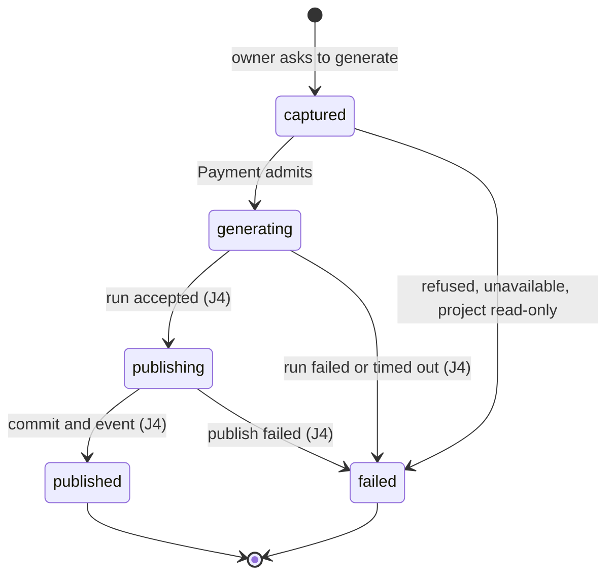

# Project service: Functional Requirements (FRD)

**Status:** Approved at gate 1 by the owner

## In short

A client creates a website with a fixed sub-domain once Payment admits it, edits pages without losing saves, freezes a
contract and asks to generate; Payment admits in the background, then AI Codegen reads the frozen input. Every refusal
has a stable code; a stranger gets "not found". Other services ask over REST or gRPC who may manage a site.

**Read next:** [TRD.md](TRD.md), how it is built. Up: [PRD.md](PRD.md).

## Main flow

A generation request moves through these states; (J4) marks what is not built yet.

## Who may call, and errors any request can get

These rules hold for every endpoint, so the FRs below do not repeat them.

| ID | Trigger | Input | What happens | Errors | PR | Source |
| --- | --- | --- | --- | --- | --- | --- |
| FR-1 | Any client, REST `/api/v1/**` | `Authorization: Bearer` token | Project checks the token again after the gateway: RS256 signature from Keycloak's key set, issuer, audience `project`, `typ` `Bearer`, `exp`, `nbf` | `UNAUTHENTICATED` | PR-23 | AUTH §5, S2 §2.4, 0002 |
| FR-2 | Any client, `/api/v1/**` | A valid token | The `user_id` claim must be a canonical, non-nil UUID; it is the caller's identity | `ACCESS_DENIED` | PR-23 | AUTH §3, 0002 |
| FR-3 | Any client, any route under `/api/v1/projects/{projectId}` | A project the caller does not own | Answered exactly as a project that does not exist; the one exception is creation (FR-10) | `PROJECT_NOT_FOUND` | PR-3 | AUTH §2, S2 §2.3, 0007 |
| FR-4 | Any caller | A body, path or query that breaks a field rule, or an unreadable body | Refused before any change; field problems listed in `errors[]` with a field code; the value is never echoed | `VALIDATION_FAILED`, `MALFORMED_REQUEST` | PR-23 | S2 §2.2, 0003 |
| FR-5 | Any caller | A request that waits too long on a database lock, a statement or a pooled connection | Refused; nothing changes; try again | `DEPENDENCY_UNAVAILABLE` | PR-23 | S2 §2.3 |
| FR-6 | Another service, `/internal/**` | Any request, with or without a bearer | No token is read; a bearer sent by mistake is ignored, never answered 401 or 403. The Istio policy is the only gate (who may call what: 0002) | none | PR-23 | 0002, S2 §1 |
| FR-7 | Project calls another service | A user action that needs Payment | The call carries the user ID in the body or header, never a token; tokens never appear in logs | none | PR-23 | AUTH §1, S2 §3.5 |

**Acceptance**

| ID | Given | When | Then |
| --- | --- | --- | --- |
| FR-1.1 | A valid access token with audience `project` | `GET /api/v1/projects` | 200 |
| FR-1.2 | No token | `GET /api/v1/projects` | 401 `UNAUTHENTICATED` |
| FR-1.3 | An ID token (`typ` `ID`), or audience `payment` only | `GET /api/v1/projects` | 401 `UNAUTHENTICATED` |
| FR-2.1 | A token whose `user_id` is a lowercase UUID | Any `/api` call | The call runs as that user |
| FR-2.2 | A valid token without `user_id`, or with a non-UUID value | `GET /api/v1/projects` | 403 `ACCESS_DENIED` |
| FR-3.1 | Project P owned by user A | A gets P | 200 |
| FR-3.2 | Project P owned by user A | User B gets or saves the page of P | 404 `PROJECT_NOT_FOUND`, same body as for an unknown ID; P unchanged |
| FR-4.1 | A valid page save body | `PUT .../pages/{pageId}` as owner | 200 |
| FR-4.2 | A blank `name` | `PATCH` as owner | 400 `VALIDATION_FAILED`, `errors[0].field` `name`; nothing changes |
| FR-4.3 | A body that is not JSON | `PATCH` as owner | 400 `MALFORMED_REQUEST` |
| FR-5.1 | A free project row | Owner saves a page | 200 |
| FR-5.2 | The project row held past the lock timeout | Owner saves a page | 503 `DEPENDENCY_UNAVAILABLE`; revision unchanged |
| FR-5.3 | No pooled connection free in time | Owner calls `/api/v1` | 503 `DEPENDENCY_UNAVAILABLE`; no driver detail |
| FR-6.1 | No token | `POST /internal/v1/access-checks` with a valid body | 200 |
| FR-6.2 | An expired or garbage bearer | The same call | 200, never 401 or 403 |
| FR-7.1 | A website creation | Project calls Payment | The request has no `Authorization` header |

Proven today by: `JwtSecurityWebTest`, `SecurityErrorWebTest`, `CurrentUserTest`, `ProjectControllerTest`,
`GlobalExceptionHandlerWebTest`, `RetryAfterWebTest`, `HttpPaymentAdmissionsTest`, `AccessCheckControllerTest`.

## Creating a website

The wizard lets a client pick a business type and a template, then creates the website once Payment admits it.

| ID | Trigger | Input | What happens | Errors | PR | Source |
| --- | --- | --- | --- | --- | --- | --- |
| FR-8 | Client, `GET /api/v1/business-types` and `GET /api/v1/business-types/{code}` | none, or a type code | The list gives the active catalog business types (`code`, `name`). The detail of an active type gives `code`, `name` and `productTypes`, each with `code`, `name` and `fieldSchema` (the JSON Schema of its latest active version), ordered by name; a retired or unknown code is 404 | `BUSINESS_TYPE_NOT_FOUND`, `CATALOG_UNAVAILABLE` | PR-1 | S3 business_types, S3 product_type_schemas |
| FR-9 | Client, `GET /api/v1/templates` with optional `businessTypeCode` | An optional type code | Lists templates (`templateCode`, `name`, `description`, `thumbnailUrl`, `badge`, `styleKey`, `version`, `pageCount`). Without a code: every template. With the code of an active type: the templates that apply to it (the four style templates and `blank` apply to every type). With an unknown or retired code: an empty list. `GET /api/v1/templates/{templateCode}` gives one template with its one page (FR-9.5); an unknown code is 404 | `TEMPLATE_NOT_FOUND` | PR-1 | S1 How the tables work |
| FR-10 | Client, `PUT /api/v1/projects/{projectId}` | Client-chosen project ID; `name`, `businessTypeCode`, `templateCode`, `businessProfile` | 1. A known ID: same owner, name, type and template answer 200 with the website, else conflict (409 even to a stranger: the exception to FR-3 recorded in 0007). 2. Checks type and template, and that the owner has no live website with this name (trimmed, any case: FR-10.12). 3. Asks Payment (FR-11). 4. In one transaction: the project (`draft`, revision 0), its template pages and the catalog registration job (FR-35). 5. Answers 201 | `BUSINESS_TYPE_NOT_AVAILABLE`, `TEMPLATE_NOT_AVAILABLE`, `PROJECT_ID_CONFLICT`, `PROJECT_NAME_TAKEN`, `ADMISSION_RELEASE_PENDING`, `CATALOG_UNAVAILABLE` | PR-1 | S1 projects, PAY §2.1 |
| FR-11 | FR-10, step 3 | Owner and project ID | Payment admits or refuses, keyed on the project ID; a refusal or no answer creates nothing | `WEBSITE_LIMIT_REACHED`, `TRIAL_ENDED`, `NO_ACTIVE_PLAN`, `CLIENT_SUSPENDED`, `WEBSITE_NOT_ADMITTED`, `PAYMENT_UNAVAILABLE` | PR-15 | PAY §2.1 |
| FR-12 | Durable job, after FR-10 fails for good once admitted | Project ID | If no project with the ID exists, Payment's admission is released (`DELETE /internal/v1/website-admissions/{projectId}`); 204, 404 and 409 all end the job; no answer retries 12 times, from 2 s doubling to 10 min | none | PR-15 | PAY §2.2 |
| FR-13 | Client, `PUT /api/v1/projects/{projectId}` | Also `subdomain` | The sub-domain must be one DNS label (`a-z`, `0-9`, `-`, 3 to 55, so `<subdomain>-preview` fits 63; no `-` at either end), not ending in `-preview` (preview hosts are `<subdomain>-preview.<site domain>`), not starting with `xn--`, and not reserved (configured list, default `www`, `app`, `api`, `admin`, `git`, `mail`, `status`, `docs`, `auth`, `preview`; `production` refuses an empty list). It is checked as free before Payment is asked; the unique index decides a race. The answer has `subdomain` and `platformHostname` `<subdomain>.<site domain>`. A repeat with another sub-domain is a conflict. Before create, the wizard may check a label with `GET /api/v1/subdomains/{subdomain}` (user token): 200 with `available` and `reason` `TAKEN` or `INVALID`, by the same rule and lookup | `HOSTNAME_TAKEN`, `VALIDATION_FAILED`, `PROJECT_ID_CONFLICT` | PR-2 | S1 Site hostname, S1 projects, Q-2 |

**Acceptance**

| ID | Given | When | Then |
| --- | --- | --- | --- |
| FR-8.1 | Active types `clothing_shop`, `tech_shop`, one retired | List types | 200, the two active ones |
| FR-8.2 | Catalog database down | List types | 503 `CATALOG_UNAVAILABLE` |
| FR-8.3 | `food_shop` is active with one product type | `GET /api/v1/business-types/food_shop` | 200, `code`, `name` and its product type with `fieldSchema` |
| FR-8.4 | `nope_shop` is unknown, another type is retired | Detail of either | 404 `BUSINESS_TYPE_NOT_FOUND` |
| FR-9.1 | `clothing_shop` is active | List templates for it | 200, the five templates, each with its `pageCount` and display fields |
| FR-9.2 | `nope_shop` is unknown or retired | List templates for it | 200, empty list |
| FR-9.3 | The bundled templates | List without `businessTypeCode` | 200, all five |
| FR-9.4 | `sweet_pastel` and `food_shop` | `PUT` the project | 201; its one `Home` page at `/` is the template's page |
| FR-9.5 | A bundled template | `GET /api/v1/templates/{templateCode}` with a user token | 200, the list item's fields and `page` (`name`, `path`, `puckTree`), the template's one page; no token is 401 |
| FR-9.6 | An unknown template code | `GET /api/v1/templates/{templateCode}` | 404 `TEMPLATE_NOT_FOUND` |
| FR-10.1 | New ID, active type, matching template, Payment admits | `PUT` | 201; status `draft`, `editRevision` 0; template pages stored; one catalog job in the outbox |
| FR-10.2 | That website exists | The same `PUT` again | 200, same website; Payment not asked again |
| FR-10.3 | That website exists | `PUT` with another name, or by another user | 409 `PROJECT_ID_CONFLICT`; nothing changes |
| FR-10.4 | Type retired or unknown | `PUT` | 422 `BUSINESS_TYPE_NOT_AVAILABLE`; Payment not asked |
| FR-10.5 | Template not of that type | `PUT` | 422 `TEMPLATE_NOT_AVAILABLE`; Payment not asked |
| FR-10.6 | A release of this ID's admission is pending | `PUT` | 409 `ADMISSION_RELEASE_PENDING` with `Retry-After`; no project |
| FR-10.7 | Catalog database down | `PUT` | 503 `CATALOG_UNAVAILABLE`; no project |
| FR-10.8 | `businessProfile.openingHours` has seven rows (`day` `MONDAY` to `SUNDAY`, `open`, `opensAt`, `closesAt` as `HH:mm`) | `PUT` | The catalog profile's `opening_hours` holds the ranges: consecutive open days with the same times are one `{from_day, to_day, opens_at, closes_at, closes_next_day: false}` (day names upper case as `java.time.DayOfWeek`, `MONDAY` to `SUNDAY`, Monday first); closed days give none; no `openingHours`, or all days closed, gives `[]` |
| FR-10.9 | `openingHours` has six rows, a weekday twice, a time outside `00:00` to `23:59`, or an open day with `opensAt` not before `closesAt` | `PUT` | 400 `VALIDATION_FAILED`, field `businessProfile.openingHours` (the list) or `businessProfile.openingHours[n].opensAt` or `.closesAt`; no project |
| FR-10.10 | A create with or without `openingHours`; a pending registration written before the field existed | The registration job runs | `catalog.business_profiles.opening_hours` holds the ranges, `[]` without them, `[]` for the old pending row |
| FR-10.11 | A template whose home page has root props (the four style templates) | `PUT` | The home page's root props `businessName`, `address`, `email`, `phones` (`[{number}]`) and, when opening hours exist, `hours` (first open day, `9:00 – 18:00`) and `hoursDetail` (`Mon – Fri 9:00 – 18:00 · Sat – Sun closed`) come from the profile; a detail the client left out becomes `""` (`phones` `[]`, `hours` and `hoursDetail` `""` without opening hours), never the template's sample; every other prop keeps the template's value; `blank` is unchanged |
| FR-10.12 | The owner has a live website named `Kiln Cafe` | `PUT` another ID named `kiln cafe` or ` KILN CAFE ` | 409 `PROJECT_NAME_TAKEN`; Payment not asked; no project. A deleted website, or another owner's, with that name does not block. A repeat of the same create (FR-10.2) is still 200 |
| FR-10.13 | `businessProfile.timezone` or `businessProfile.businessName` is missing or blank | `PUT` | 201; the catalog profile holds `Asia/Phnom_Penh` and the website's `name` in their place; a `timezone` that is sent must still be a known zone |
| FR-11.1 | Payment admits | `PUT` | 201 |
| FR-11.2 | Payment refuses `WEBSITE_LIMIT_REACHED` | `PUT` | 422 `WEBSITE_LIMIT_REACHED`; no project, no pages |
| FR-11.3 | Payment refuses `TRIAL_ENDED` | `PUT` | 422 `TRIAL_ENDED`; no project |
| FR-11.4 | Payment refuses `NO_ACTIVE_PLAN` | `PUT` | 422 `NO_ACTIVE_PLAN`; no project |
| FR-11.5 | Payment refuses `CLIENT_SUSPENDED` | `PUT` | 422 `CLIENT_SUSPENDED`; no project |
| FR-11.6 | Payment refuses with a reason not in PAY §2.1 | `PUT` | 422 `WEBSITE_NOT_ADMITTED`; no project |
| FR-11.7 | Payment times out twice | `PUT` | 503 `PAYMENT_UNAVAILABLE`; no project |
| FR-12.1 | Admitted, then the insert fails for good | The job runs | Payment gets one `DELETE` for the ID; the job completes |
| FR-12.2 | A concurrent request created the project | FR-10 fails in this request | No release job is scheduled |
| FR-13.1 | `kilncoffee` free | `PUT` with it | 201; `subdomain` `kilncoffee`; `platformHostname` `kilncoffee.<site domain>` |
| FR-13.2 | A deleted project holds `kilncoffee` | `PUT` with it | 409 `HOSTNAME_TAKEN`; Payment not asked; no project |
| FR-13.3 | `auth`, `-shop` or `ab` | `PUT` with it | 400 `VALIDATION_FAILED`, field `subdomain` `VALUE_INVALID` |
| FR-13.4 | The website exists with `kilncoffee` | The same `PUT` with `kiln2` | 409 `PROJECT_ID_CONFLICT` |
| FR-13.5 | `kilncoffee-preview` | `PUT` with it | 400 `VALIDATION_FAILED`, field `subdomain` `VALUE_INVALID`; no project |
| FR-13.6 | `preview`, default list | `PUT` with it | 400 `VALIDATION_FAILED`, field `subdomain` `VALUE_INVALID`; no project |
| FR-13.7 | `xn--kiln-9ra` | `PUT` with it | 400 `VALIDATION_FAILED`, field `subdomain` `VALUE_INVALID`; no project |
| FR-13.8 | `previewshop`, `kiln-previews`, `xnshop` or a 55-character label, free | `PUT` with it | 201 |
| FR-13.9 | Profile `production`, an empty reserved list | Start | `ProfileGuard` refuses; the message names `webblock.platform.reserved-subdomains` |
| FR-13.10 | Profile `production`, the default list | Start | Starts |
| FR-13.11 | A 56-character label | `PUT` with it | 400 `VALIDATION_FAILED`, field `subdomain` `VALUE_INVALID`; no project |
| FR-13.12 | A site domain of 190 characters | Start | Refused; at 189 the longest preview host is 253 |
| FR-13.13 | `kilncoffee` free | `GET /api/v1/subdomains/kilncoffee` with a user token | 200; `subdomain` `kilncoffee`, `available` true, `reason` null |
| FR-13.14 | A live or a deleted project holds `kilncoffee` | `GET` it | 200; `available` false, `reason` `TAKEN`; the same body for both, nothing about the holder |
| FR-13.15 | A label the FR-13 rule refuses as create applies it (`ab`, `-shop`, `auth`, upper case) | `GET` it | 200; `available` false, `reason` `INVALID`; `subdomain` as given, not normalised |
| FR-13.16 | No token | `GET` | 401 |
| FR-13.17 | Any label | `GET` it, and `PUT` with it | One rule and one lookup: `INVALID` exactly where the `PUT` answers `VALUE_INVALID` for `subdomain`, `TAKEN` where its free check answers `HOSTNAME_TAKEN` |

Proven today by: `BusinessTypeControllerTest`, `TemplateControllerTest`, `ProjectCreationServiceTest`,
`ProjectCreationControllerTest`, `ProjectCreationIntegrationTest`, `ProjectCreationRefusalIntegrationTest`,
`AdmissionReleaseHandlerTest`, `AdmissionReleaseFenceTest`; for FR-10.12 and FR-10.13 `ProjectCreationIntegrationTest`; for FR-9.5 and FR-9.6 `TemplateControllerTest`;
for FR-14.10 and FR-14.11 `ProjectControllerTest`, `ProjectCountsIntegrationTest`; for FR-10.8 to FR-10.11 also `OpeningHoursTest`,
`OpeningHoursRequestTest`, `HomePageDetailsTest`, `CatalogRegistrationHandlerTest`; for FR-13 also `SubdomainTest`, `ProjectServiceTest`,
`ProjectConfigTest`, `PlatformPropertiesTest`, `J1ErrorCodesTest`; for FR-13.13 to FR-13.17
`SubdomainControllerTest`, `SubdomainCheckIntegrationTest`, `ProjectServiceTest`. FR-13.5 to FR-13.12: `SubdomainTest`, `PlatformPropertiesTest`, `ProfileGuardTest`, `ProjectServiceTest`.
Existing values fit 55: the V6 backfill `p-<12 characters>` has 14, and there is no production data yet.

## My websites

The owner lists and opens their websites. A website's name cannot be changed.

| ID | Trigger | Input | What happens | Errors | PR | Source |
| --- | --- | --- | --- | --- | --- | --- |
| FR-14 | Owner, `GET /api/v1/projects` | `limit` 1 to 100 (default 20), `cursor`, `q` (optional, at most 100 characters), `status` (optional: `draft`, `active` or `suspended`) | The caller's live websites, newest first; next page in `meta.page.nextCursor`; deleted ones are left out; `GET /api/v1/projects/counts` gives `all`, `draft`, `active` and `suspended` counts of them (FR-14.10); each carries `businessTypeCode`, `businessTypeName` and `thumbnailUrl` and `hasUndeployedChanges` and `lastDeployedEditRevision` (see FR-14.2 to FR-14.9) | none | PR-3 | S2 §2.1 |
| FR-15 | Owner, `GET /api/v1/projects/{projectId}` | Project ID | The website, with `readOnly` true when suspended (a deleted website is 404, FR-38); never the owner's ID; carries the same display fields and undeployed-changes fields as the list | none | PR-3 | S1 projects, 0007 |
| FR-16 | Withdrawn by owner decision: the name of a website cannot be changed. `PATCH /api/v1/projects/{projectId}` no longer routes | none | none | none | PR-3 | S1 projects, 0007 |

**Acceptance**

| ID | Given | When | Then |
| --- | --- | --- | --- |
| FR-14.1 | The owner has 3 live websites and 1 deleted | List with `limit=2` | 200, the 2 newest; a `nextCursor`; the next page has 1; the deleted one never appears |
| FR-14.2 | A website with a catalog business type | List | Each item has `businessTypeCode` and `businessTypeName` from the catalog, read with one catalog query for the whole page |
| FR-14.3 | A website whose home page `root.props.templateId` is a bundled template's `styleKey` (for example `sweet-pastel`) | List or get | `thumbnailUrl` is that template's thumbnail; `null` for a `blank` website, an unknown key or no home page |
| FR-14.4 | The catalog cannot be read | List or get | 200; `businessTypeCode` and `businessTypeName` are `null`, `thumbnailUrl` is unchanged |
| FR-14.5 | Websites named "Kiln Cafe", "Bakery", "100% Organic" | List with `q` (trimmed, any case, for example ` kiln `) | Only websites whose name contains `q`; `%`, `_` and `\` in `q` match themselves; over 100 characters is 400 `VALIDATION_FAILED`; a cursor is only a position, so the client sends the same `q` and `status` with it |
| FR-14.6 | Websites in each status, one deleted, one of another owner | List with `status=draft`, `active` or `suspended` | Only the caller's live websites in that status; an unknown value is 400 `VALIDATION_FAILED` |
| FR-14.7 | Several matches of `q` and `status` | List with both and `limit` below the count | Pages continue newest first with the same filters; the last page has no `nextCursor` |
| FR-14.8 | A website | List, get or create | `lastDeployedEditRevision` is the highest `captured_edit_revision` among its `published` generation requests, `null` if none; `hasUndeployedChanges` is true when it is `null` (never deployed) or `editRevision` is above it, false right after a deploy, true again after a later page save |
| FR-14.9 | A page of websites | List | The deployed revisions of the whole page come from one grouped query on `generation_requests` |
| FR-14.10 | A caller with 2 draft, 1 active, 1 suspended and 1 deleted website, and another owner with websites | `GET /api/v1/projects/counts` | 200, `all` 4, `draft` 2, `active` 1, `suspended` 1: the caller's live websites, one grouped query |
| FR-14.11 | A caller without websites, or any caller | `GET /api/v1/projects/counts` | 200 with zeros; the path is never read as a project ID; no token is 401 |
| FR-15.1 | A suspended website of the caller | Get it | 200, `readOnly` true; no `ownerUserId` field |
| FR-15.2 | A website of the caller | Get it | `businessTypeCode`, `businessTypeName` and `thumbnailUrl` as in FR-14.2 and FR-14.3 |
| FR-16.1 | Any website of the owner | `PATCH /api/v1/projects/{projectId}` | 405 `METHOD_NOT_ALLOWED`; the name is unchanged |
| FR-16.2 | Withdrawn | Withdrawn | The rename of a suspended website is withdrawn with FR-16 |

Proven today by: `ProjectControllerTest`, `ProjectServiceTest`, `ProjectCursorTest`.

## Deleting and suspending a website

The owner deletes a website for good, or suspends it to lock editing. Only the owner may; anyone else, an unknown
project and a deleted one are all 404 `PROJECT_NOT_FOUND`.

| ID | Trigger | Input | What happens | Errors | PR | Source |
| --- | --- | --- | --- | --- | --- | --- |
| FR-38 | Owner, `DELETE /api/v1/projects/{projectId}` | Project ID | In one transaction: sets `deleted_at` (once; the row stays), publishes `project.project_deleted.v1` (FR-38.6) and schedules the catalog archive (FR-40). Only a `draft` website (never deployed) is deleted, and not while a generation request of it is captured, generating or publishing; the checks run under the project row lock, owner first, so a stranger never learns the status. Answers 204. From then on every per-project call of the caller, and the access check, treat the website as unknown | `PROJECT_NOT_FOUND`, `PROJECT_NOT_DELETABLE`, `GENERATION_IN_PROGRESS` | PR-10, PR-20 | S1 projects, S2 §5.2, PAY §4 |
| FR-39 | Owner, `POST /api/v1/projects/{projectId}/suspend` or `/reactivate` | Project ID | Suspend: a `draft` or `active` website becomes `suspended`, an editing lock only (no hosting effect, no event). Reactivate: a `suspended` website becomes `active` if any of its generation requests is `published`, else `draft`. Already in the target state: 200, nothing changes. Answers the website as FR-15. Suspend blocks new work only: a request already generating may finish, and admission fails a `captured` one `project_unavailable`. An admin suspension (Provisioning's hosting reason `ADMIN_SUSPENDED`) that the owner cannot lift is planned with Provisioning and not built | `PROJECT_NOT_FOUND` | PR-10 | S1 projects, 0007 |
| FR-40 | Durable job `catalog-archive:<id>` from FR-38 | Project ID | As `catalog_platform`: sets `catalog.websites.status` to `archived` where it is not already; the website, its profile and history stay. A website not registered yet (its registration is still pending) is retried 16 times, from 1 s doubling to 5 min, until it exists; no website and no pending registration completes the job | none | PR-10 | S3 websites |

**Acceptance**

| ID | Given | When | Then |
| --- | --- | --- | --- |
| FR-38.1 | The owner's website | Delete | 204, no body; `deleted_at` set; one event and one archive job stored |
| FR-38.2 | A stranger's, an unknown or an already deleted website | Delete | 404 `PROJECT_NOT_FOUND`; nothing changes, no event |
| FR-38.3 | A deleted website | Get, list pages, list contracts or requests, capture, suspend | 404 `PROJECT_NOT_FOUND`; the list leaves it out |
| FR-38.4 | A website with a `captured`, `generating` or `publishing` request | Delete | 409 `GENERATION_IN_PROGRESS`; nothing changes, no event |
| FR-38.5 | A deleted website | Access check, any action, any caller | `allowed` false, `NOT_FOUND` |
| FR-38.6 | A delete | The event is relayed | One message on `project.events`, routing key `project_deleted.v1`, snake_case envelope only (`schema_version`, `message_id` UUIDv7, `message_type`, `occurred_at`, `correlation_id` = project ID, `project_id`) |
| FR-38.7 | A request is `captured`; the website is suspended or deleted while Payment is asked | Admission ends | The request is `failed` `project_unavailable`; no `generation_requested` event. A `generating` request of a deleted website is served no input: 404 `GENERATION_REQUEST_NOT_FOUND` |
| FR-38.8 | A `draft` website whose requests all ended | Delete | 204 |
| FR-38.9 | An `active` or `suspended` website | Delete by the owner; by a stranger | 409 `PROJECT_NOT_DELETABLE`; 404 `PROJECT_NOT_FOUND` (never 409) |
| FR-38.10 | The owner deleted P | `PUT` P again with the original body | 409 `PROJECT_ID_CONFLICT` |
| FR-39.1 | A `draft` website | Suspend, then suspend again | 200 `suspended`, `readOnly` true; the repeat changes nothing |
| FR-39.2 | An `active` website with a `published` request | Suspend, then reactivate | 200 `suspended`; then 200 `active` |
| FR-39.3 | A website with no `published` request | Suspend, then reactivate; reactivate a `draft` one | `draft`; the `draft` one is unchanged |
| FR-39.4 | A suspended website | Save the page, capture a request | 422 `PROJECT_READ_ONLY` each |
| FR-39.5 | A stranger | Suspend or reactivate | 404 `PROJECT_NOT_FOUND`; status unchanged |
| FR-39.6 | A request is `generating` | The website is suspended, then Codegen reads its input | 200: the request may finish |
| FR-40.1 | A registered website, `active` or `suspended` | The job runs, twice | `archived`; the second run changes nothing |
| FR-40.2 | The registration is pending | The job runs | Retried until the website exists, then `archived`; with no website and no pending row it completes |
| FR-40.3 | The job fails | Its retries | 16 retries with the registration's backoff |
| FR-40.4 | A registration is pending and the catalog holds a website under the ID that the registration did not write | The job runs | Nothing is archived; the record fails at once without retry, for an operator |

Proven today by: `ProjectLifecycleIntegrationTest`, `ProjectDeletedMessagingTest`, `CatalogArchiveHandlerTest`,
`ProjectControllerTest`, `ProjectServiceTest`, `ProjectLockTest`, `AccessCheckServiceTest`, `AccessGrpcServiceTest`.

## Pages and the builder

The owner edits pages; every write sends the revision it read, so two saves never overwrite each other.

| ID | Trigger | Input | What happens | Errors | PR | Source |
| --- | --- | --- | --- | --- | --- | --- |
| FR-17 | Owner, `GET /api/v1/projects/{projectId}/pages` | Project ID | Live pages in page order, with the project's `editRevision` | none | PR-4 | S1 pages |
| FR-18 | Withdrawn by owner decision: a website has exactly one page (home, `/`), so no page is added. `POST .../pages` no longer routes; a site template with any other number of pages stops the start-up | none | none | none | PR-4 | S1 pages |
| FR-19 | Owner, `PUT .../pages/{pageId}` | `expectedEditRevision`, `name`, `path`, `puckTree`, `seoTitle`, `seoDescription`, `sortOrder` 0 to 1000 | Checks the tree against the component catalog and size limit (1 MB); moves the revision from the expected value under the project lock; path unique among live pages; replaces the page's content and order | `PROJECT_READ_ONLY`, `STALE_EDIT_REVISION`, `PAGE_NOT_FOUND`, `PAGE_PATH_TAKEN`, `PAYLOAD_TOO_LARGE` | PR-4 | S1 pages |
| FR-20 | Withdrawn by owner decision: a website has exactly one page, so no page is deleted. `DELETE .../pages/{pageId}` no longer routes | none | none | none | PR-4 | S1 pages, 0007 |
| FR-21 | Builder, `GET /api/v1/component-catalog/{version}` | Catalog version | The block definitions of that version | `COMPONENT_CATALOG_NOT_FOUND` | PR-5 | S1 projects |
| FR-41 | Owner, `GET /api/v1/projects/{projectId}/versions` and `POST .../versions/{versionId}/restore` | `limit`, `cursor`; `expectedEditRevision` (0 or more) | A version is a `published` generation request (its `versionId` is the request ID). List: newest first by the time the request reached `published` (`updated_at`), cursor pages as FR-25; items `versionId`, `editRevision` (the revision it froze), `publishedAt`, `current` (true only for the newest). Restore: takes the home page (`/`) from that request's frozen `captured_input` and saves it into the live home page through the page save of FR-19 (revision check, read-only refusal, catalog and size checks), so the revision moves by one; answers as FR-19. Nothing is deployed. A frozen tree the current catalog refuses answers that check's validation error. A stranger, unknown or deleted website is `PROJECT_NOT_FOUND` before the version is looked at; a suspended website may list but not restore | `PROJECT_NOT_FOUND`, `VERSION_NOT_FOUND`, `PROJECT_READ_ONLY`, `STALE_EDIT_REVISION`, `VALIDATION_FAILED`, `PAYLOAD_TOO_LARGE` | PR-4 | `ai/handoffs/next.md`, S1 generation_requests |

**Acceptance**

| ID | Given | When | Then |
| --- | --- | --- | --- |
| FR-17.1 | Revision 3, the home page `/` | List | 200, `editRevision` 3, the one page |
| FR-18.1 | Any website of the owner | `POST .../pages` | 405 `METHOD_NOT_ALLOWED`; no page added |
| FR-18.2 | Withdrawn | Withdrawn | Withdrawn with FR-18 |
| FR-18.3 | Withdrawn | Withdrawn | A site template with two pages or none stops the start-up |
| FR-18.4 | Withdrawn | Withdrawn | Withdrawn with FR-18 |
| FR-18.5 | Withdrawn | Withdrawn | Withdrawn with FR-18 |
| FR-18.6 | Withdrawn | Withdrawn | Withdrawn with FR-18 |
| FR-18.7 | Withdrawn | Withdrawn | Withdrawn with FR-18 |
| FR-19.1 | Revision 4 | Save page with revision 4 | 200, page changed, `editRevision` 5 |
| FR-19.2 | Revision 5 | Save with revision 4 | 409 `STALE_EDIT_REVISION`; page unchanged |
| FR-19.3 | A deleted page | Save it | 404 `PAGE_NOT_FOUND` |
| FR-19.4 | Another live page at `/menu` | Save with path `/menu` | 409 `PAGE_PATH_TAKEN` |
| FR-19.5 | A read-only website | Save | 422 `PROJECT_READ_ONLY` |
| FR-20.1 | Any page of the owner | `DELETE .../pages/{pageId}` | 405 `METHOD_NOT_ALLOWED`; the page stays |
| FR-20.2 | Withdrawn | Withdrawn | Withdrawn with FR-20 |
| FR-20.3 | Withdrawn | Withdrawn | Withdrawn with FR-20 |
| FR-20.4 | Withdrawn | Withdrawn | Withdrawn with FR-20 |
| FR-21.1 | The website's catalog version | Get it | 200, the definitions |
| FR-21.2 | Version `9.9.9` does not exist | Get it | 404 `COMPONENT_CATALOG_NOT_FOUND` |
| FR-41.1 | Two published requests | List | Newest first by publish time; `current` true on the first only |
| FR-41.2 | Captured and failed requests | List | They are not listed |
| FR-41.3 | A stranger, an unknown or a deleted website | List or restore | 404 `PROJECT_NOT_FOUND` |
| FR-41.4 | Three versions | List with `limit` 2, then the cursor | Two items and a cursor, then one; a bad cursor is 400 |
| FR-41.5 | Revision R, an older version | Restore with R | 200, the home page equals the frozen one, `editRevision` R+1, `hasUndeployedChanges` true; a missing or negative `expectedEditRevision` is 400 |
| FR-41.6 | Revision R | Restore with R-1 | 409 `STALE_EDIT_REVISION`; nothing changes |
| FR-41.7 | A suspended website | Restore; list | 422 `PROJECT_READ_ONLY`; the list is 200 |
| FR-41.8 | An unknown, unpublished or another website's version | Restore | 404 `VERSION_NOT_FOUND` |
| FR-41.9 | A version with no home page; a frozen tree the catalog refuses | Restore | 404 `VERSION_NOT_FOUND`; 400 validation error; nothing changes |

Proven today by: `PageControllerTest`, `PageServiceTest`, `LivePagesTest`, `PageStoredSizeTest`, `PuckValidatorTest`,
`ComponentCatalogControllerTest`, `ProjectLockTest`, `PageVersionControllerTest`, `PageVersionIntegrationTest`.

## Generation contracts

A contract freezes, per chosen product type, the newest active schema, so a generation always follows fixed rules.

| ID | Trigger | Input | What happens | Errors | PR | Source |
| --- | --- | --- | --- | --- | --- | --- |
| FR-22 | Owner, `POST /api/v1/projects/{projectId}/generation-contracts` | `productTypeIds` (one or more, no repeats) | Each type must belong to the website's business type and be active; freezes its active schema with the highest version as the next contract version; `apiContractVersion` comes from configuration; answers 201 | `PRODUCT_TYPE_NOT_ALLOWED`, `PROJECT_READ_ONLY`, `CATALOG_UNAVAILABLE` | PR-6 | S1 generation_contracts, 0004 |
| FR-23 | Owner, `GET .../generation-contracts` | `limit`, `cursor` | Contracts newest version first, each with its product types and schema versions | `CATALOG_UNAVAILABLE` | PR-6 | S1 generation_contracts |

**Acceptance**

| ID | Given | When | Then |
| --- | --- | --- | --- |
| FR-22.1 | `top` has schema versions 1 and 2 active, no contract yet | Create with `top` | 201, `versionNumber` 1, `top` at version 2 |
| FR-22.2 | `graphics_card` belongs to another business type | Create with it | 422 `PRODUCT_TYPE_NOT_ALLOWED`, field `productTypeIds[0]`; no contract |
| FR-22.3 | A read-only website | Create | 422 `PROJECT_READ_ONLY` |
| FR-22.4 | Catalog database down | Create | 503 `CATALOG_UNAVAILABLE`; no contract |
| FR-22.5 | A capture without a contract ID (FR-24.7) and no reusable contract | Capture | The contract is made by this same create logic (checks and rows of FR-22) for all active product types of the business type, in the capture transaction |
| FR-23.1 | Contracts 1 and 2 | List | 200, version 2 then 1 |
| FR-23.2 | Catalog database down | List | 503 `CATALOG_UNAVAILABLE` |

Proven today by: `GenerationContractServiceTest`, `GenerationContractControllerTest`, `ContractSchemasTest`.

## Generation requests and admission

The owner asks to generate; Project freezes the pages at once and asks Payment in the background.

| ID | Trigger | Input | What happens | Errors | PR | Source |
| --- | --- | --- | --- | --- | --- | --- |
| FR-24 | Owner, `POST /api/v1/projects/{projectId}/generation-requests` | Header `Idempotency-Key` (1 to 255 bytes), `generationContractId` (optional; absent, the website's contract of all its business type's active product types is used, or made as FR-22) | Under the project lock: a known key with the same body answers 200 with the request and its status now (even if the website became read-only); else freezes all live pages, the catalog version and the contract with their SHA-256 (JCS) hash, stores the request `captured`, schedules its admission job; answers 202 with `Location` | `IDEMPOTENCY_KEY_REUSED`, `GENERATION_IN_PROGRESS`, `PROJECT_READ_ONLY`, `GENERATION_CONTRACT_NOT_FOUND`, `PRODUCT_TYPE_NOT_ALLOWED` (no active product type), `CATALOG_UNAVAILABLE` | PR-7 | S1 generation_requests, 0004 |
| FR-25 | Owner, `GET .../generation-requests` and `.../{generationRequestId}` | `limit`, `cursor`, or the request ID | Requests newest first, or one: ID, status, `failureCode`, times | `GENERATION_REQUEST_NOT_FOUND` | PR-7 | S1 generation_requests |
| FR-26 | Durable job `generation:<id>` | Request ID | Only a `captured` request moves. Project deleted or suspended: `failed` `project_unavailable`, Payment not asked. Admitted: `generating` and FR-27's event in one transaction. Refused: `failed` with the reason in lower case if it matches `[a-z_]{1,64}`, else `admission_error`. Other answer: `admission_error`. No answer: retry after 5 s, 10 s, 30 s, then each 60 s, until 15 min after capture, then `admission_unavailable` | stored codes below | PR-7 | 0004, PAY §2.3 |
| FR-27 | FR-26 admits | The request | Outbox event `project.generation_requested.v1` on `project.events`, routing key `generation_requested.v1`: envelope, `correlation_id` = request ID, `generation_request_id`, `captured_input_hash` | none | PR-16 | COMM §2.1, S2 §4 |
| FR-28 | Scheduled sweeper (every minute) | Requests still `captured` | A request `captured` for longer than the admission window plus 5 minutes becomes `failed` `admission_unavailable`, so it never blocks the website; `webblock.generation.stuck-capture-margin` and `stuck-sweep-interval` set the 5 minutes and the pause | none | PR-7 | `ai/handoffs/next.md`, S1 generation_requests |

**Acceptance**

| ID | Given | When | Then |
| --- | --- | --- | --- |
| FR-24.1 | A `draft` website, contract C, no request in flight | Capture with key K | 202, `Location`, status `captured`; one admission job in the outbox; `captured_input_hash` = SHA-256 of JCS(`captured_input`) |
| FR-24.2 | K was used with C | Capture with K and C again | 200, same `generationRequestId`, status as stored now; no new row |
| FR-24.3 | K was used with C | Capture with K and contract D | 409 `IDEMPOTENCY_KEY_REUSED` |
| FR-24.4 | A `generating` request exists | Capture with a new key | 409 `GENERATION_IN_PROGRESS`; no new row |
| FR-24.5 | A read-only website, new key | Capture | 422 `PROJECT_READ_ONLY` |
| FR-24.6 | A contract of another website | Capture with it | 404 `GENERATION_CONTRACT_NOT_FOUND` |
| FR-24.7 | A `draft` website, no contract | Capture with key K and no `generationContractId` (absent, `null` or no body) | 202; one contract made with every active product type of the business type (FR-22.5); the request uses it |
| FR-24.8 | FR-24.7 done, its request ended | Capture with a new key and no contract ID | 202; the same contract is reused (newest contract that froze the current active schema of every active product type); no new contract |
| FR-24.9 | K was used without a contract ID | Capture with K and no contract ID again | 200, same `generationRequestId`; no new request, no new contract. K with a contract ID instead is 409 `IDEMPOTENCY_KEY_REUSED` |
| FR-24.10 | A stranger, or a read-only website, no contract ID | Capture | 404 `PROJECT_NOT_FOUND`, or 422 `PROJECT_READ_ONLY`; no contract is made. Catalog down when a contract must be made: 503 `CATALOG_UNAVAILABLE`; no contract, no request |
| FR-25.1 | Two requests | List; get the older | 200, newest first; the one with its `failureCode` |
| FR-25.2 | A request ID of another website | Get it | 404 `GENERATION_REQUEST_NOT_FOUND` |
| FR-26.1 | `captured`; Payment admits | Job runs | `generating`; FR-27's event in the outbox |
| FR-26.2 | `captured`; Payment refuses `TRIAL_ENDED` | Job runs | `failed`, `failure_code` `trial_ended`; no event |
| FR-26.3 | `captured`; Payment refuses `Bad-Reason!` or answers 400 | Job runs | `failed`, `admission_error` |
| FR-26.4 | `captured` 3 min ago; Payment times out | Job runs | Still `captured`; the job is retried |
| FR-26.5 | `captured` 16 min ago; Payment times out | Job runs | `failed`, `admission_unavailable` |
| FR-26.6 | `captured`; the website was deleted | Job runs | `failed`, `project_unavailable`; Payment not called |
| FR-26.7 | Already `failed` | A late job runs | Nothing changes |
| FR-27.1 | FR-26.1 | The outbox sends | RabbitMQ gets one message: `message_type` `project.generation_requested.v1`, snake_case fields, `correlation_id` = request ID |
| FR-28.1 | `captured` 21 min ago, window 15 min | Sweeper runs | `failed`, `admission_unavailable`; a new capture answers 202 |
| FR-28.2 | `captured` 10 min ago | Sweeper runs | Still `captured` |

Proven today by: `GenerationRequestControllerTest`, `CaptureIntegrationTest`, `GenerationAdmissionServiceTest`,
`GenerationAdmissionHttpTest`, `GenerationAdmissionHandlerTest`, `GenerationAdmissionJobTest`,
`GenerationRequestedMessagingTest`, `FailureCodesTest`, `InputHasherTest`, `StuckCaptureSweeperIntegrationTest`.

## AI Codegen input

AI Codegen reads exactly what was frozen for a generating request.

| ID | Trigger | Input | What happens | Errors | PR | Source |
| --- | --- | --- | --- | --- | --- | --- |
| FR-29 | AI Codegen, `GET /internal/v1/generation-requests/{generationRequestId}/codegen-input` | Request ID | Answers `generationRequestId`, `projectId`, `businessTypeCode`, `capturedInput` byte for byte as stored, `capturedInputHash`, and the contract with each product type's code and `fieldSchema` | `GENERATION_REQUEST_NOT_FOUND`, `REQUEST_NOT_GENERATING`, `CATALOG_UNAVAILABLE` | PR-16 | COMM §2.2, 0004 |

**Acceptance**

| ID | Given | When | Then |
| --- | --- | --- | --- |
| FR-29.1 | A `generating` request | Read its input | 200; SHA-256 of JCS(`capturedInput`) equals `capturedInputHash` |
| FR-29.2 | An unknown request ID | Read | 404 `GENERATION_REQUEST_NOT_FOUND` |
| FR-29.3 | A `failed` request | Read | 409 `REQUEST_NOT_GENERATING` |
| FR-29.4 | Catalog database down | Read | 503 `CATALOG_UNAVAILABLE` |

Proven today by: `CodegenInputControllerTest`, `CodegenInputIntegrationTest`.

## Access checks for other services

Other services ask whether a user may act on a project; Project answers for the owner only.

Decision used by FR-30 and FR-31: unknown or deleted project: `NOT_FOUND`; not the owner: `NOT_MANAGER`; suspended
project and an action that changes something: `PROJECT_SUSPENDED`; otherwise allowed. Reads stay allowed on a
suspended project. `PROJECT_DELETED` stays in the contract's reason list and is no longer answered (FR-38.5).

| ID | Trigger | Input | What happens | Errors | PR | Source |
| --- | --- | --- | --- | --- | --- | --- |
| FR-30 | Provisioning, `POST /internal/v1/access-checks` | `userId`, `projectId` (canonical UUIDs), `action` | 200 with `{allowed: true}` or `{allowed: false, reason}`; an unknown project is never a 404 | `VALIDATION_FAILED` | PR-12 | PROV §B, 0007 |
| FR-31 | Provisioning or a portal, gRPC `webblock.project.v1.AccessService/CheckAccess`, port 9090 | `user_id`, `project_id`, `action` | Same decision; answers `allowed` and `reason` (empty when allowed); never gRPC `NOT_FOUND`. Bad input: `INVALID_ARGUMENT` with `ErrorInfo` reason `VALIDATION_FAILED`, domain `project.webblock`, and a `BadRequest` field list. Database busy: `UNAVAILABLE`, reason `DEPENDENCY_UNAVAILABLE` | `VALIDATION_FAILED`, `DEPENDENCY_UNAVAILABLE` | PR-13 | S2 §3.2 to §3.4, CTR `access.proto` |
| FR-32 | FR-30 and FR-31 | `action` | Accepted actions: changes `deploy_release`, `promote_release`, `rollback_release`, `build_release`, `manage_site`; reads `get_release`, `get_command`, `get_deployment`, `get_release_diagnostics`, `list_releases`, `list_commands`. Any other value is bad input. The list, with each action's admin-allowed flag from Provisioning, lives next to `access.proto` in CTR | `VALIDATION_FAILED` | PR-14 | PROV §B, §D, S2 §2.4, CMN §7.3 |
| FR-33 | FR-31 | A caller who is an admin | Ownership alone decides; the request carries no roles, Project grants no admin power. The caller admits an admin only for admin-allowed actions, and maps `NOT_FOUND` and `NOT_MANAGER` to 404 `PROJECT_NOT_FOUND`, `PROJECT_DELETED` and `PROJECT_SUSPENDED` to 409 with those codes (in Project's code list). Project's REST keeps 422 `PROJECT_READ_ONLY` | none | PR-13 | CMN §4.3, §7.1, §7.4, 0007 |
| FR-34 | Owner confirms Provisioning calls FR-31 everywhere | none | The REST check of FR-30 is removed; 0002 and PROV §B change in the same change | none | PR-13 | 0002, PROV §B, S2 §9 |

**Acceptance**

| ID | Given | When | Then |
| --- | --- | --- | --- |
| FR-30.1 | A owns live P | REST check A, P, `deploy_release` | 200, `allowed` true, no `reason` |
| FR-30.2 | A owns P | REST check B, P | 200, `allowed` false, `NOT_MANAGER` |
| FR-30.3 | No project P | REST check | 200, `allowed` false, `NOT_FOUND` |
| FR-30.4 | P deleted | `deploy_release`; then `get_release` | `NOT_FOUND` for both (FR-38.5) |
| FR-30.5 | P suspended | `promote_release` | `PROJECT_SUSPENDED` |
| FR-30.6 | Any | `action` `drop_db`, or a short UUID | 400 `VALIDATION_FAILED` |
| FR-31.1 | A owns live P | `CheckAccess` A, P, `deploy_release` | OK, `allowed` true, `reason` "" |
| FR-31.2 | A owns P | `CheckAccess` B, P | OK, `allowed` false, `NOT_MANAGER` |
| FR-31.3 | No project P | `CheckAccess` | OK, `allowed` false, `NOT_FOUND` |
| FR-31.4 | P suspended | `rollback_release`; then `list_releases` | `PROJECT_SUSPENDED`; then `allowed` true. A deleted P is `NOT_FOUND` for both |
| FR-31.5 | Any | `project_id` "abc" | `INVALID_ARGUMENT`, `ErrorInfo` reason `VALIDATION_FAILED`, field `project_id` |
| FR-31.6 | Project row held past the lock timeout | `CheckAccess` | `UNAVAILABLE`, reason `DEPENDENCY_UNAVAILABLE` |
| FR-32.1 | A owns live P | `manage_site` | `allowed` true |
| FR-32.2 | P suspended | `manage_site` | `PROJECT_SUSPENDED` |
| FR-32.3 | Any | `action` `drop_db` | Bad input (400 or `INVALID_ARGUMENT`) |
| FR-33.1 | Admin D does not own P | `CheckAccess` D, P, `rollback_release` | `allowed` false, `NOT_MANAGER` |
| FR-33.2 | The code list | Read `PROJECT_DELETED` and `PROJECT_SUSPENDED` | Both exist with status 409 |
| FR-34.1 | FR-31 in use by Provisioning | `POST /internal/v1/access-checks` | 404 `ROUTE_NOT_FOUND` |

Proven today by: `AccessCheckServiceTest`, `AccessCheckControllerTest` (FR-30); `AccessGrpcServiceTest`,
`CheckAccessIntegrationTest` (FR-31); `AccessCheckServiceTest`, `AccessCheckControllerTest`, `AccessGrpcServiceTest`
(FR-32.1 to FR-32.3), `AccessActionListTest` (FR-32, TR-27); `AccessGrpcServiceTest`, `GrpcErrorsTest`,
`J3ErrorCodesTest` (FR-33).

The mesh policy is the only caller gate (0002); `web-block-commons` adds a mesh identity check per method (CMN §4.2).

## Catalog registration

Every new website is registered in the shared catalog in the background, so the creation never waits on it.

| ID | Trigger | Input | What happens | Errors | PR | Source |
| --- | --- | --- | --- | --- | --- | --- |
| FR-35 | Durable job from FR-10 | Project ID; the pending business profile | As `catalog_platform`: inserts `catalog.websites` (same ID, business type, role `site_<id without dashes>`, `active`, default storage limits) and the first `catalog.business_profiles` row, then deletes the pending row. Retries 16 times, from 1 s doubling to 5 min; a website the job did not write fails at once without retry, for an operator | none | PR-17 | S1 projects, S3 websites |

**Acceptance**

| ID | Given | When | Then |
| --- | --- | --- | --- |
| FR-35.1 | A new website with a pending profile | Job runs | Catalog website `active` with the role name; profile stored; pending row gone |
| FR-35.2 | The job already completed | It runs again | Nothing changes |
| FR-35.3 | The catalog holds the same ID from elsewhere | Job runs | Record `FAILED` at once; nothing written; pending row kept |
| FR-35.4 | Catalog database down | Job runs | Retried; pending row kept |

Proven today by: `CatalogRegistrationHandlerTest`, `CatalogRegistrationEndToEndTest`, `PendingCatalogRegistrationsTest`.

## Database state

The project database must equal S1; migrations V6 and V7 bring it level with S1 "Planned, not yet applied".

| ID | Trigger | Input | What happens | Errors | PR | Source |
| --- | --- | --- | --- | --- | --- | --- |
| FR-36 | Migration job, `V6` | The V5 database | Applies S1 "Planned, not yet applied": `subdomain` (filled with `p-` and the first 12 characters of the project ID, NOT NULL, unique over all rows, frozen by a trigger); `repository_id` and `repository_full_name` renamed from `github_*`; `project.domains` and its two enums dropped; the owner index over all projects; `project_app` grants as S1 "Who may write". The service reads the hostname from `subdomain` | none | PR-24 | S1 Planned, S1 projects, Art. III |

**Acceptance**

| ID | Given | When | Then |
| --- | --- | --- | --- |
| FR-36.1 | A V5 database with project rows | V6 runs | `subdomain` NOT NULL; each old row has `p-` plus the first 12 characters of its ID |
| FR-36.2 | After V6 | Any role updates `subdomain` | Refused by the trigger; value unchanged |
| FR-36.3 | A deleted project holds `kiln` | Insert another with `kiln` | Refused by the unique index |
| FR-36.4 | After V6 | Read the columns | `repository_id`, `repository_full_name` exist; no `github_repository_*` |
| FR-36.5 | After V6 | Look up `project.domains` and its two enums | None exists |
| FR-36.6 | After V6 | `project_app` updates `subdomain` or `business_type_id` | Permission denied |
| FR-36.7 | After V6 | `db-notion-audit` runs | Zero differences with S1 |
| FR-36.8 | After V6 | List the indexes on `project.projects` | The `owner_user_id` index has no `deleted_at` condition |

Proven today by: `SubdomainMigrationTest`, `MigrationTest`, `GrantsTest`, `ProjectConstraintsTest`,
`ProjectsAndPagesTest`, `J1ErrorCodesTest`; FR-36.7 by `ai/reviews/db-notion-audit-project-notion-alignment.md`.

## Offered later

PR-8, PR-9, PR-11 and PR-18 to PR-22 get their FRs in their phase's stage 1; FR-37 is one PR-9 rule.

| ID | Trigger | Input | What happens | Errors | PR | Source |
| --- | --- | --- | --- | --- | --- | --- |
| FR-37 | Event `provisioning.publish_completed.v1`: a release is live (J4, not built) | `message_id`, `project_id`, `release_id` | A `draft` website becomes `active` in the transaction that records the message; other statuses and repeats change nothing. A failed publish sends no event: the website stays `draft`. Only the owner sets `suspended` (FR-39) | none | PR-9 | S1 projects, CTR |

**Acceptance**

| ID | Given | When | Then |
| --- | --- | --- | --- |
| FR-37.1 | A `draft` website P | `publish_completed` for P | Status `active`; one `processed_messages` row |
| FR-37.2 | A `draft` website; its first publish failed, no event | The owner saves a page | 200; status `draft` |
| FR-37.3 | An `active` website P | A later release's event | Still `active` |
| FR-37.4 | That message was handled | Its `message_id` again | Still one `processed_messages` row |

## States

A website's status decides whether the owner may change it; a request's status tells the owner where generation is.

### Project

| Value | Meaning | Next |
| --- | --- | --- |
| `draft` | No release live yet; editable | `active` (FR-37) |
| `active` | A first release went live; editable; not "live now" | none |
| `suspended` | Read-only block set by the owner (FR-39); no hosting effect. An admin suspension the owner cannot lift (Provisioning's `ADMIN_SUSPENDED`) is planned with Provisioning, not built | `draft` or `active` (FR-39) |

Only a `draft` website is deleted (FR-38). Deletion is not a status: `deleted_at` set (FR-38) means "Deleted": the website is unknown to every call.

### Generation request

| Value | Meaning | Next |
| --- | --- | --- |
| `captured` | Pages frozen; waiting for Payment | `generating` (admitted), `failed` (FR-26, FR-28) |
| `generating` | Admitted; AI Codegen runs | `publishing`, `failed` (J4) |
| `publishing` | Accepted code being committed | `published`, `failed` (J4) |
| `published` | Commit in Gitea; event queued; not live (end) | none |
| `failed` | Stopped; `failure_code` says why (end) | none |

## Errors at a glance

Each code is one meaning; the status comes from the code's category.

| Code | Status | Meaning for the user | Source |
| --- | --- | --- | --- |
| `VALIDATION_FAILED`, `MALFORMED_REQUEST` | 400 | The request is invalid or unreadable | `ErrorCode.java` |
| `UNAUTHENTICATED` | 401 | Sign in again | AUTH §5 |
| `ACCESS_DENIED` | 403 | Signed in but not set up | AUTH §3 |
| `PROJECT_NOT_FOUND`, `PAGE_NOT_FOUND`, `GENERATION_CONTRACT_NOT_FOUND`, `GENERATION_REQUEST_NOT_FOUND`, `COMPONENT_CATALOG_NOT_FOUND`, `ROUTE_NOT_FOUND`, `TEMPLATE_NOT_FOUND`, `VERSION_NOT_FOUND` | 404 | It does not exist, or is not yours | S2 §2.3 |
| `STALE_EDIT_REVISION` | 409 | Someone saved first; reload | S1 pages |
| `PAGE_PATH_TAKEN`, `HOSTNAME_TAKEN` | 409 | The path or sub-domain is in use | S1 |
| `PROJECT_NAME_TAKEN` | 409 | The owner has a live website with this name | FR-10.12 |
| `PROJECT_DELETED`, `PROJECT_SUSPENDED` | 409 | The website is deleted or suspended (access check callers) | CMN §7.4 |
| `PROJECT_NOT_DELETABLE` | 409 | Only a draft website can be deleted | FR-38 |
| `PROJECT_ID_CONFLICT` | 409 | This ID is another website | `ErrorCode.java` |
| `ADMISSION_RELEASE_PENDING` | 409 | Retry the same request shortly | `ErrorCode.java` |
| `IDEMPOTENCY_KEY_REUSED` | 409 | The key was used for another request | 0004 |
| `GENERATION_IN_PROGRESS` | 409 | Wait for the running generation | 0004 |
| `REQUEST_NOT_GENERATING` | 409 | Stop: the request is not generating | COMM §2.2 |
| `PAYLOAD_TOO_LARGE` | 413 | The page is too large | S1 pages |
| `PROJECT_READ_ONLY` | 422 | The website is deleted or suspended | 0007 |
| `PAGE_LIMIT_REACHED` | 422 | No longer answered: a website has one page | S1 pages |
| `PRODUCT_TYPE_NOT_ALLOWED`, `BUSINESS_TYPE_NOT_AVAILABLE`, `TEMPLATE_NOT_AVAILABLE` | 422 | That choice is not available | 0004 |
| `WEBSITE_LIMIT_REACHED`, `TRIAL_ENDED`, `NO_ACTIVE_PLAN`, `CLIENT_SUSPENDED`, `WEBSITE_NOT_ADMITTED` | 422 | The plan does not allow it | PAY §2.1 |
| `DEPENDENCY_UNAVAILABLE`, `PAYMENT_UNAVAILABLE`, `CATALOG_UNAVAILABLE` | 503 | Try again later | S2 §2.3 |
| `trial_generation_limit_reached`, `trial_ended`, `no_active_plan`, `client_suspended`, `project_not_admitted` | stored | Payment refused the generation | S1 Other enums |
| `admission_unavailable` | stored | Payment did not answer in time | S1 Other enums |
| `admission_error` | stored | Payment gave another answer | S1 Other enums |
| `project_unavailable` | stored | Website deleted or suspended before admission | S1 Other enums |

## Drift seen

The owner carries these as known Drift.

- S2 §4.4 and §5.2 give Project no queue for `publish_completed` (FR-37).
- CMN §4.1: unreachable Keycloak keys answer 503 `IDENTITY_UNAVAILABLE`; the code answers 401.
- S1 projects allows 3 to 63 characters and states no `-preview` or `xn--` refusal; FR-13 caps at 55 and adds them
  (Q-2, Q-5). The column stays `VARCHAR(63)`.

## Questions for the owner

Closed: Q-1 (Art. III allows `NOT_MANAGER`, FR-33), Q-2 (FR-13.5 to FR-13.9), Q-4 (FR-37 sets `active`; nothing
sets `suspended`), Q-5 (55 characters, FR-13.11).

| ID | Question | Proposal |
| --- | --- | --- |
| Q-3 | S1 "Open": who commits to Gitea? | Project (0006) |

## Glossary

| Word | Meaning here |
| --- | --- |
| Edit revision | The website's save counter; a save sends the value it read |
| Preview host | `<subdomain>-preview.<site domain>` |
| Puck tree | A page's design as JSON blocks |
| Captured input | The frozen pages, catalog version and contract of one request |
| JCS | RFC 8785 canonical JSON, used for every hash |
| Outbox | Events and jobs stored in the same transaction as the change |
| Durable job | A background task kept in the outbox until it completes |

## Sources

| Key | Source |
| --- | --- |
| S1 | Notion "2 · Project" (read-only) |
| S2 | Notion "Web Block architecture" |
| S3 | Notion "6 · Shared catalog" (read-only) |
| AUTH, PAY, PROV, COMM | `.claude/docs/contracts/` |
| CMN | `web-block-commons/DESIGN.md` |
| CTR | `web-block-contracts`: `access.proto`, `events/provisioning/publish_completed.v1.schema.json` |
| 0002, 0003, 0004, 0007 | `.claude/docs/decisions/` |
| Art. III | `.claude/docs/CONSTITUTION.md` |
| `ErrorCode.java` | `src/main/java/org/kshrd/webblock/project/common/domain/error/ErrorCode.java` |
| `FailureCodes.java` | `src/main/java/org/kshrd/webblock/project/domain/generation/model/FailureCodes.java` |
