# Workflow: spec-driven development

The one explanation of how every change to the Provisioning service is made: which stage, which agent, which
skill, and where the owner says yes. The binding rules are `.claude/rules/spec-driven.md`; every design and review
is checked against the constitution, [`.claude/docs/CONSTITUTION.md`](docs/CONSTITUTION.md) (Articles I to VIII).
Agents live in `.claude/agents/` (roster: [`agents/README.md`](agents/README.md)), skills in `.claude/skills/`.

## The flow

```mermaid
flowchart TD
  T1([New feature]) --> R
  T2([Behaviour change]) --> R
  T3([Bug]) --> R
  T4([Review finding]) --> R
  R{"Route (lead)<br/>covered by an existing FR,<br/>no new rule?"}
  R -->|no| S
  R -->|"yes: small change lane"| I

  S["1 Specify: what and why<br/>BRD, PRD, FRD with FR IDs<br/>spec-writer"] --> G1
  G1{"Gate 1<br/>owner approves the spec?"}
  G1 -->|changes| S
  G1 -->|approved| D

  D["2 Design: how<br/>TRD, change design, decision record<br/>designer"] --> G2
  G2{"Gate 2<br/>owner approves the design?"}
  G2 -->|changes| D
  G2 -->|approved| P

  P["3 Plan: the task list<br/>tasks with FR and TR IDs, coverage table<br/>planner"] --> G3
  G3{"Gate 3<br/>owner approves the plan?"}
  G3 -->|changes| P
  G3 -->|approved| I

  I["4 Implement: one task<br/>failing tests first, code, fast gates, commit<br/>implementer"]
  I -->|"Drift or no FR ID"| S
  I --> V["5 Verify the task<br/>diff against its FR and TR rows<br/>provisioning-validator"]
  V --> C{"Task touches auth, tokens,<br/>policies, secrets or dependencies?"}
  C -->|yes| SEC["Security review<br/>security-reviewer"]
  C -->|no| DB
  SEC --> DB{"Database changed?"}
  DB -->|yes| AUD["DB audit against Notion<br/>db-notion-auditor"]
  DB -->|no| F
  AUD --> F{"Findings?"}
  F -->|"yes: fix round (at most 2)"| I
  F -->|"still open after round 2"| O([Lead takes it to the owner])
  F -->|"none; more tasks"| I
  F -->|"none; last task done"| K

  K["Kind run in an owner-given slot<br/>kind-runner"] --> DIR["Direction check: DIRECTION.md<br/>spec-writer"]
  DIR --> QA["QA sweep: make qa-sweep, every finding triaged<br/>qa-reviewer"]
  QA --> FR["Final review of the whole branch<br/>final-reviewer"]
  FR --> G4{"Gate 4<br/>owner OK to merge?"}
  G4 -->|"changes: fix wave"| I
  G4 -->|approved| M([Owner merges and pushes])
```



## Stage by stage

| Stage | What it means | When it runs | Agent | Skills | Output | True before the next stage |
| --- | --- | --- | --- | --- | --- | --- |
| Route | The lead picks the lane | Every new piece of work | lead | none | Lane and brief | The work names an FR ID, or goes to Specify |
| 1 Specify | What and why, testable | New feature or behaviour change | `spec-writer` (`researcher` for facts) | `writing-brd`, `writing-prd`, `writing-frd` | `.claude/docs/requirements/` BRD, PRD, FRD | Every FR has Given / When / Then rows; gate 1 approved |
| 2 Design | How it is built | After gate 1 | `designer` | `writing-trd`, `decision-record` | TRD rows, `.claude/docs/designs/<topic>-design.md`, a decision record when a rule is set | Every FR in scope covered; Constitution check done; gate 2 approved |
| 3 Plan | Small tasks in run order | After gate 2 | `planner` | `superpowers:writing-plans` | `.claude/docs/plans/<topic>.md` | Constitution check done; coverage table has no gap; gate 3 approved |
| 4 Implement | One task, tests first | One task at a time | `implementer` (`docs-keeper` for a docs task) | `provisioning-gates`, `new-migration`, `contracts-pin`, `security-exceptions`, the Python skills, `helm-chart-scaffolding`, `k8s-security-policies`, `fastapi-endpoint` (REST and MCP endpoints) | Commits `<Area>: <what> (FR-n)` | Failing tests now pass; fast gates pass |
| 5 Verify (task) | Someone else checks the task | After every task and fix round | `provisioning-validator` | `provisioning-gates` | Report in `ai/reviews/` | Verdict approved, or a fix round (at most 2) |
| Security review | Auth and supply chain | Task touches auth, tokens, roles, policies, secrets or dependencies | `security-reviewer` | `differential-review`, `sharp-edges` | Report in `ai/reviews/` | No open critical or high finding |
| DB audit | Database against Notion | After any database change, and before a merge | `db-notion-auditor` | `db-notion-audit` | Report | Zero differences (III.3) |
| Kind run | Full local cluster run | Before a merge, in an owner-given slot | `kind-runner` | `kind-slot-run` | Counts in the decision record | All Kind suites pass on the head commit |
| Direction check | Spec against the final code | Before a merge | `spec-writer` | `checking-requirements-direction` | `.claude/docs/requirements/DIRECTION.md` (written before a merge) | No Drift on a Must item |
| QA sweep | Code quality the gates do not block | Once per phase before the final review; before any dependency upgrade | `qa-reviewer` | `qa-sweep`, `python-anti-patterns` | `ai/reviews/qa-<branch>.md` | Every finding triaged; real ones are implementer tasks |
| Final review | The whole branch | Last, then once after the fix wave | `final-reviewer` | `provisioning-gates` | Report in `ai/reviews/` | Verdict "ready"; gate 4 approved |

The Python skills are `async-python-patterns`, `python-resilience`, `python-testing-patterns` and
`python-type-safety`. The final reviewer checks `DIRECTION.md` itself; it does not take the spec-writer's word.

## Patterns we use

The flow follows the patterns of Anthropic's "Building effective agents".

| Pattern | Where it is here |
| --- | --- |
| Prompt chaining with gates | Stages 1 to 5 run in order; the four owner gates sit between them |
| Routing | The lead routes each trigger to a lane and each check to its agent (table below) |
| Orchestrator-workers | The lead briefs one agent per job and relays results; agents never start other agents |
| Evaluator-optimizer | Implementer and validator loop in fix rounds, at most 2, then the owner decides |
| Parallelization (sectioning) | Reviewers may run beside the implementer; only one implementer at a time |

Routing:

| Input | Goes to |
| --- | --- |
| New feature, behaviour change, or a bug outside every FR | Stage 1, `spec-writer` |
| Bug or review finding inside an existing FR, no new rule | Small change lane, `implementer` |
| Change to auth, tokens, roles, policies, secrets or dependencies | `security-reviewer` after the task |
| Change to migrations, `schema.py` or roles | `db-notion-auditor` after the task |
| Cluster code, chart or policies | `kind-runner` in an owner-given slot |
| Docs, runbooks, decision records, handoffs | `docs-keeper` |
| Missing facts (repo, sibling repos, web, Notion) | `researcher` |

## Small change lane

For a docs fix, or a bug fix inside an existing FR that sets no new rule: skip stages 1 to 3. The change still cites
its FR (or TR) ID, still gets a failing test first when it changes code, and still gets one review by an agent that
did not write it. Anything that changes what an FR says goes back to stage 1.

## What every brief contains

The lead writes each brief from this template; the agent's own file lists anything extra it needs.

```
Goal: <one sentence>
Stage: <1 to 5> | small change lane
IDs: FR-n, FR-n.m, TR-n (and the constitution rule, such as III.3, when one is at stake)
Sources: design, plan task, decision record, Notion pages (read-only)
Allowed files: <paths>    Not allowed: <paths>
Base commit: <sha> on branch <name>
Output: <report path or commit>, in the agent's report format
Stop and ask when: Drift, no FR ID, a missing fact, a gate that fails for an outside reason
```

## Always

- One implementer at a time in the shared tree; a different agent reviews; never merge on an agent's word alone.
  Without subagents, say so and use separate review sessions; never claim delegation that did not happen.
- Agree shared contracts first, give agents non-overlapping files, run dependent work in order. No agent changes
  another service's contract alone.
- Finish one end-to-end path before widening. Each phase brings code, tests, configuration and a short runbook.
- A report gives exact commands and results, skipped checks, schema changes, open gaps and risks, and Kind evidence
  for cluster work. Kind is not proof of production. Never say all edge cases are covered; say which were tested.
  Reports go under `ai/reviews/`.
- Handoffs: `docs-keeper` with the `phase-handoff` skill writes `ai/handoffs/<phase>.md` before a session stops.
- Decisions: the `decision-record` skill; records state current truth with reasons, no dates.
- Safety: the guard hook (`.claude/hooks/guard.py`) blocks cluster changes, secret reads, pushes and Notion DB edits.
- The Notion DB design never changes and the database matches it 100%. The architecture page may change.

## Quick start messages

- New feature: "Spec-driven: use the designer agent to write the design for FR-47 to FR-49, then stop for my
  approval."
- Changed behaviour: "Use the spec-writer to update the FRD for <change>, then stop for my approval."
- Continue work: "Read ai/handoffs/after-phase-c.md and continue with the next step of the workflow."
