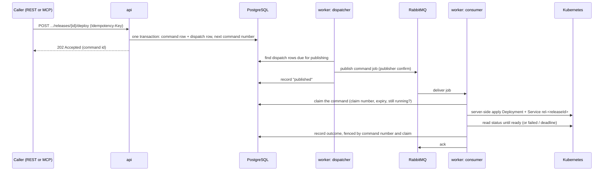

# How deployment works in the prototype

This document applies decisions `0005` (dispatch and leases), `0008` (inbox and builds), `0013` (no Crossplane) and `0014` (prototype). It records the flow; it does not change it.

**No Helm and no Crossplane per site.** Provisioning's own Python release worker renders each site's Kubernetes objects and applies them with server-side apply. Helm is used only to install cluster software, such as Cilium on Kind. A Helm chart may later deploy the Provisioning service itself, but never the generated websites.

## The processes

| Process | Job | Talks to |
| --- | --- | --- |
| `api` | REST and MCP. It checks the request and **writes the command to PostgreSQL**. It never publishes to RabbitMQ and never touches Kubernetes | PostgreSQL |
| `worker` | **Dispatcher:** publishes new command rows to RabbitMQ. **Consumer:** receives command jobs, claims each in PostgreSQL, and runs deploy, promote, rollback, suspend or resume on Kubernetes | PostgreSQL, RabbitMQ, Kubernetes (worker identity) |
| `build_worker` | Consumes Project's "source published" events, starts Jenkins builds, and polls them | PostgreSQL, RabbitMQ, Jenkins |
| `bootstrap` | Creates each site's namespace and the worker's access to it | PostgreSQL (read-only), Kubernetes (bootstrap identity) |
| Jenkins | Builds the image from the exact commit and pushes it to the registry | Git, registry |

## A command, step by step (deploy, promote, rollback)

1. **The API writes, then answers.** The API stores the command and its dispatch row in one transaction, then replies `202` with the command ID. The command row carries the command number (the fence), the idempotency key and the request fingerprint. Nothing else happens in the API.
2. **The dispatcher publishes.** The dispatcher runs inside the worker process. It reads dispatch rows that are due, publishes each as a command job to RabbitMQ, and waits for the broker's confirm before marking the row published. If the publish or the confirm fails, the row stays due and is published again later.
3. **The consumer claims and acts.** The consumer receives the job and claims it in PostgreSQL: a claim number and a claim expiry. Only one worker can hold a command at a time. While it works, it renews the claim. Then it applies the Kubernetes objects and reads their status.
4. **Every write is fenced.** Before each database write, the worker checks that the command is still running, that its claim is still valid, and that the command number is still current. A stale or crashed worker's write is refused.
5. **Acknowledge last.** The worker acks the RabbitMQ message only after the outcome is committed.

**PostgreSQL is the source of truth; RabbitMQ only wakes the worker up.** A lost message, a duplicate or a redelivery is harmless:
- the dispatcher republishes from SQL;
- a duplicate finds the command already claimed or finished;
- a worker that dies mid-command loses its claim when it expires, and another worker resumes from SQL.

## The release lifecycle with Jenkins

1. **A release is created.** Project's "source published" event arrives on RabbitMQ, simulated in the prototype. The `build_worker` stores it in the inbox and creates the release (`accepted`).
2. **The build starts.** This happens by itself, or through `POST .../releases/{id}/build` (MCP `build_release`), which starts or retries it. The release goes to `building`, and Provisioning triggers the Jenkins job with project, release, attempt, repository and exact commit SHA. The Jenkins build URL is stored in the build step's `log_ref`.
3. **Jenkins builds.** It checks out exactly that commit, builds the image with BuildKit, pushes it to the registry, and archives `result.json` (project, release, attempt, commit, image digest).
4. **Provisioning polls Jenkins.** It accepts the result only when project, release, attempt and commit match, and stores the digest. The release goes to `built`.
5. **Deploy command.** The worker deploys the candidate `rel-<releaseId>` next to the live site, which keeps serving, and waits until it is ready (`candidate_ready`). A candidate that never becomes ready fails, and the live site is untouched.
6. **Promote command.** It proves the candidate first, then moves the site (decision 0014 section 17).
   - **Preview.** The worker points the per-project HTTPRoute `preview-<projectId>` (hostname
     `<subdomain>-preview.sites.webblock.test`, decision 0023 G18b) at the candidate, confirms it at the command's
     number, and probes `GET /readyz` through the Gateway on that hostname. This happens after the intent is recorded
     (the release is `promoting`) and before the site's route moves. The preview route matches only requests that carry
     `X-Webblock-Preview` with the project's own probe token, an HMAC of the worker's secret and the project ID
     (decision 0023 G18c); anyone else gets 404 there. The route removes that header before the request reaches the
     site, and the probe of the site's own hostname never sends it.
   - **Up to 3 tries.** One try is the preview, then the switch. A try that fails puts the route back on the live
     release, or on the offline page on a first publish, and the next try starts at least 30 s later, then 60 s
     (decision `0027`). The release stays `promoting` between tries. A candidate that fails its preview never receives
     the site's traffic.
   - **Switch.** Otherwise the worker points HTTPRoute `route-<projectId>` at the candidate, confirms it, and probes the site's own hostname (`<subdomain>.sites.webblock.test` in the prototype, decision 0023 G18) until the candidate answers. Every probe goes to the Gateway's HTTPS listener with the hostname as TLS server name, verified against the stack's CA.
   - **Which release answered.** Every rule of both routes sets the response header `X-Webblock-Release` to its backend's release ID, or `offline`, with a `ResponseHeaderModifier` filter. The Gateway overwrites any value a site sends. A probe counts only a `200` whose header names the release it expects, so the old backend, which the Gateway may still use for a moment after a route is accepted, never counts.
   - On success, the release is `live` and the old one is `superseded`.
   - **When try 3 fails, the route is pointed back** at the old release, and the candidate is `rolled_back` with try 3's
     code. On a first publish there is nothing to point back to: the route shows the offline page and the release is
     `failed`.
   - A claim resumed after a crash is the next try: it puts the route back first, then runs the preview again.
7. **Suspend and resume.** A simulated Payment event creates a `suspend_hosting` command, which points the route at the offline page; `resume_hosting` points it back at the live release. These two come only from Payment events, never from REST or MCP.

## Where each guarantee lives

| Guarantee | Mechanism |
| --- | --- |
| A retried request does not run twice | Idempotency key plus request fingerprint on the command row |
| One command at a time per project | Unique index on in-flight commands; a second one is refused as busy |
| A stale worker cannot overwrite a newer one | Command number checked in SQL and stamped on every Kubernetes object |
| No lost command | The dispatch row in SQL; the dispatcher republishes until confirmed |
| A worker crash | The claim expires and another worker resumes |
| A Provisioning crash during a Jenkins build | `log_ref` holds the build URL; after a restart, polling resumes, or the build is found again by its parameters |
| A bad candidate does not replace the live site | Deploy: the candidate runs beside it and must become ready. Promote: the candidate must answer on its own preview route, with its release header, before the site's route moves; a failure there never touches the site |
| The preview is not public | The preview route matches only the project's own probe token header (HMAC of the worker's secret and the project ID), and removes it before the site; a site never sees the worker's secret or another project's token (decision 0023 G18c) |
| One hostname per site | Every site is served only on `<projectId>.sites.webblock.test`, derived from the project ID; a route naming any other hostname under the site domain is refused (decision 0014 section 23: no custom domains) |
| A promotion confirms the release it promoted | Every probe requires `X-Webblock-Release` to name the expected release; the Gateway sets that header, generated code cannot |
| What is not guaranteed | A candidate that passes its preview and then fails on the site's hostname serves visitors until the switch deadline ends and the route is restored (`site_not_answering`). Between the route being accepted and the Gateway's data plane switching, some requests may still reach the old release |
