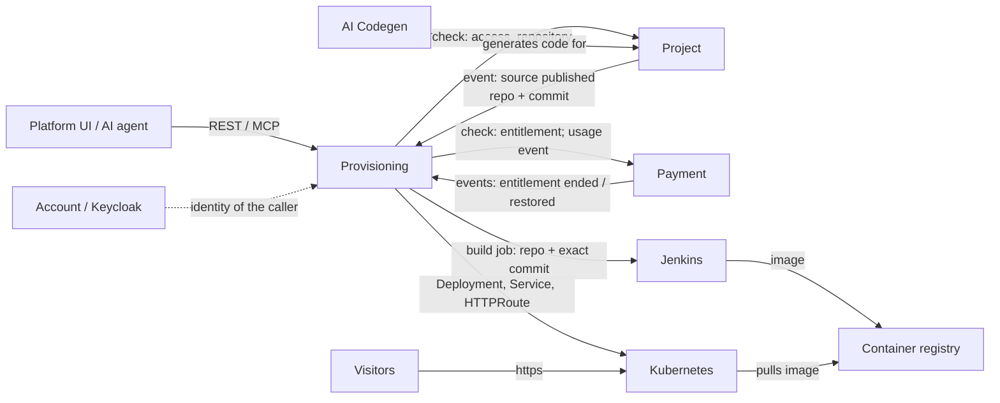

# The Provisioning service: what it does and where it fits

This is a readable summary. The authoritative sources are the spec in `.claude/docs/requirements/` (BRD and FRD) and
decisions `0013` and `0014`. The step-by-step deployment flow is in
`.claude/docs/architecture/prototype-deployment-flow.md`.

## In one paragraph

WebBlock lets a customer design a website and has AI generate its code. **Provisioning turns that generated code into a running website and keeps it running.** It starts from an exact Git commit that Project has published. It builds that commit into a container image (on Jenkins), runs the image as a private candidate beside the live site, switches public traffic to it when it is healthy, and switches back if the switch fails. It also takes a site offline when the customer's plan ends, and back online when it is restored. It does not write code, create repositories, handle payments or manage users.

## Where it sits among the services

| Service | Owns | What Provisioning gets from it or gives it |
| --- | --- | --- |
| **Project** | Projects, pages, generation requests, the GitHub repository, committing generated code, domains and DNS | Receives the **"source published"** event (project, generation request, repository, commit SHA). Asks Project whether a caller may act on a project and which repository belongs to it |
| **Payment** | Trials, plans, subscriptions, hosting entitlement | Receives **"entitlement ended / restored"**, which become `suspend_hosting` / `resume_hosting` commands. Checks entitlement before deploy and promote. Later sends a "publish completed" usage event |
| **Account / Keycloak** | Users and login | Validates the caller's token on every REST and MCP request |
| **AI Codegen** | Generating and checking source code | **No link.** It works for Project |
| **Jenkins** (build system) | Building and pushing images | Provisioning triggers a job for one exact commit and polls it for the result and image digest |
| **Kubernetes** | Running containers, routing traffic | Provisioning's worker applies each site's Deployment, Service and HTTPRoute, and reads their status |
| **Shared catalog** (PostgreSQL) | Site content: products, categories, profiles | Later (`access_setup`): a database login per website that sees only its own rows. Not in the prototype |

**Boundaries Provisioning never crosses:**
- It never reads another service's database.
- It never commits to or resets a Git repository.
- It holds no DNS or registrar credentials.
- It never counts trials or payments itself: Payment decides.

## What it does, as a lifecycle

1. **Accept a release.** Project reports a published commit. Provisioning confirms the repository with Project and records a **release** (`accepted`). A duplicate event creates nothing new.
2. **Build.** The build starts automatically, or through `POST .../releases/{id}/build` (start or retry). Jenkins builds exactly that commit and pushes the image. Provisioning checks that the result is for the right project, release and commit, then records the image digest (`built`).
3. **Deploy a candidate.** The `deploy` command runs the new image as `rel-<releaseId>` next to the live site, and waits until it is ready (`candidate_ready`). Visitors still see the old site.
4. **Promote.** The `promote` command points the site's route at the candidate and checks that it answers (`live`; the old release becomes `superseded`). If it fails, the route goes back to the old release (`rolled_back`), and visitors keep the working site.
5. **Recover.** If a route switch ends in an unknown state, new work stops (`uncertain`) until an operator runs `rollback`.
6. **Suspend or resume hosting.** A Payment event takes the site offline (the route shows an offline page) or brings it back. Code, image and content are kept.

## Inside the service

| Process | Role | Has |
| --- | --- | --- |
| `api` | REST and MCP for the UI and AI agents: start builds, deploy, promote, rollback, read status. Checks the caller, **writes a command row**, answers at once | Database only. No cluster access |
| `worker` | Publishes commands from the database to RabbitMQ, then receives and executes them on Kubernetes | Database, RabbitMQ, the worker's cluster identity |
| `build_worker` | Takes in Project's events, starts and polls Jenkins builds | Database, RabbitMQ, Jenkins. No cluster access |
| `bootstrap` | Creates each site's namespace and gives the worker access to it | A separate, more powerful cluster identity, used only for this |

**PostgreSQL is the source of truth.** RabbitMQ only wakes the worker up, so a lost or repeated message never loses or doubles work.

**Every command is numbered.** The numbers keep one change at a time per site, and they stop a slow or crashed worker from overwriting a newer change.

**Database tables:**
- `releases`: one per commit;
- `project_hosting`: one per site, holding what is live and whether it is online;
- `release_steps`: build and deploy attempts;
- `commands`: deploy, promote, rollback, suspend and resume;
- two operational tables: `command_dispatch` (delivery and the worker claim) and `source_published_events` (the event inbox).

## For AI agents (MCP)

Agents get the same operations as the UI, through the same use cases, under the same checks:
- build, deploy, promote and rollback;
- read a release, a command, a site's deployment or a release's diagnostics.

An agent cannot skip a step, for example promoting a release that was never deployed. It cannot suspend or resume hosting, because only Payment events do that.

## Prototype status (decision `0014`)

**What runs locally:** a Kind cluster, a local Jenkins and the local registry.

**What is simulated:** Project and Payment, through events published to RabbitMQ by a developer tool; and authentication, through development tokens.

**Not in the prototype:**
- custom domains and certificates;
- the catalog database access;
- usage events to Payment;
- production hardening.

Section 5 of `0014` lists everything that is paused.
