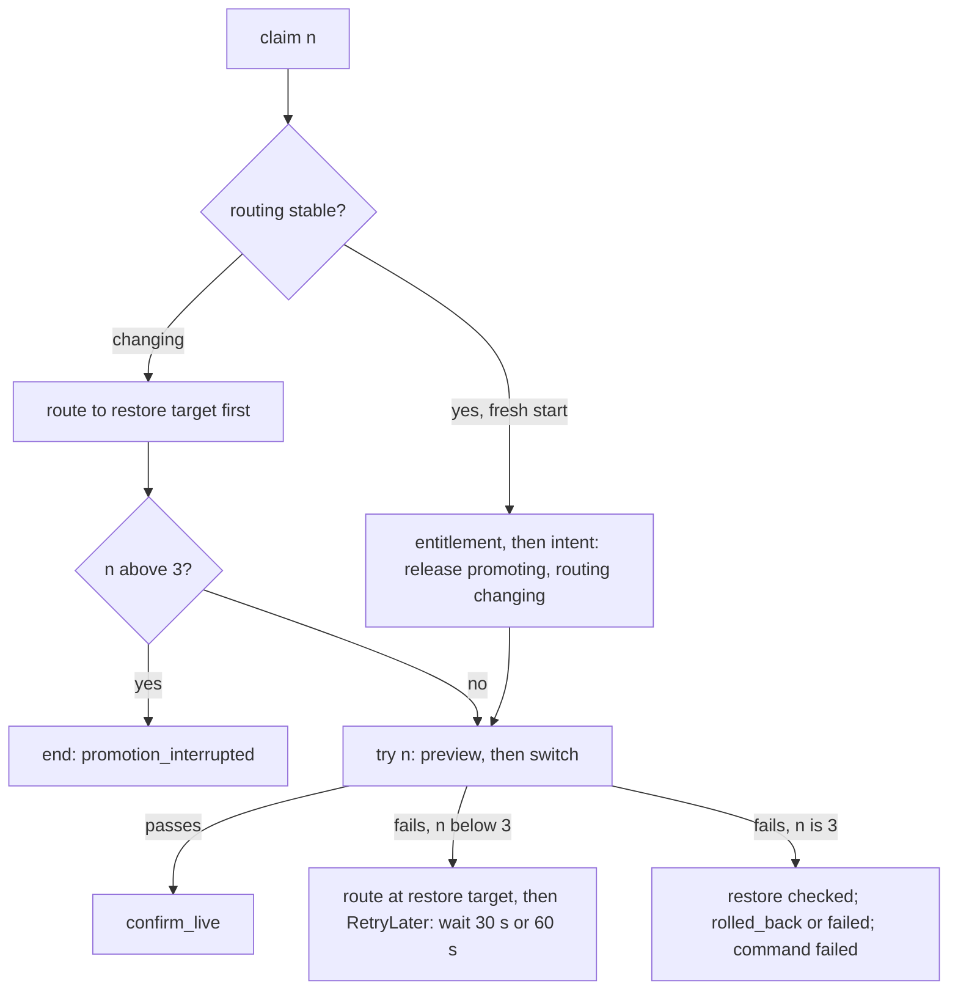

# Design: going live takes up to 3 tries

Stage 2 design. Base commit `cc190ad`, branch `go-live-tries`. Approved at gate 2. The rules it sets
are proposed in decision record `0027` (`.claude/docs/decisions/0027-go-live-tries.md`).

## 1. Context

- The FRD asks that one `promote` command tries the go-live up to 3 times (FR-19, FR-21, FR-22). Between tries
  visitors keep the page they had: the live release, or the offline page on a first deployment. Try 2 starts at
  least 30 s after try 1 failed, try 3 at least 60 s after try 2. Only try 3 ends the release `rolled_back` or
  `failed`, with try 3's failure code.
- Today `Routing.promote` (`core/application/routing/background/routing.py`) restores the route after the first
  failed switch and ends the command (`_restore`). On a fresh start the preview runs before the intent, and a
  failing preview raises `PermanentFailure`, so the command ends with the release `candidate_ready` (FRD "Drift
  seen"; decision `0014` section 17 item 1).
- The parts that already exist and are reused:
  - `JobStore.claim` (`infrastructure/postgres/job_store.py`) adds 1 to `execution_attempts` and `claim_number` on
    each claim and refuses a claim while `retry_after` is in the future (`ClaimOutcome.BACKOFF`).
  - `JobStore.release_claim` clears the claim and sets `retry_after`, `next_publish_at` and `last_failure_code` in
    one short transaction. The consumer calls it for a transient executor error
    (`presentation/messaging/consumers/consumer.py`, `CommandConsumer._execute`).
  - The dispatcher (`core/application/jobs/background/dispatcher.py`) publishes the job again when
    `next_publish_at` is due, so a lost message is rebuilt from SQL.
  - `RoutePointer.point`, `_preview`, `_switch` and `_restore` in `routing.py`; `RouteAbandoner` in
    `routing/background/recovery.py` for a command past its deadline or attempt budget.
  - `DeployRetryLater(code)` (`deploys/background/deploy.py:98`), which the consumer turns into a claim release with
    the generic backoff (`consumer.py:158-170`). G11 makes it the one generic `RetryLater`.
  - The domain outcomes `start_route_change`, `confirm_live`, `restore_verified`, `route_removed_verified` and
    `route_uncertain` (`core/domain/rules/outcome.py`) already allow every move this design needs.
- Notion "5 · Provisioning" (read-only) confirms `command_dispatch` has `execution_attempts` ("successful claims so
  far"), `retry_after` ("earliest next claim after a temporary failure"), `last_failure_code`, `claim_number`,
  `claim_expires_at`, `next_publish_at` and `deadline_at`, and that a release moves `candidate_ready` to `promoting`,
  then `live`, `rolled_back` (live release exists) or `failed` (none). Nothing here needs a schema change.
- `hosting/background/retry.py` retries a failed suspend or resume as a new command. FR-21 keeps one command, so
  that pattern is not reused; only its rule "the budget is a value in code" is (`HOSTING_RETRY_BUDGET`).

## 2. IDs covered

- FRs: FR-19 (FR-19.1 to FR-19.3), FR-21 (FR-21.1 to FR-21.6), FR-22 (FR-22.1, FR-22.2), FR-37 (row FR-37.3).
- FR-48: the try logic is keyed on the `promote` kind and the claim, not on who stored the command, so an automatic
  promote gets it with no change. Storing that command (FR-48, TR-51, TRD Q-5) is not built here.
- TRs added: TR-57 (the tries), TR-58 (the timing checks). TR-57 states the one exception to TR-37 (G3). TRs this
  design relies on, unchanged: TR-4, TR-5, TR-6, TR-15, TR-37, TR-38, TR-49, TR-55.
- FRs in scope not covered: none.

## 3. How one claim runs

## 4. Decisions

Each decision is labelled `owner` (fixed by the owner) or `lead` (the lead's call under the owner's delegation).

### G1. A try is a claim (owner)

Try n of a promote is `Claim.execution_attempt`, the value of `command_dispatch.execution_attempts` after the claim
(FR-21.5). The wait before the next try is `command_dispatch.retry_after`. Test: a second claim of one promote
command runs try 2, whatever ended the first.

### G2. No database change (owner)

No migration, column, index, enum value, constraint or grant. The worker role already updates `command_dispatch`
(`release_claim`). Test: `make py-test-integration` with the unchanged schema; no file under `src/migrations/`.

### G3. The numbers are code constants in a domain rule (lead)

New module `core/domain/rules/go_live.py`, exported from `core.domain`:

- `GO_LIVE_TRIES: Final = 3`;
- `wait_after_failed_try(try_number: int) -> timedelta | None`: 30 s after try 1, 60 s after try 2, None after try 3
  (the last), `ValueError` below 1;
- the try codes: `CODE_ROUTE_REFUSED`, `CODE_ROUTE_NOT_ACCEPTED`, `CODE_CANDIDATE_NOT_ANSWERING` and
  `CODE_SITE_NOT_ANSWERING` move here from `routing.py` (lines 93 to 99), and `GO_LIVE_TRY_CODES: Final` is built
  from them and the domain's `CODE_DEPENDENCY_UNAVAILABLE` (`values/deploy_failures.py`). `routing.py` imports them
  from `core.domain`; no copy of the strings stays in the application.

They are code constants, not settings: FR-21 fixes the numbers, so a setting could only drift from the spec, and a
change stays a reviewed change, like `HOSTING_RETRY_BUDGET`. TR-57 states this exception to TR-37 ("retry budgets
are required settings"). Test: unit tests of the function and the set (TR-57).

### G4. The intent is written before the preview (lead)

`Routing.promote` on a fresh start (routing `stable`, release `candidate_ready`): recheck entitlement (as today;
`LimitReached` is `PermanentFailure(entitlement_lost)`, nothing touched), then `start_route_change` (release
`promoting`, routing `changing`), then the try. So every failed try leaves the release `promoting`, the only state
from which try 3 may end it `rolled_back` or `failed` (Notion). The cluster route still never moves before the
preview passes. Test: on a fresh start the store records the intent before `apply_preview` is called.

### G5. One try is the preview, then the switch (lead)

Every try runs `_preview` then `_switch`, as the code does today. A later claim (routing `changing`) skips the
entitlement and the intent. A try fails with one code:

| Step | Failure | Code |
| --- | --- | --- |
| Preview route | refused by the cluster | `route_refused` |
| Preview route | not confirmed within `ROUTE_SWITCH_DEADLINE` (today a transient `Timeout`) | `route_not_accepted` |
| Preview probe | the candidate never answers with its header | `candidate_not_answering` |
| Preview probe | the candidate answers 503 naming itself | `dependency_unavailable` |
| Switch | refused by the cluster | `route_refused` |
| Switch | not accepted within `ROUTE_SWITCH_DEADLINE` | `route_not_accepted` (FR-19.2) |
| Switch probe | the site does not answer with the candidate's header | `site_not_answering` (FR-19.3) |

All are in the failure code catalogue (`core/domain/values/failure_codes.py`) for both release and command. The
resumed-claim check "route at this command's number on the restore target means a restore was under way, so finish
it" goes; G9 replaces it. Test: one unit test per row.

### G6. The route goes to the restore target, and a failed try 1 or 2 waits (lead)

New private method `Routing._to_restore_target(fence, inp)`, bounded in all by one `ROUTE_RESTORE_DEADLINE`. It
returns whether the route is confirmed at the restore target:

1. The restore target is `restore_target_of(live_release_id)`: the live release, or `OFFLINE` without one.
2. Read `route_status`. When it is accepted at the restore target, write nothing to the cluster: this is how a
   fresh-start preview failure leaves the route untouched on L (FR-21.6). When it is anywhere else, absent (first
   deployment, FR-22.2) or cannot be read, point the route at the target with this command's number and confirm it
   (`RoutePointer.point`).
3. Not confirmed: the caller records `route_uncertain` with `route_restore_unconfirmed`, as `_restore` does
   (FR-23.1), and the command ends; no `RetryLater` is raised.

After a failed try 1 or 2 (`_between_tries`, which runs only for those tries, so the wait is never None): call
`_to_restore_target`; confirmed, raise `RetryLater(code, wait_after_failed_try(try_number))`. No SQL write happens
in the executor between tries. Test: FR-21.2, FR-21.4, FR-21.6, FR-22.2 rows, and the unconfirmed case.

### G7. What stays as it is between tries (owner, lead)

The release stays `promoting` and `live_release_id` unchanged (owner). The command stays `running` and routing stays
`changing` (lead): Notion and decision `0001` section 3 item 2 allow a `promoting` release only with routing
`changing` or `uncertain`, and `changing` is true (a command is still moving the route; UI "Updating"). The dispatch
row: no claim, `retry_after` and `next_publish_at` = database now plus the wait, `last_failure_code` = the try's
code. Test: integration rows after `release_claim` (FR-21.2).

### G8. Try 3 ends the command (owner)

A failed try 3 calls the existing `_restore`: point the route at the restore target with this command's number,
confirm it, then `restore_verified` (release `rolled_back`, FR-21.1) or `route_removed_verified` (release `failed`,
FR-22.1), both with try 3's code; command `failed`, routing `stable`, no `usage_outbox` row. Then the existing
workload cleanup. Unconfirmed is `route_uncertain` (FR-23.1). Test: FR-21.1, FR-22.1.

### G9. A claim on a changing route restores first; an interrupted try counts (lead)

- **Restore first.** Any claim of this promote that finds routing `changing` runs `_to_restore_target` before
  anything else. So a route that an interrupted switch left on an unproven candidate goes back to the live release
  or the offline page at once, and FR-21's "never left on a release that did not answer" holds after a crash too.
  After a normal failed try the route is already there, so this is one read. Not confirmed: `route_uncertain`, the
  command ends.
- **An interrupted try counts and has no wait.** A try ended by a worker stop (`_stop` releases with
  `worker_stopping`), a crash (the claim lapses after `WORKER_LEASE_TTL`), a lost claim, a database error or
  `WORKER_ATTEMPT_TIMEOUT` (both released with the generic `WORKER_RETRY_BACKOFF`) records no try code and no try
  wait. The next claim is the next try and starts as soon as the claim is free (FR-21.5).
- **Claim 4.** A claim with `execution_attempt` above `GO_LIVE_TRIES` (try 3 was interrupted) runs no try. With
  routing `changing` it ends through `_restore` with `promotion_interrupted` (the restore-first step has already put
  the route there). With routing `stable` (no intent was ever written) it raises
  `PermanentFailure(attempts_exhausted)`; the release stays `candidate_ready`.

Test: FR-21.5 rows; a claim of try 2 that finds the route on R points it back before its preview; claim 4 with
routing `stable`.

### G10. Every remote failure inside a try is a failed try (lead)

After the intent, no cluster error in a try reaches the consumer: the pointer turns cluster errors into "not
confirmed" within its deadline, and the preview `Timeout` becomes `route_not_accepted` (G5). Before the intent, an
entitlement recheck that Payment cannot answer (`DependencyUnavailable` today) is a failed try with code
`transient_failure`: on try 1 or 2 it raises `RetryLater` with the try's wait; on try 3 `PermanentFailure`
(`attempts_exhausted`). The command ends `failed` and the release stays `candidate_ready`: nothing was touched, and
Notion allows a failed promote to leave its release `candidate_ready`. `ClaimLost` and `StaleFence` still propagate
and write nothing more. Test: Payment unreachable on try 1 (wait 30 s) and on try 3 (`attempts_exhausted`).

### G11. One generic `RetryLater` (lead)

`DeployRetryLater` (`deploys/background/deploy.py:98`) becomes the one executor result `RetryLater(code: str,
after: timedelta | None = None)` in `core/application/jobs/claims.py`, beside `PermanentFailure`, exported from
`core/application/__init__.py`. It means "release the claim with `code`; the next claim no sooner than `after`, or
after the generic `WORKER_RETRY_BACKOFF` when `after` is None". No second class stays.

- The constructor refuses an `after` that is zero or negative (`ValueError`); `release_claim` refuses one too
  (`job_store.py:391`).
- `deploy.py` and `redeploy.py` raise `RetryLater(code)` where they raise `DeployRetryLater(code)` today; the deploy
  behaviour does not change.
- `CommandConsumer._execute` has one branch for it: `release_claim(claim, after or the backoff delay, code)`. A code
  that fails `validate_code` becomes `transient_failure`, as `_transient_code` does today (`consumer.py:158-170`).
  The metric result is `try_failed` when `after` is set, else `transient_failure` as today.
- The consumer knows nothing of promote; the executor owns the rule (TR-55). `RoutingExecutor` passes it through.

Rejected option: the executor calls `release_claim` itself, which would give the routing use case a second store
port and split the end of a claim between two places. Test: consumer unit tests (both forms, a bad code, a
non-positive wait).

### G12. The command deadline and the claim limit (lead; TR-58)

Settings and their values today (prototype `scripts/prototype/run-provisioning.sh` and `.env.example`; production
values are set outside this repository, OD-15):

| Setting | Value | Role |
| --- | --- | --- |
| `ROUTE_SWITCH_DEADLINE` (S) | 20 s | preview, and again the switch |
| `ROUTE_RESTORE_DEADLINE` (R) | 60 s | a restore; the restore-first step; the between-tries step |
| `WORKER_ATTEMPT_TIMEOUT` | 10 m | one claim's limit |
| `WORKER_LEASE_TTL` (L) | 15 s | a crashed worker's claim lapses after it |
| `WORKER_RETRY_BACKOFF_MAX` (B) | 10 s | the longest generic backoff after a database error |
| `WORKER_MAX_ATTEMPTS` | 20 | the generic claim budget |
| `COMMAND_DEADLINE` | 15 m | `deadline_at` = acceptance plus it |

- **One claim:** restore first, preview, switch, restore = 2 x S + 2 x R = 160 s. The per-claim check in
  `infrastructure/config/worker.py` `_check_timing` becomes `WORKER_ATTEMPT_TIMEOUT` above 2 x
  `ROUTE_SWITCH_DEADLINE` plus 2 x `ROUTE_RESTORE_DEADLINE` (today the larger of 2S + R and 2R). It also covers the
  operator rollback's apply and reclaim (2R).
- **The command:** new check in `_check_timing`: `COMMAND_DEADLINE` above
  3 x (2 x S + R) + 90 s + 3 x (max(L, B) + R), else the worker refuses to start naming the keys. Today:
  300 s + 90 s + 3 x (15 s + 60 s) = 615 s, inside 15 m. Reason: 3 tries of up to 2S + R each, the two waits
  (90 s), and an interruption that can happen on each of the 3 tries. An interruption costs max(L, B) + R: the
  claim lapses (L) or is released after a database error (B), then the next claim restores first (R), or claim 4
  restores after try 3. This bounds every sequence for any values, not only today's. Dispatch latency comes on
  top and is small (`DISPATCH_POLL_INTERVAL`).
- **The budget:** new check: `WORKER_MAX_ATTEMPTS` above `GO_LIVE_TRIES`, so claim 4 reaches the executor (G9) and
  the generic budget never cuts try 3.
- **Two copies of the deadline.** The API writes `deadline_at` from its own `COMMAND_DEADLINE`
  (`config/api.py:261`); the worker checks its own (`config/worker.py:246`). Both are 15 m today. One process cannot
  check the other's value, so this is not part of TR-58: the runbook
  `.claude/docs/runbooks/production-profile.md` states that the API's and the worker's `COMMAND_DEADLINE` must be
  equal.
- **A deadline that passes anyway.** The consumer's `_abandon_then_fail` runs `RouteAbandoner`, which restores.
  - Restore confirmed: when the dispatch row's `last_failure_code` is in `GO_LIVE_TRY_CODES`, the release and the
    command end with that code, so the client sees why the go-live failed; otherwise with the consumer's code
    (`deadline_exceeded` or `attempts_exhausted`) as today.
  - Restore not confirmed: `route_uncertain` with the consumer's code, as today; the release stays `promoting` and
    gets no code until the operator rollback.
  - The row keeps only the last code written. A stop or a database error after a failed try overwrites it with
    `worker_stopping` or `transient_failure`; then the abandoner writes the consumer's code. So the release gets
    the last try code only when it is still in the row, else today's code.
  - `Abandoner.abandon` returns the failure code it wrote, or None when it wrote no outcome; the routing and
    hosting executors pass on the result of `RouteAbandoner`, the deploy executor returns None. The consumer's
    "abandon hook ran" line names the code returned, so the log shows the code actually written.
  - `Claim` gains `last_failure_code: str | None = None` as its last field, so the 8 test files that build a
    `Claim` need no change. `JobStore.claim` fills it from the dispatch row it already locks (`DispatchRow` in
    `infrastructure/postgres/fenced.py` gains the field; the SELECT already reads every column), and
    `extend_claim` copies it, so the heartbeat keeps it.
  - Notion types `releases.failure_code` as VARCHAR(100), set exactly when `failed` or `rolled_back`, with no value
    list; the five codes are release codes in the catalogue already.

Test: `tests/unit/infrastructure/config/test_worker_timing.py` (TR-58); `RouteAbandoner` with and without a try
code (TR-57).

### G13. What the reads return (lead; FR-37.3)

No read changes. `GetReleaseQuery` (`core/application/operations/queries/get_release.py`) returns, between tries,
`status` `promoting` with no `failureCode` or `failureSummary` (Notion sets them only for `failed` and
`rolled_back`) and only the build and candidate steps (promotion writes no step rows). After try 3 it returns
`rolled_back` or `failed` with try 3's `failureCode`. The try codes in `last_failure_code` are never returned to a
client. The admin command list shows the promote `running` until it ends. Test: FR-37.3.

### G14. Reconcile, rollback, abandon and new commands while a try waits (lead)

- Reconcile (`core/application/reconcile/background/reconcile.py`) skips a project whose routing is not `stable` or
  that has an unfinished command, so it never touches the route or the candidate between tries.
- Admin rollback (FR-50) needs routing `uncertain`; while a try waits it is `changing`, so the acceptance refuses it
  (`check_command_preconditions`). Only a restore that is not confirmed (G6, G8, G9) leaves `uncertain`; that ends
  the promote, and the rollback then ends the `promoting` release `rolled_back` with `operator_rollback` (FR-50.4).
- Any new command for the project is refused while the promote is in flight (one command in flight, FR-14.3).
  Payment and Project events that become hosting commands are held and retried by their consumer
  (`PAYMENT_MAX_RETRIES` 100, backoff up to 10 s, about 16 minutes), which outlasts the go-live (G12).
- `RouteAbandoner` stays the end of a promote past its deadline or the generic attempt budget (G12).

Test: unit test that the reconciler skips a project with a waiting promote; existing FR-50 tests stay green.

### G15. Telemetry (lead)

- One info log line per failed try from `Routing.promote`: `command_id`, `project_id`, `release_id`, `try`, `of`,
  `failure_code`, `next_try_after_seconds`. The consumer's log line for `RetryLater` names `retry_after`.
- The histogram `provisioning_command_execution_seconds{kind="promote"}` gets result `try_failed`
  (`infrastructure/telemetry/metrics.py` `EXECUTION_RESULTS`; `_result_of` in the consumer).
- The command's end is counted as today by `provisioning_commands_finished`.
- No token, preview token (`PREVIEW_PROBE_TOKEN`), credential or site content is logged: errors are logged by type
  and code only, as in the rest of `routing.py`.

Test: consumer unit test of the metric word; a log test that the line holds no preview token.

### G16. FR-48 reuses it as is (lead)

Nothing in G1 to G15 reads `requested_by_subject` or the caller. When FR-48 stores an automatic `promote`, the same
executor runs it with 3 tries. Test: none here; FR-48.2 to FR-48.4 reuse the FR-21 and FR-22 tests later.

## 5. Constitution check

| Article | Result | Why |
| --- | --- | --- |
| I Spec-driven flow | pass | Covers approved FR-19, FR-21, FR-22, FR-37.3; adds TR-57, TR-58; record 0027 first |
| II Tech stack | pass | No library, image, tool or store added |
| III Architecture limits | pass | No DB change; tries and waits in SQL; no transaction across a remote call |
| IV Coding conventions | pass | Rule in domain, use case in `routing/background`, one `RetryLater`, thin consumer |
| V Testing and quality | pass | Tests per acceptance row first (section 7); two start checks added, none lowered |
| VI Safety guardrails | pass | Kind only for live tests; no secret read or logged |
| VII Docs | pass | Current facts, plain English; prose lines within 120, table rows longer as in the FRD and TRD |
| VIII Agents | pass | Designer wrote design, TRD rows and record; no code; the lead commits |

## 6. What changes

Code:

- `core/domain/rules/go_live.py` (new) and its export in `core/domain/__init__.py` (G3).
- `core/application/jobs/claims.py`: `RetryLater` (G11); `Claim.last_failure_code` (G12). Both exported from
  `core/application/__init__.py`, the facade the consumer imports.
- `core/application/deploys/background/deploy.py` and `redeploy.py`: `DeployRetryLater` removed, `RetryLater`
  raised; the docstrings of `deploy_executor.py` and `redeploy_executor.py` name it (G11).
- `core/application/routing/background/routing.py`: `Routing.promote` (G4, G5, G8, G9, G10), new
  `_to_restore_target` and `_between_tries` (G6), `_preview` returns `route_not_accepted` instead of raising
  `Timeout`, module docstring; the four try code constants are imported from `core.domain` (G3).
- `core/application/routing/background/recovery.py`: `RouteAbandoner` keeps a try code for a promote and returns
  the code it wrote (G12). `routing_executor.py`, `hosting_executor.py` and `deploy_executor.py`: `abandon` returns
  `str | None`.
- `infrastructure/postgres/fenced.py` (`DispatchRow.last_failure_code`) and `infrastructure/postgres/job_store.py`
  (`claim` and `extend_claim` fill `Claim.last_failure_code`); no SQL statement changes (G12).
- `presentation/messaging/consumers/consumer.py`: `_execute`, `_transient_code` and `_result_of` (G11, G15); the
  `Abandoner` protocol returns `str | None`, and `_abandon_then_fail` logs the code written (G12).
- `infrastructure/telemetry/metrics.py`: `EXECUTION_RESULTS` gains `try_failed` (G15).
- `infrastructure/config/worker.py`: `_check_timing` changes the per-claim check and gains two checks (G12).
- `core/domain/values/failure_codes.py`: the meaning of `promotion_interrupted` becomes "The last go-live try was
  interrupted; the next claim restored the route and ended the promotion."

Unchanged: the schema and migrations, every SQL statement, `RouteCommandStore`, the domain outcomes,
`RoutingExecutor`, the reconciler, the API, `src/contracts/`, the chart and the setting values.

Tests that assert the old rule and change: in `tests/unit/core/application/routing/background/test_routing.py`,
`test_promote_proves_the_candidate_on_its_preview_before_recording_the_intent`,
`test_a_candidate_failing_its_preview_fails_the_command_and_leaves_the_route`,
`test_a_refused_preview_is_a_permanent_route_refused`,
`test_a_preview_never_confirmed_is_transient_and_writes_nothing`,
`test_a_resumed_claim_whose_preview_fails_restores_the_route`,
`test_a_claim_resumed_during_a_restore_finishes_the_restore`, and every test that expects a restore after one
failed switch. Also `test_routing_recovery.py`, `test_recovery.py`, the consumer and deploy tests that name
`DeployRetryLater`, `tests/integration/test_routing_store.py`, the tests that import the try code constants
from `routing.py` (`test_routing.py`, `tests/integration/kubernetes/test_routing_live.py`; they import from
`core.domain`),
`tests/unit/core/domain/values/test_failure_codes.py` (line 52: `_FAILURE_CALLS` gets `RetryLater` in place of
`DeployRetryLater`, and its docstring at lines 13 and 14 changes to match, so the guard still checks the codes of
every retry against the catalogue),
`tests/unit/core/domain/rules/test_rollback_uncertain.py` (check: they use these codes),
`tests/integration/kubernetes/test_routing_live.py`, `tests/e2e/test_scenarios_promote.py`,
`tests/e2e/test_flows.py` and `tests/e2e/faults/test_recovery_stuck_project.py`.

Docs:

- Decision `0027` (Accepted); "Amended by 0027" at the top of `0014` and `0005`; its row in
  `.claude/docs/decisions/README.md`.
- Runbooks: `failure-codes.md` (`promotion_interrupted`, try codes in `last_failure_code`), `observability.md`
  (`try_failed`, the log line), `production-profile.md` (the API and worker `COMMAND_DEADLINE` must be equal; the
  new start checks).
- `.claude/docs/architecture/prototype-deployment-flow.md` (line 63: a preview failure keeps `candidate_ready`),
  `.claude/docs/architecture/failure-modes.md` (line 100), `.claude/docs/architecture/acceptance-scenarios.md`
  (lines 31 and 32), `.claude/docs/guides/team-testing.md` (line 315): each states the one-try rule.
- The FRD's "Not built yet" notes on FR-21 and FR-22 and its Drift entry go after the build (spec-writer).
- Notion "5 · Provisioning", `commands`, "Not the same as": "a failed promote may leave its release
  `candidate_ready` (preview failed)" now holds only for `entitlement_lost` and G10's Payment case. Prose, not
  schema; the page is read-only for agents, so the owner decides whether to change the wording.

Other services: none. No endpoint, event, scope or table of another service changes. Payment still hears only of a
release confirmed live (FR-42).

## 7. Acceptance tests per FR row

Unit: `tests/unit/...` with fakes. Integration: `tests/integration/` on real PostgreSQL 18, driving `PgJobStore`
(`claim`, `release_claim`) and the routing store with a fake cluster. Kind: `tests/e2e/` or
`tests/integration/kubernetes/` on the local Kind stack only.

| Row | Unit | Integration (PostgreSQL) | Kind |
| --- | --- | --- | --- |
| FR-19.1 | try 1 passes: intent, preview, switch, `confirm_live` (kept) | `confirm_live` rows and one usage row (kept) | promote goes live (kept) |
| FR-19.2 | switch not accepted on try 1: route back on L, `RetryLater(route_not_accepted, 30 s)`; preview route not confirmed gives the same code | none | none |
| FR-19.3 | site not answering on try 1: route back on L, `RetryLater(site_not_answering, 30 s)` | none | none |
| FR-21.1 | claim 3 fails: `_restore`, R `rolled_back` with try 3's code, command `failed`, routing `stable`, no usage row | three claims through `claim` and `release_claim`, then the outcome: rows as the row says, `execution_attempts` 3, `finished_at` set | a candidate that never answers on its site host: after 3 tries R `rolled_back`, L still serves |
| FR-21.2 | try 1 fails: point to L, no SQL write after the intent, `RetryLater` after 30 s; try 1's restore not confirmed: `route_uncertain`, `route_restore_unconfirmed`, no `RetryLater` (FR-23.1) | `release_claim`: no claim, `retry_after` now plus 30 s, command `running`, R `promoting`, L still `live_release_id`; a claim before `retry_after` is `BACKOFF` and leaves `execution_attempts` | the gap between try 1 and try 2 is at least 30 s |
| FR-21.3 | claim 2 passes: one route read, no entitlement call, no second intent, `confirm_live` | claim 1, release, claim 2, `confirm_live`: R `live`, L `superseded`, one usage row, command `succeeded` | only if a demo site can fail its first answers (planner); else none |
| FR-21.4 | claim 2 fails: route back on L, `RetryLater` after 60 s | `retry_after` now plus 60 s after the second release | the gap between try 2 and try 3 is at least 60 s |
| FR-21.5 | a claim with `execution_attempt` 2 after a lapsed claim finds the route on R, points it back on L, then runs try 2; claim 4 with routing `changing` ends `promotion_interrupted`; claim 4 with routing `stable` ends `attempts_exhausted`, R `candidate_ready`; consumer: a stop releases with `worker_stopping` | claim A lapses, claim B has `execution_attempt` 2; A's writes refused (FR-25); `Claim.last_failure_code` read from the row | worker killed mid-try: the next claim is try 2 and the go-live ends |
| FR-21.6 | fresh start, preview fails: intent written, `apply_route` never called, `RetryLater(candidate_not_answering, 30 s)`; claim 3 fails as FR-21.1 | as FR-21.2 with R `promoting` after a preview failure | a candidate that never answers its preview: L serves throughout, R ends `rolled_back` |
| FR-22.1 | no live release, claim 3 fails: route `OFFLINE`, R `failed` with try 3's code, no usage row | three claims, then R `failed`, routing `stable` | first deployment that never answers: offline page, R `failed` |
| FR-22.2 | no live release, try 1 fails: route absent, so it is pointed `OFFLINE`; R `promoting`; `RetryLater` | rows as FR-21.2 with no live release | offline page between tries |
| FR-37.3 | `GetReleaseQuery` on `rolled_back` returns `failureCode`; on `promoting` none | GET after the FR-21.1 flow returns `rolled_back` and try 3's code | GET through the API after the Kind FR-21.1 run |

Technical tests (TR-57, TR-58): `go_live.py` waits, last try and code set; `RetryLater` refuses a zero or negative
wait; the consumer maps both `RetryLater` forms, a bad code to `transient_failure`, and `try_failed`; Payment
unreachable on try 1 (wait 30 s) and on try 3 (`attempts_exhausted`, R `candidate_ready`); `RouteAbandoner` keeps a
try code and otherwise writes `deadline_exceeded`; the three start checks with their key names; the reconciler skips
a waiting promote.

Time for live suites: every failing go-live scenario on Kind or in e2e now waits at least 90 s (30 s plus 60 s)
before it ends, as the waits are code constants. The plan raises the `pytest.mark.timeout` of the affected e2e
tests and counts the extra minutes in the Kind slot.

## 8. Cost if wrong, and accepted limits

- A go-live takes at most about 10 minutes before it ends (the 615 s bound of G12), against about 100 s today;
  TR-38 (95% live within 15 minutes) still holds.
- A broken candidate costs 3 previews and 90 s of waits instead of one; visitors keep their page the whole time.
- The rules sit in one domain module and one executor method, so a different number of tries or waits is a small
  reviewed change. No data is written that a rollback of this change would have to repair.
- Accepted limit: if try 3 proved the candidate but its `confirm_live` write failed (a database error), claim 4
  restores and ends `promotion_interrupted`, rolling back a release that worked. A new go-live needs a new commit.
- Accepted limit: a rolling restart of the worker during a go-live uses up a try.
- Pre-existing, out of scope: a worker whose claim just lapsed may still write the route while the next claim
  works, at the same command number; the cluster fence cannot tell two claims apart (`0005` section 4, "What
  fencing proves"). More claims per promote make it a little more likely.

## 9. Owner questions answered

Lead decisions (owner delegated), now stated as facts above:

- Q-1: an interrupted try counts as a try, and the next try has no wait (G9).
- Q-2: 3 tries and the 30 s and 60 s waits are code constants in `core/domain/rules/go_live.py`; TR-57 states the
  exception to TR-37 (G3).
- Q-3: Payment unreachable on all 3 tries ends the command `attempts_exhausted`, and the release stays
  `candidate_ready` (G10).
- I-2: any claim that finds routing `changing` for this promote restores the route first (G9).

No question is open.
