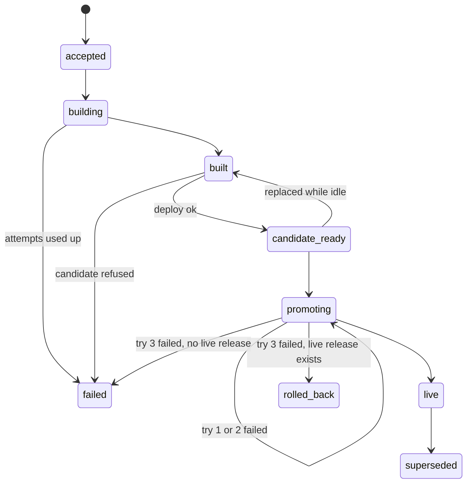

# Provisioning: Functional Requirements (FRD)

**Status:** Approved at gate 1 (answers O1 to O4 are in `GATE1`).

## In short

Project's "source published" event becomes a release, which builds, starts privately and goes live by itself.
Going live is tried 3 times. If all 3 tries fail, the previous version comes back by itself, or the offline page on a
first deployment; if that cannot be confirmed, the site is stuck until an admin rolls back. Sites go offline and
online through Payment, Project and admin requests, each reason on its own. The automatic flow (FR-47 to FR-49) and
private site images (FR-53) are planned for the next phase and not started; the code still takes deploy and go-live
from the owner (Drift seen).

**Read next:** [TRD.md](TRD.md), how it is built. Up: [PRD.md](PRD.md).

## Main flow

A release moves from `accepted` to `live` through build, private start and go-live (S1 `releases`).

## Sign-in and access (any request)

These rules apply to every REST and MCP request; other FRs do not repeat their errors.

| ID | Trigger | Input | What happens | Errors | PR | Source |
| --- | --- | --- | --- | --- | --- | --- |
| FR-1 | Any caller, REST or MCP | Bearer token | Checks signature (RS256), `iss`, own audience `provisioning`, `typ` Bearer, `exp`, `nbf` | `UNAUTHENTICATED`, `IDENTITY_UNAVAILABLE` | PR-6 | AUTH §5, S2 §2.4 |
| FR-2 | Any caller | Token without `user_id` | Refused before any store or Project call | `ACCESS_DENIED` | PR-6 | AUTH §3, S2 §2.4 |
| FR-3 | Owner, any project route | `projectId`, action | Asks Project `CheckAccess`; not the owner answers like an unknown project | `PROJECT_NOT_FOUND` | PR-6 | AUTH §2, S2 §2.3, 0023 G6 |
| FR-4 | Any caller, admin action | `roles` claim | Admin actions need `ADMIN` (top-level `roles`, exact case); no `CheckAccess` | `ACCESS_DENIED` | PR-10 | S2 §2.4, 0023 G10 |
| FR-5 | Owner | `projectId` | `CheckAccess` with 2 s deadline, retry only `UNAVAILABLE` twice; no answer means no | `PROJECT_ACCESS_UNAVAILABLE` | PR-6 | S2 §3.6, 0023 G14 |
| FR-6 | Any caller, production profile | A change | Every change refused until Project's and Payment's gRPC calls pass on Kind; reads allowed | `OPERATION_UNAVAILABLE` | PR-27 | 0016 §6, 0023 G13, LEAD |
| FR-7 | Any caller | Path, query, headers, body | Bad input answers a Problem with `errors[]`; never echoes the value | `VALIDATION_FAILED`, `REQUEST_TOO_LARGE`, `RESOURCE_NOT_FOUND` | PR-8 | S2 §2.2, 0023 G5 |
| FR-8 | Provisioning calls Project or Payment | user, request | Sends `x-user-id` (when a user), `x-request-id`, `traceparent`; never the token | none | PR-6 | S2 §3.5, AUTH §5 |

**Acceptance**

| ID | Given | When | Then |
| --- | --- | --- | --- |
| FR-1.1 | a valid token with audience `provisioning` | GET a release | 200 |
| FR-1.2 | `typ` `ID`, wrong `iss`, no `provisioning` audience, or expired | any request | 401 `UNAUTHENTICATED`; no store read |
| FR-1.3 | the key set cannot be fetched | any request | 503 `IDENTITY_UNAVAILABLE` |
| FR-2.1 | a valid token with a `user_id` UUID | GET a release | 200 |
| FR-2.2 | a valid token with no `user_id` | any route, `/mcp` included | 403 `ACCESS_DENIED`; Project never called |
| FR-3.1 | Project allows the user | GET a release | `CheckAccess` called with action `get_release`; 200 |
| FR-3.2 | Project denies, and another project is unknown | GET each | both 404 `PROJECT_NOT_FOUND`, same bytes except `requestId`, `traceId`, `instance` |
| FR-4.1 | `roles` holds `ADMIN` | admin suspend | 202; `CheckAccess` not called |
| FR-4.2 | `roles` holds `USER` or `admin` only | admin suspend | 403 `ACCESS_DENIED`; nothing stored |
| FR-5.1 | Project answers `UNAVAILABLE` once, then allowed | GET a release | 200; 2 calls |
| FR-5.2 | Project answers `UNAVAILABLE` 3 times | GET a release | 503 `PROJECT_ACCESS_UNAVAILABLE`; 3 calls |
| FR-6.1 | production profile | GET a release | 200 |
| FR-6.2 | production profile | admin suspend | 503 `OPERATION_UNAVAILABLE`; nothing stored |
| FR-7.1 | valid IDs, `limit` 20 | list releases | 200 |
| FR-7.2 | `projectId` not a UUID | GET a release | 400 `VALIDATION_FAILED`, `errors[0]` `{projectId, INVALID_FORMAT}`; value absent |
| FR-7.3 | a body over the limit | admin suspend | 413 `REQUEST_TOO_LARGE` |
| FR-7.4 | an unknown path | GET it | 404 `RESOURCE_NOT_FOUND` |
| FR-8.1 | a signed-in request | `CheckAccess` sent | metadata has `x-user-id`, `x-request-id`; no `authorization` |
| FR-8.2 | a call to Jenkins | build starts | none of `x-user-id`, `x-request-id`, `traceparent` sent |

## New releases and builds

A published commit becomes one release, and its build starts by itself.

| ID | Trigger | Input | What happens | Errors | PR | Source |
| --- | --- | --- | --- | --- | --- | --- |
| FR-9 | Project event `source_published.v1` | project, generation request, repository, commit | Inbox row `pending`; Project `GetRepository` confirms; release `accepted`, hosting row (with sub-domain) if first, build attempt 1 | `repository_mismatch`, `repository_not_registered`, `attempts_exhausted` | PR-15, PR-1 | S1 `source_published_events`, S2 §4.3 |
| FR-10 | Same event again | same key | Same source: ignored. Other repository or commit: counted, never accepted | none | PR-15 | S1 `source_published_events` |
| FR-11 | Build worker | build attempt | Jenkins builds the pinned commit; result kept only if project, release, commit match; digest stored; release `built` | `build_failed`, `build_result_mismatch`, `clone_failed`, `push_failed` | PR-1 | S1 `releases`, 0014 §3 |
| FR-12 | Failed attempt or late step | attempt | New attempt until `BUILD_MAX_ATTEMPTS` (1 to 10); then release `failed`. Late running step fails | `build_attempts_exhausted`, `deadline_exceeded` | PR-1 | S1 `release_steps` |
| FR-13 | Owner, REST or MCP (prototype) | `projectId`, `releaseId` | Asks the build worker to start the pending attempt now; writes nothing | `RELEASE_NOT_BUILDABLE`, `BUILD_IN_PROGRESS` | PR-7 | 0014 §3, 0016 §6 |

**Acceptance**

| ID | Given | When | Then |
| --- | --- | --- | --- |
| FR-9.1 | Project confirms the repository | the event arrives | inbox `accepted`; release `accepted`; build step 1 `pending`; hosting row with `subdomain` |
| FR-9.2 | the event names another repository | it arrives | inbox `rejected`, `repository_mismatch`; no release |
| FR-9.3 | Project does not know the repository | it arrives | inbox `rejected`, `repository_not_registered`; no release |
| FR-9.4 | Project unreachable for every attempt | attempts run out | inbox `failed`, `attempts_exhausted`; no release |
| FR-10.1 | an accepted event | the same event again | one release; acked |
| FR-10.2 | an accepted event | same key, other commit | `mismatched_repeat_count` 1; release unchanged |
| FR-11.1 | Jenkins reports success for the release's commit | poll | step `succeeded`; release `built` with `sha256:` digest |
| FR-11.2 | Jenkins reports another commit | poll | step `failed`, `build_result_mismatch`; no digest |
| FR-11.3 | the site's build fails | poll | step `failed`, `build_failed` |
| FR-11.4 | the template cannot clone | poll | step `failed`, `clone_failed` |
| FR-11.5 | the template cannot push | poll | step `failed`, `push_failed` |
| FR-12.1 | attempt 1 failed, max 3 | sweep | attempt 2 `pending`; release `building` |
| FR-12.2 | attempt 3 failed, max 3 | sweep | release `failed`, `build_attempts_exhausted` |
| FR-12.3 | a running step past `deadline_at` | sweep | step `failed`, `deadline_exceeded` |
| FR-13.1 | release `accepted` with a pending attempt | build | 202 with the release |
| FR-13.2 | release `built` | build | 422 `RELEASE_NOT_BUILDABLE` |
| FR-13.3 | an attempt `running` | build | 409 `BUILD_IN_PROGRESS` |

## Accepting a command

Every action on a site is a stored command; this area holds the rules all commands share.

| ID | Trigger | Input | What happens | Errors | PR | Source |
| --- | --- | --- | --- | --- | --- | --- |
| FR-14 | Admin (REST or MCP) or the automatic flow | `Idempotency-Key`, path IDs | Command and dispatch row stored in one transaction with the next command number; 202 with the command | `COMMAND_IN_PROGRESS`, `ROUTE_NOT_STABLE`, `IDEMPOTENCY_KEY_REUSED`, `CONCURRENT_CHANGE`, `COMMAND_NUMBER_EXHAUSTED` | PR-26, PR-10 | S1 `commands`, 0005 |
| FR-15 | Dispatcher, timer | accepted command | Published to RabbitMQ until claimed; unclaimed by its deadline ends `failed` | `deadline_exceeded` | PR-26 | S1 `command_dispatch` |

**Acceptance**

| ID | Given | When | Then |
| --- | --- | --- | --- |
| FR-14.1 | routing `stable`, nothing in flight | admin redeploy with key K | 202; command `accepted`; `command_number` = last plus 1; dispatch row |
| FR-14.2 | a command with key K stored | same request with K | 202 with the same command; nothing new |
| FR-14.3 | a command `running` | admin redeploy | 409 `COMMAND_IN_PROGRESS`, `commandId` of the running one; nothing stored |
| FR-14.4 | routing `changing` | admin redeploy | 422 `ROUTE_NOT_STABLE`; nothing stored |
| FR-14.5 | key K used for another request | admin redeploy with K | 422 `IDEMPOTENCY_KEY_REUSED`; nothing stored |
| FR-14.6 | the hosting row is locked past the wait | admin redeploy | 409 `CONCURRENT_CHANGE`; nothing stored |
| FR-14.7 | `last_command_number` at 2^53-1 | admin redeploy | 422 `COMMAND_NUMBER_EXHAUSTED` |
| FR-15.1 | a command accepted | worker claims it | command `running`; `claim_number` plus 1 |
| FR-15.2 | no worker claims it by `deadline_at` | sweep | command `failed`, `deadline_exceeded` |

## Deploy and go live

A built release starts privately, then visitors move to it; nobody clicks (GATE1 O2).

| ID | Trigger | Input | What happens | Errors | PR | Source |
| --- | --- | --- | --- | --- | --- | --- |
| FR-16 | Removed: the owner no longer starts deploy (GATE1 O2); see FR-47 | none | none | none | PR-2 | GATE1 |
| FR-17 | Worker | deploy command | Applies `rel-<releaseId>` in `wb-<projectId>`; waits ready; release `candidate_ready`; an idle older candidate goes back to `built` | `candidate_refused`, `candidate_not_ready` | PR-26 | S1 `releases`, 0014 §3 |
| FR-18 | Removed: the owner no longer starts go-live (GATE1 O2); see FR-48 | none | none | none | PR-2 | GATE1 |
| FR-19 | Worker | promote command | Routing `changing`; route `<subdomain>.<site domain>` to the candidate; checked; in one write release `live`, old `superseded`, `live_release_id`, usage row, routing `stable`. A failed try is tried again, 3 tries in all (FR-21, FR-22) | `route_not_accepted`, `site_not_answering` | PR-26, PR-20 | S1 `project_hosting`, 0023 G18, TRIES |
| FR-20 | Worker | deploy command | The candidate also answers on `<subdomain>-preview.<site domain>`, one label under the site domain, so a sub-domain has at most 55 characters (FR-55) | none | PR-21 | PREVIEW1 |
| FR-47 | Automatic flow, release turns `built` (FR-11) | release | Stores a `deploy` command, no requester, when hosting `online`, plan covers the site, release not older than live, routing `stable`; else FR-49 | none | PR-26, PR-9 | GATE1 O2, S1 step 3 |
| FR-48 | Automatic flow, its deploy `succeeded` (FR-17) | release `candidate_ready` | Stores a `promote` command with the same checks; go-live runs as FR-19 with 3 tries, recovery as FR-21 to FR-23 with no owner step | none | PR-26, PR-3 | GATE1 O2, S1 step 4, TRIES |
| FR-49 | Automatic flow, a check says no | release | Another command in flight: tries again when it ends. Offline, plan not covering, or older than live: no command; release stays as it is (details proposed, Q-4) | none | PR-26, PR-9 | GATE1 O2 |
| FR-52 | Visitor, preview host | request | Reaches the candidate only with the project's preview token, removed before the site; today only the worker's check holds it; owner sign-in later | none | PR-29 | 0023 G18c, LEAD, PREVIEW1 |
| FR-53 | Bootstrap, each run | site namespaces | Creates and keeps a pull Secret for the private site images in each `wb-<projectId>`; site pods use it. Not started, next phase | `candidate_not_ready` | PR-26, PR-12 | GATE1 O3 (replaced) |

**Acceptance**

| ID | Given | When | Then |
| --- | --- | --- | --- |
| FR-16.1 to FR-16.5 | Removed with FR-16 | | |
| FR-17.1 | a deploy running | pods ready | release `candidate_ready`; candidate step `succeeded`; command `succeeded` |
| FR-17.2 | the cluster refuses the objects | deploy runs | release `failed`, `candidate_refused`; route unchanged |
| FR-17.3 | pods not ready by the deadline | deploy runs | command `failed`, `candidate_not_ready`; release stays `built` |
| FR-17.4 | release A `candidate_ready`, idle | deploy B runs | A back to `built` |
| FR-18.1 to FR-18.5 | Removed with FR-18 | | |
| FR-19.1 | a promote running, a live release L | route checked | new release `live`, L `superseded`, `live_release_id` new, one `usage_outbox` row, routing `stable` |
| FR-19.2 | the Gateway does not accept the route | promote runs | `route_not_accepted`; the try failed; FR-21 or FR-22 applies |
| FR-19.3 | the site does not answer through the Gateway | promote runs | `site_not_answering`; the try failed; FR-21 or FR-22 applies |
| FR-20.1 | a candidate of project with sub-domain `shop` | GET `shop-preview.<site domain>` with its preview token | the candidate answers; `shop.<site domain>` still the live one |
| FR-47.1 | build succeeds; online, plan covers it, routing `stable` | release turns `built` | one `deploy` command; `requested_by_subject` NULL; no owner request |
| FR-48.1 | the automatic deploy succeeded | release `candidate_ready` | one `promote` command; run: release `live`, one `usage_outbox` row |
| FR-48.2 | live release L; all 3 tries of the automatic go-live fail | promote runs | route back to L; release `rolled_back`; no owner or admin step |
| FR-48.3 | live release L; try 1 of the automatic go-live fails, try 2 passes | promote runs | release `live`, L `superseded`; no owner or admin step |
| FR-48.4 | no live release; all 3 tries of the automatic go-live fail | promote runs | route to the offline page; release `failed`; no owner or admin step |
| FR-49.1 | an admin command `running` | release turns `built` | no `deploy` yet; one `deploy` after the admin command ends |
| FR-49.2 | hosting `offline` | release turns `built` | no command; release stays `built` |
| FR-49.3 | Payment says the plan does not cover it | release turns `built` | no command; release stays `built` |
| FR-49.4 | release created before the live one | release turns `built` | no command; live release unchanged |
| FR-52.1 | a candidate of `shop` | GET `shop-preview.<site domain>` with no or another project's token | the candidate is not reached |
| FR-52.2 | a candidate of `shop` | GET its preview with its token | the site never sees `X-Webblock-Preview` |
| FR-53.1 | a new `wb-<projectId>` | bootstrap runs | the pull Secret exists there; the site Deployment names it |
| FR-53.2 | the pull Secret deleted or changed | bootstrap runs again | the Secret is back as it should be |
| FR-53.3 | a namespace with no pull Secret | deploy runs | pods cannot pull; command `failed`, `candidate_not_ready` |
| FR-53.4 | any bootstrap run | it logs | no line holds the Gitea token |

## Rollback and recovery

When going live fails 3 times, the site goes back to its last good state, or waits for an admin's rollback.

| ID | Trigger | Input | What happens | Errors | PR | Source |
| --- | --- | --- | --- | --- | --- | --- |
| FR-21 | Worker, failed promote try, live release exists | promote command | Each claim of the one `promote` command is a try; a preview that fails on a fresh start is a failed try too, with the route untouched. Try 1 or 2 failed: the route goes back to `live_release_id`, so visitors keep the page they had before the go-live and the route is never left on a release that did not answer; the release stays `promoting`; try 2 starts 30 s after try 1 failed, try 3 60 s after try 2 failed. Try 3 failed: route back to `live_release_id`, checked; release `rolled_back` with the last try's failure code; command `failed`. The command deadline leaves room for 3 tries, both waits and the restore; one claim's time limit leaves room for one try and its restore. Tries cost the client nothing: plan usage counts only a release confirmed live (FR-42, PAY A4) | none | PR-3 | S1 `releases`, TRIES, LEAD |
| FR-22 | Worker, failed promote try, first deployment | promote command | Tries as in FR-21, but between tries and after try 3 the route is on the offline page. Try 3 failed: route to the offline page, checked; release `failed` with the last try's failure code | none | PR-3, PR-22 | S1 `releases`, 0014 §3, TRIES |
| FR-23 | Worker, restore not confirmed | promote command | Routing `uncertain`; operator alerted; all new work refused | `route_restore_unconfirmed`, `route_change_unconfirmed` | PR-3 | S1 `routing_status` |
| FR-24 | Removed: only an admin rolls back (GATE1 O1); see FR-50 | none | none | none | PR-5 | GATE1 |
| FR-25 | Any worker write | command, claim | A write whose command or claim number is out of date changes nothing | none | PR-3 | S1 `project_hosting`, `command_dispatch` |
| FR-50 | `ADMIN` only, REST or MCP | `projectId`, `releaseId` | Rollback only while `uncertain`: route to live release, or offline page if offline or none; a promoting release `rolled_back`; requester = admin's `sub` | `RELEASE_STATE_INVALID` | PR-13 | GATE1 O1, 0019 §3, S1 `commands` kind |

**Acceptance**

| ID | Given | When | Then |
| --- | --- | --- | --- |
| FR-21.1 | live L, try 3 of the promote of R fails | restore checked | route to L; R `rolled_back`, `failureCode` of try 3; L `live`; command `failed`; routing `stable`; no `usage_outbox` row |
| FR-21.2 | live L, try 1 of the promote of R fails | the try ends | route back on L; R `promoting`; L still `live_release_id`; command not ended; try 2 starts no sooner than 30 s later |
| FR-21.3 | live L, try 1 of the promote of R fails | try 2 passes | R `live`; L `superseded`; one `usage_outbox` row; command `succeeded`; routing `stable` |
| FR-21.4 | live L, tries 1 and 2 of the promote of R fail | try 2 ends | route back on L; R `promoting`; try 3 starts no sooner than 60 s later |
| FR-21.5 | live L, the worker running try 1 stops | another worker claims the command | that claim is try 2 |
| FR-21.6 | live L, the preview of R fails on a fresh start | the try ends | route untouched on L; it is try 1; try 2 no sooner than 30 s later; after try 3 as FR-21.1 or FR-22.1 |
| FR-22.1 | no live release, try 3 of the promote of R fails | restore runs | route to offline page; R `failed`, `failureCode` of try 3; routing `stable`; no `usage_outbox` row |
| FR-22.2 | no live release, try 1 or try 2 of the promote of R fails | the try ends | route on the offline page; R `promoting`, not `failed`; command not ended; the next try runs after its wait |
| FR-23.1 | the restore is not confirmed | timeout | routing `uncertain`; command `failed`, `route_restore_unconfirmed` |
| FR-23.2 | a suspend's route change not confirmed | timeout | routing `uncertain`, `route_change_unconfirmed` |
| FR-23.3 | routing `uncertain` | admin redeploy | 422 `ROUTE_NOT_STABLE`; nothing stored |
| FR-24.1 to FR-24.5 | Removed with FR-24 | | |
| FR-25.1 | worker A's claim lapsed, B claimed | A writes | A's write refused; row unchanged |
| FR-50.1 | routing `uncertain`, an `ADMIN` not the owner | rollback | 202; `CheckAccess` not called; `requested_by_subject` = admin's `sub`; run: route to live, `stable` |
| FR-50.2 | routing `uncertain`, the owner without `ADMIN` | rollback | 403 `ACCESS_DENIED`; nothing stored |
| FR-50.3 | routing `uncertain`, hosting `offline` | rollback runs | route to offline page; routing `stable` |
| FR-50.4 | a promoting release | rollback runs | it ends `rolled_back`, `operator_rollback` |
| FR-50.5 | routing `stable` | rollback | 422 `RELEASE_STATE_INVALID`; nothing stored |

## Hosting off and on

Payment, Project and admins take a site offline or online; each adds or removes only its own reason.

| ID | Trigger | Input | What happens | Errors | PR | Source |
| --- | --- | --- | --- | --- | --- | --- |
| FR-26 | Payment `hosting_entitlement_ended.v1` | event key | `suspend_hosting`, reason `billing`, key = event key; rechecks entitlement first | `entitlement_restored` | PR-18 | S1 `offline_reasons` |
| FR-27 | Payment `hosting_entitlement_restored.v1` | event key | `resume_hosting`, removes `billing`; online only if no reason left | `entitlement_ended` | PR-18 | S1 `offline_reasons` |
| FR-28 | Project `project_deleted.v1` | project | `suspend_hosting`, reason `project_deleted`, key `project-deleted`; never removed | none | PR-16 | S1 `offline_reasons` |
| FR-29 | Project `owner_status_changed.v1` | status, version, sub-domain | Suspend or resume `user_suspended`, key `owner-status:<version>`; version at or below stored changes nothing; no hosting row: row inserted, no command | none | PR-17 | S1 planned 00018, 0023 G17 |
| FR-30 | Payment event, project never deployed | event | Acked and logged; no row, no command | none | PR-18 | S1 `commands` notes |
| FR-31 | Worker, hosting command | command | Reason already there (suspend) or absent (resume): `skipped`. A failed one is retried as `<key>.retry-<n>` while still needed | `hosting_already_offline`, `hosting_already_online` | PR-18 | S1 `commands` |
| FR-32 | Any consumer | message | A failing message returns to its queue up to 5 times, every failure counted, then to `<queue>.dlq` | none | PR-15, PR-18 | S2 §4.3, 0023 G15 |
| FR-54 | First hosting row (FR-9, FR-29) | project, sub-domain | Held by another project: owner-status stores nothing, dead-letters; a release row gets no tenant (bootstrap). Same project racing: not refused | `repository_unconfirmed`, reason `subdomain_taken` | PR-20 | S1 `subdomain`, DBRULE |
| FR-55 | Bootstrap, each run | hosting row, sub-domain | A sub-domain ending in `-preview` is another project's preview host (`shop-preview` is `shop`'s): no tenant; error log with the project ID, never the sub-domain; row kept, as FR-54. A sub-domain of 56 to 63 characters is refused the same way. `preview` alone is allowed | none | PR-20, PR-21 | PREVIEW1, DBRULE |

**Acceptance**

| ID | Given | When | Then |
| --- | --- | --- | --- |
| FR-26.1 | online, plan ended | ended event | `suspend_hosting` `billing` `succeeded`; `hosting_status` `offline`; reasons `{billing}` |
| FR-26.2 | the plan was restored before it ran | suspend runs | command `skipped`, `entitlement_restored`; site online |
| FR-27.1 | reasons `{billing}` | restored event | reasons `{}`; `online`; route to `live_release_id` |
| FR-27.2 | reasons `{billing, user_suspended}` | restored event | reasons `{user_suspended}`; still `offline` |
| FR-27.3 | the plan ended again before it ran | resume runs | `skipped`, `entitlement_ended` |
| FR-28.1 | an online site | deleted event | reasons hold `project_deleted`; `offline`; no resume removes it |
| FR-29.1 | stored version 4 | `suspended`, version 5 | reasons hold `user_suspended`; version 5 |
| FR-29.2 | stored version 5 | any status, version 5 or 4 | acked `STALE`; nothing written |
| FR-29.3 | no hosting row | `suspended`, version 1 | row `offline`, `{user_suspended}`; no command |
| FR-30.1 | no hosting row | ended event | acked; no row; no command |
| FR-31.1 | reasons hold `billing` | another `billing` suspend runs | `skipped`, `hosting_already_offline` |
| FR-31.2 | reasons lack `billing` | `billing` resume runs | `skipped`, `hosting_already_online` |
| FR-31.3 | a suspend `failed`, still needed | retry sweep | new command key `<key>.retry-1` |
| FR-32.1 | a message fails 5 times, database down included | 5th failure | message in `<queue>.dlq`; nothing written |
| FR-54.1 | B holds `shop` | A's owner-status, `shop` | no row; dead-lettered; error log, no sub-domain |
| FR-54.2 | no row | two first inserts of A at once | one row; none refused |
| FR-54.3 | no rows | owner-status of A and B, `shop`, at once | one row; other refused |
| FR-54.4 | B holds `shop` | A's first release, `shop` | A's row stored; no tenant for A, B |
| FR-54.5 | store says taken, attempts used | release intake | `failed`, `repository_unconfirmed`, `subdomain_taken` |
| FR-55.1 | sub-domains `preview`, `preview-shop`, `shop-previews`, each with a release needing a tenant | bootstrap runs | each gets its `wb-<projectId>` tenant |
| FR-55.2 | sub-domain `shop-preview` with a release needing a tenant, project `shop` there or not | bootstrap runs | no `wb-<projectId>` for it; one error line with its project ID, no `shop-preview`; rows unchanged; the round's other projects get tenants |
| FR-55.3 | the project refused in FR-55.2 | the next round | still no tenant; never remembered as ready |
| FR-55.4 | a sub-domain of 56 to 63 characters, a release needing a tenant | bootstrap runs | refused as in FR-55.2; a 55-character sub-domain gets its tenant |

## Admin actions

Platform staff act on any site; each action is a command that names the admin.

| ID | Trigger | Input | What happens | Errors | PR | Source |
| --- | --- | --- | --- | --- | --- | --- |
| FR-33 | `ADMIN`, `POST /v1/admin/projects/{projectId}/hosting/suspend` | key | `suspend_hosting`, reason `admin_suspended`, key `admin:<key>`, requester = admin's `sub`; never-deployed site refused | `DEPLOYMENT_NOT_FOUND` | PR-10 | S1 planned migration, 0023 G9, G11, LEAD |
| FR-34 | `ADMIN`, `POST .../hosting/resume` | key | `resume_hosting` removes only `admin_suspended` | none | PR-11 | S1 `offline_reasons`, 0023 G11 |
| FR-35 | `ADMIN`, `POST .../redeploy` | key | Needs a live release and `online`; restarts its pods, same digest; route, release status and usage untouched | `REDEPLOY_NOT_ALLOWED`, `redeploy_unready`, `redeploy_target_changed` | PR-12 | S1 `redeploy`, 0023 G12 |
| FR-36 | `ADMIN`, `GET .../commands` | `limit`, `cursor` | The site's commands with `requestedBySubject`, paged | none | PR-14 | S1 open item, 0023 G9 |

**Acceptance**

| ID | Given | When | Then |
| --- | --- | --- | --- |
| FR-33.1 | an online site | admin suspend, key K | 202; key `admin:K`; reason `admin_suspended`; run: `offline` |
| FR-33.2 | no hosting row (never deployed) | admin suspend | 404 `DEPLOYMENT_NOT_FOUND`; nothing stored |
| FR-34.1 | reasons `{admin_suspended}` | admin resume | run: reasons `{}`; `online` |
| FR-34.2 | reasons `{admin_suspended, billing}` | admin resume | run: reasons `{billing}`; `offline` |
| FR-35.1 | live release, `online` | redeploy | 202; run: pod template `restart-command` = number; `succeeded`; no `usage_outbox` row |
| FR-35.2 | no live release, or `offline` | redeploy | 422 `REDEPLOY_NOT_ALLOWED`; nothing stored |
| FR-35.3 | pods not ready by the deadline | redeploy runs | `failed`, `redeploy_unready`; old pods serve |
| FR-35.4 | a new release went live first | redeploy runs | `failed`, `redeploy_target_changed` |
| FR-36.1 | 25 commands, one by an admin | list, `limit` 20 | 20 items; `nextCursor` set; admin's row has `requestedBySubject` |

## Status reads

Owners read their own sites; admins read any site.

| ID | Trigger | Input | What happens | Errors | PR | Source |
| --- | --- | --- | --- | --- | --- | --- |
| FR-37 | Owner, REST or MCP | `projectId`, `releaseId` | The release with status, failure code, safe summary and its steps | `RELEASE_NOT_FOUND` | PR-4 | S1 `releases`, `release_steps` |
| FR-38 | Owner | `limit` (1 to 50, 20), `cursor` | The project's releases, or commands, newest first, paged | none | PR-4, PR-8 | S2 §2.1, 0023 G4 |
| FR-39 | Owner | `projectId`, `commandId` | The command; never `requestedBySubject` | `COMMAND_NOT_FOUND` | PR-4 | S1 `commands` |
| FR-40 | Owner | `projectId` | Live release, routing, hosting, offline reasons | `DEPLOYMENT_NOT_FOUND` | PR-4 | S1 status questions |
| FR-41 | Owner | `projectId`, `releaseId` | Bounded, redacted diagnostics of the release | `RELEASE_NOT_FOUND` | PR-4 | 0014 §21 |
| FR-51 | `ADMIN`, REST or MCP | as FR-37 to FR-41 | The same reads for any project, with no `CheckAccess`; still no `requestedBySubject` | as FR-37 to FR-41 | PR-28 | LEAD, S2 §2.4 |

**Acceptance**

| ID | Given | When | Then |
| --- | --- | --- | --- |
| FR-37.1 | a `failed` release | GET it | 200; `status` `failed`; `failureCode`; steps listed |
| FR-37.2 | a release of another project | GET it under this project | 404 `RELEASE_NOT_FOUND` |
| FR-37.3 | a `rolled_back` release | GET it | 200; `status` `rolled_back`; `failureCode` |
| FR-38.1 | 3 releases | list, `limit` 2 | 2 items; `meta.page.nextCursor` set; next page 1 item, `nextCursor` null |
| FR-39.1 | a deploy by the owner | GET the command | 200; no `requestedBySubject` field |
| FR-39.2 | an unknown `commandId` | GET it | 404 `COMMAND_NOT_FOUND` |
| FR-40.1 | a live, offline site | GET deployment | 200; `liveReleaseId`; `hostingStatus` `offline`; reasons |
| FR-40.2 | never deployed | GET deployment | 404 `DEPLOYMENT_NOT_FOUND` |
| FR-41.1 | a release with a failed step | diagnostics | 200; failure codes only; no repository, commit, token or log text |
| FR-41.2 | an unknown release | diagnostics | 404 `RELEASE_NOT_FOUND` |
| FR-51.1 | an `ADMIN` not the owner | GET release, command, deployment | 200 each; `CheckAccess` not called |

## Messages to other services

What Provisioning tells others, and how a request can be followed.

| ID | Trigger | Input | What happens | Errors | PR | Source |
| --- | --- | --- | --- | --- | --- | --- |
| FR-42 | Worker, usage publisher | `usage_outbox` row | Publishes `publish_completed.v1`, key `publish-completed-<release_id>`; `sent` only after broker confirm | `publish_unconfirmed` | PR-19 | S1 `usage_outbox` |
| FR-43 | Any publish or log line | request | Messages carry `traceparent` and `x-request-id`; JSON logs carry `trace_id`, `span_id`, `request_id` | none | PR-25 | S2 §4.1, §7.3 |

**Acceptance**

| ID | Given | When | Then |
| --- | --- | --- | --- |
| FR-42.1 | a release went live | publisher runs | one message, key `publish-completed-<id>`; row `sent` |
| FR-42.2 | the broker does not confirm | publisher runs | row `pending`, `attempts` plus 1, `publish_unconfirmed` |
| FR-43.1 | a request with `traceparent` T | its command job is published | headers hold T's trace and `x-request-id` |
| FR-43.2 | a worker handles a message | it logs | the line has `trace_id`, `span_id`, `request_id`; no token |

## Operator tools and MCP

Operators repair stuck work; team agents use the same actions as REST.

| ID | Trigger | Input | What happens | Errors | PR | Source |
| --- | --- | --- | --- | --- | --- | --- |
| FR-44 | Operator CLI | inbox key | A `failed` source event goes back to `pending` with more attempts; who and when kept | `CLI exit 1` | PR-23 | S1 `source_published_events` |
| FR-45 | Operator CLI | queue | Lists a `.dlq` and moves messages back | `CLI exit 1` | PR-23 | S2 §4.3, 0022 |
| FR-46 | Team agent, MCP | tool, camelCase arguments | Same operations and checks as REST; result = REST `data`; list = `{items, page}`; error = Problem | none | PR-24 | S2 §6.2, 0023 G7 |

**Acceptance**

| ID | Given | When | Then |
| --- | --- | --- | --- |
| FR-44.1 | inbox `failed` | retry | exit 0; `pending`; `max_attempts` raised; `last_manual_retry_by` set |
| FR-44.2 | inbox `accepted` or `rejected` | retry | exit 1; row unchanged |
| FR-45.1 | 2 messages in a `.dlq` | redrive | exit 0; both back on the queue |
| FR-45.2 | an unknown queue | redrive | exit 1; nothing moved |
| FR-46.1 | an owner's token | `get_release` tool | same object as REST `data` |
| FR-46.2 | a `USER` token | `suspend_website` tool | Problem 403 `ACCESS_DENIED` |

## States

Each status tells one thing; values are S1's and are never renamed.

### Release

As in the Main flow diagram; at most one `live` per project; `superseded`, `failed`, `rolled_back` end.

### Release step

`pending`, then `running` (has a deadline), then `succeeded` or `failed`; `pending` may fail too; a retry is a new row.

### Command

| Value | Meaning | Next |
| --- | --- | --- |
| `accepted` | Stored, waiting for a worker | `running`, `failed` (deadline) |
| `running` | A worker applies it | `succeeded`, `failed`, `skipped` (hosting kinds) |
| `succeeded`, `failed`, `skipped` | End | none |

### Routing and hosting

| Value | Meaning | Next |
| --- | --- | --- |
| `stable` | Route settled; new commands allowed | `changing` |
| `changing` | A command moves the route | `stable`, `uncertain` |
| `uncertain` | Not confirmed; only rollback | `changing` (rollback) |
| `online` | Visitors allowed | `offline` (suspend) |
| `offline` | Some offline reason holds | `online` (last reason removed; never with `project_deleted`) |

### Source event and usage message

| Value | Meaning | Next |
| --- | --- | --- |
| `pending` (event) | Waiting for Project's confirmation | `accepted`, `rejected`, `failed` |
| `accepted`, `rejected` (event) | End | none |
| `failed` (event) | Out of attempts | `pending` (operator only) |
| `pending` (usage) | Not confirmed by the broker | `sent` |
| `sent` (usage) | Confirmed; end | none |

## Errors at a glance

One code list, one status each (0023 G6); stored codes live on a record.

| Code | Status | Meaning for the user | Source |
| --- | --- | --- | --- |
| `VALIDATION_FAILED` | 400 | The request is invalid | S2 §2.3 |
| `UNAUTHENTICATED` | 401 | Sign in again | S2 §2.3 |
| `ACCESS_DENIED` | 403 | Signed in, but not allowed | S2 §2.3 |
| `PROJECT_NOT_FOUND`, `RELEASE_NOT_FOUND`, `COMMAND_NOT_FOUND`, `DEPLOYMENT_NOT_FOUND`, `RESOURCE_NOT_FOUND` | 404 | Not there, or not yours | 0023 G6, G10 |
| `COMMAND_IN_PROGRESS`, `BUILD_IN_PROGRESS`, `CONCURRENT_CHANGE` | 409 | Something else is running; retry later | `presentation/operations/errors.py` |
| `REQUEST_TOO_LARGE` | 413 | Body too large | 0023 §3a |
| `IDEMPOTENCY_KEY_REUSED`, `ROUTE_NOT_STABLE`, `HOSTING_OFFLINE`, `RELEASE_STATE_INVALID`, `RELEASE_OUTDATED`, `RELEASE_NOT_BUILDABLE`, `COMMAND_NUMBER_EXHAUSTED`, `PUBLISH_LIMIT_REACHED`, `REDEPLOY_NOT_ALLOWED` | 422 | A business rule says no | `presentation/operations/errors.py` |
| `INTERNAL_ERROR` | 500 | Our bug | S2 §2.3 |
| `SERVICE_OVERLOADED`, `DEPENDENCY_UNAVAILABLE`, `PROJECT_ACCESS_UNAVAILABLE`, `IDENTITY_UNAVAILABLE`, `OPERATION_UNAVAILABLE` | 503 | Try later | `presentation/operations/errors.py` |
| `REQUEST_TIMEOUT`, `DEPENDENCY_TIMEOUT` | 504 | Took too long | S2 §2.3 |
| `repository_mismatch`, `repository_not_registered`, `attempts_exhausted` | stored | Why a source event was refused or failed | `core/domain/values/failure_codes.py` |
| `build_*`, `clone_failed`, `push_failed`, `deadline_exceeded` | stored | Why a build step failed | `core/domain/values/failure_codes.py` |
| `candidate_*`, `route_*`, `site_not_answering`, `operator_rollback` | stored | Why a deploy or go-live failed | `core/domain/values/failure_codes.py` |
| `entitlement_*`, `hosting_already_*` | stored | Why a hosting command was skipped | S1 `commands` |
| `redeploy_unready`, `redeploy_target_changed`, `publish_unconfirmed` | stored | Redeploy or usage message failed | `core/domain/values/failure_codes.py` |
| `CLI exit 1` | CLI exit 1 | The operator tool refused | `hosts/operator/cli.py` |

## Constitution check

| Article | Result | Why |
| --- | --- | --- |
| I Spec-driven flow | pass | Every FR links up to a PR and has acceptance rows; changes follow owner decisions |
| II Tech stack | not applicable | The FRD names no library or tool |
| III Architecture limits | pass | FR-54, FR-55 refuse in code, the database stays equal to S1; FR-3 answers 404 |
| IV Coding conventions | not applicable | No code rule is set here |
| V Testing and quality | pass | Each acceptance row is one test; no gate is set lower |
| VI Safety guardrails | pass | FR-53.4, FR-55.2: no token or sub-domain in logs |
| VII Docs | pass | Current facts, plain English, sources named |
| VIII Agents | not applicable | No agent rule is set here |

## Drift seen

- FR-43: no `x-request-id` message header; worker logs lack `request_id` and `span_id`
  (`infrastructure/rabbitmq/client.py:433`, `infrastructure/telemetry/logger.py:40`); planned for `web-block-commons`.
- FR-5: production access uses Project's HTTP check, not gRPC `CheckAccess` (Project has no gRPC yet; HO-AUTH task 11).

## For the frontend

Not Provisioning work; listed so the client screens match FR-21 and FR-22.

- While the tries run the release reads `promoting`; the client stays on the same screen.
- Once all 3 tries have failed the release reads `rolled_back` or `failed` with its `failureCode` (FR-37.1,
  FR-37.3); the client's screen then offers a "contact the admin" action.

## Questions for the owner

| ID | Question | Why it matters | Suggested answer |
| --- | --- | --- | --- |
| Q-4 | Details of the automatic flow (FR-47 to FR-49), no source says | Tests need one answer | suggestion: keys `auto-deploy:<releaseId>` and `auto-promote:<releaseId>`; a newer `built` release wins; a `candidate_not_ready` deploy is tried again up to 3 times; a resume deploys the newest `built` release |
| Q-5 | Keep deploy and promote in the API for admins? | Whether the old deploy and promote routes stay | see PRD Q-4 |

Answered (LEAD): Q-1 in FR-6 (PR-27), Q-2 in FR-33.2, Q-3 in FR-39, Q-6 (the waits) in FR-21. Answered (TRIES):
Q-7 and Q-8 in FR-21 and FR-22. Answered (PREVIEW1): OD-71 in FR-20 and FR-52;
Q-9 (sub-domains of 56 to 63 characters) in FR-55.4.

## Glossary

| Word | Meaning here |
| --- | --- |
| Command | One stored action on a site, run by the worker |
| Command number | Per-project counter; an older worker write is refused |
| Claim | A worker's hold on a command; its number fences writes |
| Inbox | The table that keeps each incoming event once |
| Outbox | The table a message waits in until the broker confirms it |
| `.dlq` | Where a message goes after 5 failures |
| Offline page | What visitors get while a site is offline |
| Preview host | `<subdomain>-preview.<site domain>`, where a candidate answers with its project's token |

## Sources

| Key | Source |
| --- | --- |
| S1 | Notion "5 · Provisioning" (read-only) |
| S2 | Notion "Web Block architecture" (read-only) |
| AUTH | `../project-service/.claude/docs/contracts/authentication-contract.md` |
| HO-AUTH | `ai/handoffs/auth-telemetry-alignment.md` |
| 0005, 0014, 0016, 0019, 0022, 0023 | `.claude/docs/decisions/` records by number |
| GATE1 | Owner: gate 1 answers O1 to O4; O3 is private images with a pull Secret |
| LEAD | Answers the owner delegated to the lead |
| DBRULE | Owner: DB equals S1; 00024 reverted; check in code |
| TRIES | Owner: going live is tried 3 times, then rollback, or the offline page on a first deployment; visitors keep their page between tries; each claim is a try; tries never count against the plan |
| PAY | `../project-service/.claude/docs/contracts/payment-contract.md` (A4: publishes counted when a release goes live) |
| PREVIEW1 | Owner: the site domain has one level; the preview host is `<subdomain>-preview.<site domain>` (MVP `roaa15.xyz`, covered by the free Cloudflare certificate), public with the project's token, replacing 0023 G18b's host. A sub-domain ending in `-preview`, or of 56 to 63 characters, is refused in code only; the database stays equal to S1. Project caps sub-domains at 55 characters (asked through project-service-14) |
| Code | `src/contracts/openapi.yaml`, `src/provisioning/presentation/operations/errors.py`, `core/domain/values/failure_codes.py` |
