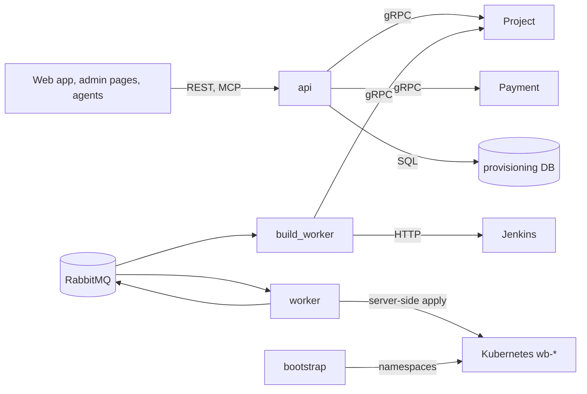

# Provisioning: Technical Requirements (TRD)

**Status:** Approved at gate 1 (answers O1 to O4 are in `GATE1`); TR-2, TR-54 and TR-55 approved at gate 2
(design `CQ`). TR-57 and TR-58 approved at gate 2 (design `TRIES-D`) and built.

## In short

Provisioning is one Python package run as four processes (API, worker, build worker, bootstrap) plus an operator
tool, laid out in four layers. Its data lives in its own `provisioning` database in the shared PostgreSQL cluster
`platform-db`, exactly as Notion "5 · Provisioning" defines it. The web app and agents use REST and MCP; it asks
Project and Payment over gRPC and hears their events over RabbitMQ. The gateway and then the API check each token,
calls inside carry only the user ID over mTLS, and the worker alone may change site objects in the cluster. A Helm
chart deploys it into namespace `webblock`, and each site runs in its own namespace `wb-<project-id>`. The auth and
telemetry rules go into decision record 0024 (planned, `ai/handoffs/auth-telemetry-alignment.md` task 1).
Site images are private and pulled with a per-site Secret (TR-52), planned for the next phase and not started.

**Read next:** [DIRECTION.md](DIRECTION.md), whether the work matches these requirements. Up: [FRD.md](FRD.md).

## Components

Each process has one job and only the credentials that job needs.

| ID | Requirement | FR | Decision | Source |
| --- | --- | --- | --- | --- |
| TR-1 | One package, processes `api`, `worker`, `build_worker`, `bootstrap`, plus the `operator` CLI and a migrate Job | All FR | 0013 | 0014 §3, `deploy/helm/provisioning/` |
| TR-2 | Four layers plus `hosts`: domain imports nothing of ours, application only domain, infrastructure implements application ports; inside the domain, `rules \| events` > `entities` > `values` > `enums` > `errors`; import-linter checks it | All FR | 0010, 0025 | S2 §6.2, FL, CQ |
| TR-3 | REST and MCP call the same use cases through one operation table | FR-46 | 0006 | 0023 G7 |
| TR-4 | PostgreSQL is the authority; a dispatch row is written with each command and republished to RabbitMQ until the command ends | FR-14, FR-15 | 0005 | S1 `command_dispatch` |
| TR-5 | Every worker write checks the command number and the claim number; an out-of-date write changes nothing | FR-25 | 0005 | S1 `project_hosting` |
| TR-6 | The worker applies site objects by server-side apply under one field manager, with the fence annotation `websites.webblock.internal/command-number`; no Crossplane | FR-17, FR-19, FR-35 | 0013 | 0013 §3 |
| TR-7 | The build worker starts Jenkins jobs and polls them; Provisioning never writes to Git | FR-11, FR-12, FR-13 | 0014 | 0014 §2, S2 §5.4 |
| TR-54 | Every entry point a caller uses is a command or a query object sent through `CommandBus` or `QueryBus` (`core/application/shared/cqrs.py`); each process registers only its own handlers and checks at start that each operation has exactly one; commands and queries never import each other | All FR with a REST, MCP or message entry point | 0025 | CQ §3 CQ10, CQ11 |
| TR-55 | Worker jobs, loops and relays live in `<feature>/background/` and start from a durable row, never from a bus | All FR with worker work | 0025 | CQ §3 CQ6, CQ9 |
| TR-57 | One `promote` command makes at most 3 tries; try n is its claim n (`command_dispatch.execution_attempts`). A failed try 1 or 2 puts the route on `live_release_id` or the offline page, keeps the release `promoting` and routing `changing`, and gives the claim back with `retry_after` 30 s or 60 s later. Try 3 restores, checks, and ends the release `rolled_back` or `failed` with its code. A claim on a `changing` route restores first. The 3 tries and both waits are code constants, the one exception to TR-37, as FR-21 fixes them. No schema change | FR-21, FR-22, FR-19, FR-37, FR-48 | 0027, 0005 | TRIES-D G1 to G16, S1 `command_dispatch` |

## Stack

Python and open-source libraries, pinned and aged.

| ID | Requirement | FR | Decision | Source |
| --- | --- | --- | --- | --- |
| TR-8 | Python 3.14, FastAPI, Pydantic v2, uvicorn, MCP SDK 2.x, SQLAlchemy Core on psycopg 3, aio-pika, grpcio, kubernetes_asyncio, httpx2, PyJWT, structlog, OpenTelemetry, prometheus-client, Sentry SDK | All FR | 0013 | `pyproject.toml` |
| TR-9 | Each dependency at least 14 days old; open-source licences only; images pinned by digest | All FR | 0013 | 0013 §9, OWN |
| TR-10 | Goose SQL migrations are the only schema source, run by the migrate Job | FR-9 to FR-42 | 0014 | 0014 §11 |

## Data

Tables (fields live only in S1, on purpose):

- `provisioning_ops.source_published_events`: one "source published" event from Project.
- `provisioning.project_hosting`: one row per site: live release, route settled, online, offline reasons.
- `provisioning.releases`: one version of a site, from one commit.
- `provisioning.release_steps`: one attempt at one stage (build, candidate).
- `provisioning.commands`: one requested action on a site.
- `provisioning_ops.command_dispatch`: delivery and worker claim of one command.
- `provisioning_ops.usage_outbox`: one "publish completed" message for Payment.

| ID | Requirement | FR | Decision | Source |
| --- | --- | --- | --- | --- |
| TR-11 | Database `provisioning` in the shared CloudNativePG cluster `platform-db` (namespace `webblock-data`); Provisioning reads no other database | FR-9 to FR-42 | 0016 (differs), 0024 (planned) | S2 §7.1, OWN, LEAD |
| TR-12 | The schema equals S1 exactly: tables, columns and order, types, enums, constraints, roles, grants; no column defaults; FKs block deletes; no role deletes rows | FR-9 to FR-42 | 0023 | 0023 G16, G20, S1 rules |
| TR-13 | Roles as S1: `provisioning_api`, `provisioning_worker`, `provisioning_hosting_intake`, `provisioning_intake`, `provisioning_build`, `provisioning_operator`, `provisioning_bootstrap` (reads only) | FR-9, FR-14, FR-26, FR-44 | 0008 | S1 rules, 0023 G18a |
| TR-14 | Inbox keys: `(project_id, generation_request_id)` for source events; the event key on the hosting command for Payment and Project events; no Payment inbox table | FR-9, FR-10, FR-26 to FR-30 | 0021 | S1, S2 §4.3 |
| TR-15 | The usage row is written in the go-live transaction and marked `sent` only after the broker confirms | FR-19, FR-42 | 0008 | S1 `usage_outbox` |
| TR-16 | Finished rows are kept; no retention job | FR-37 to FR-41 | 0024 (planned) | S1 "Open", LEAD |
| TR-53 | A first hosting row insert takes `pg_advisory_xact_lock` on a stable hash of the sub-domain, so inserts of one sub-domain run one at a time. The hosting intake (SELECT on `project_hosting`) then checks no other project's row holds it. The release intake (SELECT `project_id` only) takes the lock but cannot read it, so the bootstrap (SELECT `subdomain`, 00023) makes no tenant for a shared sub-domain. No schema change, grant or index. Residual: a writer outside Provisioning | FR-54 | 0023 (G20a withdrawn) | DBRULE, S1 rules |

## Interfaces

REST and MCP in; gRPC and events between services; HTTP to Jenkins.

| ID | Requirement | FR | Decision | Source |
| --- | --- | --- | --- | --- |
| TR-17 | REST under `/v1`: success envelope, RFC 9457 Problem with fixed member order, camelCase names, cursor paging; `openapi.yaml` 0.2.0, draft | FR-7, FR-37 to FR-41 | 0023 | S2 §2, 0023 G1 to G6 |
| TR-18 | Admin routes under `/v1/admin/projects/{projectId}`: `hosting/suspend`, `hosting/resume`, `redeploy`, `commands` | FR-33 to FR-36 | 0023 | 0023 G9 |
| TR-19 | MCP over Streamable HTTP at `/mcp`; `tools.json` 0.2.0; result = REST `data`, list `{items, page}` | FR-46 | 0023 | 0023 G7 |
| TR-20 | gRPC clients from pinned `web-block-contracts`: Project `CheckAccess` (api), `GetRepository` (build worker), Payment `GetEntitlement` (api, worker); deadline 2 s, retry only `UNAVAILABLE` twice, fail closed | FR-5, FR-9, FR-26, FR-47, FR-48 | 0022 | S2 §3, §5.1 |
| TR-21 | gRPC errors map by S2 table 2.3, reason kept as code; access failure is always 503 `PROJECT_ACCESS_UNAVAILABLE` | FR-5 | 0023 | 0023 G14 |
| TR-22 | Consumes quorum queues `provisioning.<event>.v1` for `source_published`, `project_deleted`, `owner_status_changed`, `hosting_entitlement_ended`, `_restored`; ack after commit; 5 failures, all counted, then `.dlq` | FR-9, FR-26 to FR-32 | 0022 | S2 §4.2 to §4.4, 0023 G15 |
| TR-23 | Publishes `publish_completed.v1` on exchange `provisioning.events`; command jobs on `provisioning.command_job.v1` | FR-15, FR-42 | 0022 | S2 §4.4 |
| TR-24 | Every event uses the v1 envelope and its schema; schemas mirrored under `src/contracts/shared` | FR-9, FR-26 to FR-29, FR-42 | 0022 | S2 §3.7, §4.1 |
| TR-25 | Jenkins over HTTP with its own token; the build gets project, release, repository and exact commit | FR-11 | 0014 | 0014 §3 |

## Security

The gateway checks the token, the API checks it again, inner calls carry only the user ID over mTLS (AUTH, S2 §1).

| ID | Requirement | FR | Decision | Source |
| --- | --- | --- | --- | --- |
| TR-26 | The API checks each token: Keycloak key set, RS256 only, exact `iss`, audience `provisioning`, `typ` `Bearer`, `exp` and `nbf` with skew at most 60 s | FR-1 | 0019 | AUTH §5, §6, S2 §8 |
| TR-27 | `user_id` (UUID) is the user; missing answers 403. Roles only from top-level `roles`; `ADMIN` exact case; `realm_access` never read | FR-2, FR-4 | 0019 | AUTH §3, §5 |
| TR-28 | Removed: owners no longer deploy, promote or roll back (GATE1 O1, O2); see TR-48 | FR-24 | 0019 | GATE1 |
| TR-29 | Not the owner and unknown project answer the same 404 byte for byte | FR-3 | 0023 | AUTH §2, 0023 G6 |
| TR-30 | Calls to our services carry `x-user-id` (when a user), `x-request-id`, `traceparent`; never a token; nothing of these to outside hosts | FR-8 | 0019 | S2 §3.5, AUTH §5 |
| TR-31 | Istio sidecars with STRICT mTLS; Project's policy lets `provisioning-api` call `CheckAccess` and `provisioning-build-worker` call `GetRepository` | FR-5, FR-9 | 0019 | S2 §3.8, HO-AUTH task 8 |
| TR-32 | `web-block-commons` (Python package) does the token check, the current user and the inner-call headers; the FR-43 log fields and message headers are still Provisioning's own | FR-1, FR-2, FR-8, FR-43 | 0024 | S2 §8, OWN |
| TR-33 | Tokens, bodies and caller values never in logs, traces, Sentry or answers; logs pass an allow-list | FR-1, FR-7, FR-43 | 0006 | AUTH §5, S2 §2.2 |
| TR-34 | API and build worker have no Kubernetes token; worker and bootstrap use projected tokens (600 s) checked by SelfSubjectReview | FR-17, FR-19 | 0016 | 0016 §9 |
| TR-35 | Admission policies allow only labelled site objects, the site image prefix, and hosts `<subdomain>.<site domain>` and `<subdomain>-preview.<site domain>`; the preview route answers `Cache-Control: private, no-store`; a new sub-domain label has at most 55 characters and does not end in `-preview` | FR-17, FR-19, FR-20 | 0023 | 0023 G18, G18a, G18b, PREVIEW1 |
| TR-36 | Site builds get no cluster token, Docker socket, Git write token or database secret; DevOps proves it before the first production build | FR-11 | 0024 (planned) | OD-62, LEAD |
| TR-48 | Owner reads and build retry need `USER` and Project `CheckAccess`; rollback and admin actions need `ADMIN`, no `CheckAccess`; `ADMIN` reads any site with no `CheckAccess` | FR-3, FR-4, FR-50, FR-51 | 0019 | 0019 §3, §7, GATE1 O1, LEAD, S2 §2.4 |

## Non-functional needs

Every limit is configured; the owner set the service targets.

| ID | Requirement | FR | Decision | Source |
| --- | --- | --- | --- | --- |
| TR-37 | Request size, in-flight limit, timeouts, deadlines and retry budgets are required settings with no default, except the token check limits web-block-commons fixes (decision 0024 G4) | All FR | 0004 | OD-15 |
| TR-38 | Publish-to-live time and API availability targets: 95% of publishes live within 15 minutes; API available 99.5% per month | FR-19, FR-37, FR-47, FR-48 | 0024 (planned) | OD-15, GATE1 O4 |
| TR-39 | API, worker and build worker run safely as two or more replicas; bootstrap runs as one, guarded by an advisory lock | FR-14, FR-25 | 0016 | 0016 §6 |
| TR-40 | Metrics on `/metrics` (Prometheus), errors to Sentry, spans by OTLP/HTTP to Tempo, sampling parent based | FR-43 | 0022 | S2 §7.3, 0016 §5 |
| TR-41 | JSON logs on stdout with `trace_id`, `span_id`, `request_id`; message headers carry `traceparent` and `x-request-id` | FR-43 | 0022 | S2 §4.1, §7.3 |
| TR-58 | The worker refuses to start unless `COMMAND_DEADLINE` exceeds 3 x (2 x `ROUTE_SWITCH_DEADLINE` plus `ROUTE_RESTORE_DEADLINE`) plus 90 s plus 3 x (max(`WORKER_LEASE_TTL`, `WORKER_RETRY_BACKOFF_MAX`) plus `ROUTE_RESTORE_DEADLINE`), `WORKER_ATTEMPT_TIMEOUT` exceeds 2 x `ROUTE_SWITCH_DEADLINE` plus 2 x `ROUTE_RESTORE_DEADLINE`, and `WORKER_MAX_ATTEMPTS` exceeds 3 | FR-21, FR-22 | 0027, 0005 | TRIES-D G12 |

## Deployment

Argo CD deploys the Helm chart; each site gets its own namespace.

| ID | Requirement | FR | Decision | Source |
| --- | --- | --- | --- | --- |
| TR-42 | Helm chart `deploy/helm/provisioning` in namespace `webblock`: four Deployments, migrate Job, service accounts, default-deny NetworkPolicies, probes `/healthz` and `/readyz` | All FR | 0016 | `deploy/helm/provisioning/`, S2 §7 |
| TR-43 | Egress allowed only where needed: database, broker, Keycloak key set, Project and Payment on 9090, Tempo on 4318 | FR-1, FR-5, FR-43 | 0024 (planned) | HO-AUTH task 9 |
| TR-44 | Per site: namespace `wb-<projectId>`, Deployment and Service `rel-<releaseId>`, routes `route-<projectId>` and `preview-<projectId>` on the Istio Gateway API, behind Cloudflare Tunnel | FR-17, FR-19, FR-20 | 0023 | S2 §7.1, OWN, 0023 G18b |
| TR-45 | The Gateway's one wildcard certificate `*.<site domain>` (cert-manager) covers the site hosts and the preview hosts `<subdomain>-preview.<site domain>` | FR-19, FR-20 | 0023 | 0023 G18b, PREVIEW1 |
| TR-46 | Jenkins pushes site images to the Gitea container registry, one image per site, used by digest | FR-11, FR-17 | 0016 (differs), 0024 (planned) | S2 §5.4, OWN |
| TR-47 | Profile `production` refuses every change while contracts are open and never builds a stand-in; `prototype` uses stand-ins | FR-6 | 0016 | 0016 §6, LEAD |
| TR-49 | Site images of the live release and of releases not yet ended are kept | FR-11, FR-21 | 0024 (planned) | LEAD |
| TR-50 | Removed: the owner made site images private, anonymous pulls cannot work; see TR-52 | FR-11, FR-17 | 0024 (planned) | GATE1 O3 |
| TR-51 | The automatic flow stores `deploy` and `promote` commands under the same command rules (one in flight, numbers, fences) | FR-47 to FR-49 | none (Q-5) | GATE1 O2, S1 `commands` |
| TR-52 | Site images are private. One read-only Gitea account pulls; its token is a Kubernetes Secret only the bootstrap reads, never logged. The bootstrap writes a pull Secret into each `wb-<projectId>`; site pods name it. Not started, next phase | FR-53, FR-17, FR-35 | 0024 (planned) | GATE1 O3 (replaced) |

## Agent tooling

The tools around the agents that build this service. Commits that change only them cite TR-56.

| ID | Requirement | FR | Decision | Source |
| --- | --- | --- | --- | --- |
| TR-56 | Agent guard and tooling: the guard hook, the reviewer write limit, the session start and post-edit hooks, spec-check and the QA tools keep agents inside the constitution | All FR | 0026 | Constitution I.2, V.3, VI.5, VIII.2, LEAD |

## Constitution check

Each article of `.claude/docs/CONSTITUTION.md` against this document.

| Article | Result | Why |
| --- | --- | --- |
| I Spec-driven flow | pass | Every TR links up to an FR (or all FR) and names its record |
| II Tech stack | pass | TR-8 to TR-10 are the fixed stack, versions only in `TECH_STACK.md` |
| III Architecture limits | pass | TR-2, TR-4, TR-12, TR-34, TR-48, TR-57: layers, DB equals S1, worker only, 404 |
| IV Coding conventions | pass | TR-2, TR-54, TR-55 follow `python-code.md` and 0025 |
| V Testing and quality | pass | TR-37 and TR-58 refuse bad settings; no gate is set lower here |
| VI Safety guardrails | pass | TR-33, TR-34, TR-36: no tokens logged, least cluster rights |
| VII Docs | pass | Current facts, plain English, sources named |
| VIII Agents | pass | TR-56 keeps the guard, reviewer limit and QA tools |

## Drift seen

- TR-2: closed by Task 13 (FL section 4): `workers/` is now `core/application/<feature>/` and
  `presentation/messaging/consumers/`, `devtools/` is `hosts/devtools/`, `presentation/ops` is
  `presentation/operations`.
- TR-20: production access uses Project's HTTP check (`infrastructure/project/access.py`); Project has no gRPC yet.
- TR-40: chart default `OTEL_EXPORTER_OTLP_ENDPOINT=none` drops the incoming trace (`values.yaml:35`).
- TR-43: the API NetworkPolicy allows only DNS and its database (`networkpolicies.yaml:35`).
- TR-46: `0016` sections 2 and 5 still describe Docker Hub for site images; a note at its top points here, and
  record `0024` is reserved for the change.
- TR-31: S2 §3.8's example names `provisioning-build`; the chart keeps `provisioning-build-worker` (LEAD); the
  owner fixes the Notion example.

## Open infrastructure notes

Not spec items: facts web-block-config and the chart must settle before site images flow (GATE1 O3, replaced).

- Nodes must reach the registry. `git.roa-dev.digital` sits behind Cloudflare Access, which the kubelet cannot
  pass. web-block-config needs an Access bypass for the registry path `/v2/` (Gitea still asks for the token) or
  another registry address the nodes can reach.
- Jenkins pushes through the same path; check Cloudflare's upload size limit for large image layers.
- The Gitea organization `webblock` must exist and accept the nested image name `sites/<projectId>`.
- Provisioning must send Cloudflare Access service-token headers to Jenkins. The chart's NetworkPolicy allows
  Jenkins only on 8080 to one /32 address, not 443 through Cloudflare (`networkpolicies.yaml:105`).
- The AMQPS broker uses its own CA; Provisioning has no CA setting for it yet.
- The MVP site domain is `roaa15.xyz`; previews are public at `<subdomain>-preview.roaa15.xyz` with the project's
  token (`0016` section 10).

## Questions for the owner

| ID | Question | Why it matters | Suggested answer |
| --- | --- | --- | --- |
| Q-5 | S1 lets only role `provisioning_api` insert `deploy` and `promote`. Which process writes the automatic ones (TR-51)? | A new writer needs a grant S1 lacks | suggestion: keep the role; a consumer in the api process hears "built" and "candidate ready"; decide in the next phase design |

Answered (LEAD): Q-1 and Q-2 recorded in 0024 (planned, HO-AUTH task 1); Q-3 DevOps proves
build isolation before the first production build (TR-36); Q-4 keep `provisioning-build-worker`, the owner fixes the
Notion 3.8 example. Answered (LEAD): Q-6 the 3 go-live tries and the 30 s and 60 s waits are code constants, the
exception to TR-37 written in TR-57 (TRIES-D G3).

## Glossary

| Word | Meaning here |
| --- | --- |
| Server-side apply | Kubernetes merges our fields under one owner name |
| Fence | A number every write compares, so an old writer changes nothing |
| Stand-in | A fake of an outside system, prototype only |
| Profile | `prototype` or `production`; picks which adapters run |
| Admission policy | A cluster rule that refuses wrong site objects |

## Sources

| Key | Source |
| --- | --- |
| S1 | Notion "5 · Provisioning" (read-only) |
| S2 | Notion "Web Block architecture" (read-only) |
| AUTH | `../project-service/.claude/docs/contracts/authentication-contract.md` |
| OWN | Owner decisions, in the lead's brief |
| GATE1 | Owner: gate 1 answers O1 to O4; O3 is private images with a pull Secret |
| LEAD | Answers the owner delegated to the lead |
| DBRULE | Owner rule: the database matches S1 100%; 00024 reverted; taken sub-domain checked in code |
| FL | `.claude/docs/decisions/0025-domain-kinds-and-cqrs.md` section 3b (folder layout rules) |
| CQ | `.claude/docs/decisions/0025-domain-kinds-and-cqrs.md` (CQ1 to CQ12) |
| TRIES-D | `.claude/docs/designs/go-live-tries-design.md` |
| HO-AUTH | `ai/handoffs/auth-telemetry-alignment.md` |
| 0004 to 0027 | `.claude/docs/decisions/` records by number |
| OD-n | `.claude/docs/decisions/open-decisions.md` |
| Code | `pyproject.toml`, `deploy/helm/provisioning/`, `src/` |
